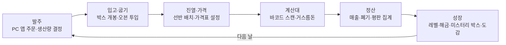

# Bakery Shop Simulator

1인칭 시점에서 재료를 발주하고, 빵을 굽고, 진열하고, 계산대에서 직접 손님을 받으며 가게를 키우는 3D 빵집 운영 시뮬레이터입니다. 레퍼런스는 TCG Card Shop Simulator이며, 카드 팩 개봉의 재미는 **미스터리 재료 박스**와 **레시피 도감**으로 대응합니다.

> 현재 상태 (2026년 11월): 기획과 설계, 작업 45개의 구현 계획을 마쳤고, 첫 마일스톤(조작과 상호작용)의 코드를 병합해 Unity에서 확인하는 중입니다. 진행 상황은 [Milestones](https://github.com/SeanKim0719/bakery-shop-simulator/milestones)와 [로드맵](docs/ROADMAP.md)에서 볼 수 있습니다. 플레이 영상과 빌드 링크는 MVP 완성 후 추가합니다.

## 한눈에 보기

| 항목 | 내용 |
| --- | --- |
| 장르 | 경영 시뮬레이션 (상점 운영) |
| 엔진 | Unity 6.6 (C#, URP) |
| 시점 | 1인칭 3D |
| 플랫폼 | PC (Windows), WebGL |
| 개발 기간 | 약 12주 (MVP 기준, 하루 1~2시간) |

## 핵심 게임 루프

## 기술적으로 보여주고 싶은 것

- **상호작용 구조**: `IInteractable` 인터페이스로 오븐·선반·계산대 같은 대상을 추가해도 플레이어 코드는 그대로
- **데이터 드리븐 설계**: 모든 수치를 `content.json` 한 파일에 두고 ScriptableObject로 가져옴. 같은 파일을 밸런스 시뮬레이터가 읽어, 구현 전에 규칙의 문제를 수치로 확인
- **씬 없이 도는 게임 로직**: 규칙은 순수 C#에 두고 EditMode 테스트로 검증. 하루 전체를 에디터 플레이 없이 돌리는 통합 테스트
- **상태 패턴 FSM**: 손님 AI와 결제 흐름을 확장 가능한 구조로 설계
- **이벤트 기반 분리**: 판매 이벤트 하나에 정산·HUD·사운드가 서로 모른 채 반응
- **검증 가능한 확률 시스템**: 가중치 확률 테이블, 천장, 분포 시뮬레이션 테스트
- **3D 세이브**: 배치 오브젝트 고유 ID와 버전 필드로 매장 상태 전체를 저장·복원

## 트러블슈팅

개발 중 겪은 문제를 어떻게 발견하고, 원인을 좁히고, 해결을 수치로 검증했는지 기록합니다. 가장 깊게 파고든 사례는 [docs/troubleshooting](docs/troubleshooting/)에 정리합니다.

| 사례 | 분류 | 결과 |
| --- | --- | --- |
| [빵을 많이 구울수록 덜 팔린다: 어제 빵이 진열대를 막는 문제](docs/troubleshooting/TS-001-day-old-bread-blocks-shelf.md) | 밸런스 (규칙 설계) | 예상 수요만큼 구웠을 때 하루 판매 21.8개 → 29.9개, 순이익 +28% (구현 전 시뮬레이션) |

개발 진행에 따라 추가합니다.

## 문서

| 문서 | 내용 |
| --- | --- |
| [기획서 (GDD)](docs/GDD.md) | 컨셉, 디자인 기둥, 재미 포인트 12개, 시스템 요약, MVP 범위 |
| [아키텍처](docs/ARCHITECTURE.md) | 계층 구조, 설계 원칙, 폴더 구성 |
| [게임 구조 설계](docs/design/README.md) | 런타임 구조, 하루 흐름, 데이터 모델, 상호작용, 손님·계산, 세이브, 경제, 미스터리 박스, UI, 매장 배치, 콘텐츠 표 |
| [구현 계획](docs/plan/README.md) | 마일스톤 6개, 작업 45개의 명세 (파일, 공개 API, 규칙, 테스트, 확인 항목) |
| [코드 작성 규칙](docs/CONVENTIONS.md) | 폴더와 네임스페이스, 모델·뷰·이벤트의 모양, 테스트 규칙, 작업 흐름 |
| [로드맵](docs/ROADMAP.md) | 마일스톤별 진행 상황 |
| [밸런스 시뮬레이션 결과](Tools/balance/latest_report.md) | `content.json`의 수치로 하루 영업·가격·박스·성장 속도를 돌린 결과 |
| [개발 환경 셋업](docs/SETUP.md) | Unity 버전, 프로젝트 생성 순서, 폴더 구조, 작업 규칙 |
| [설계 결정 기록](docs/decisions/) | 주요 결정의 배경과 이유 (ADR) |
| [트러블슈팅](docs/troubleshooting/) | 기록 방식과 해결 사례 |
