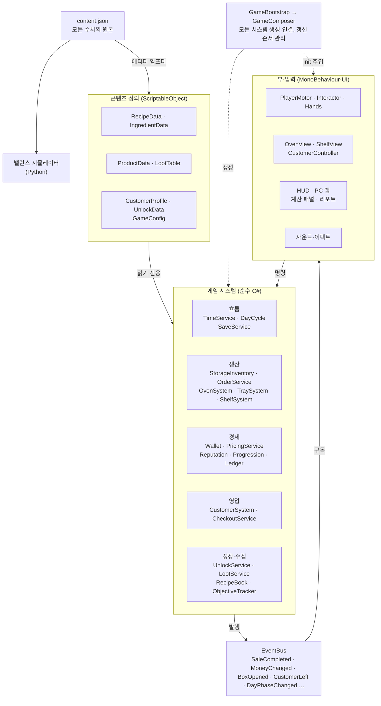

# 아키텍처

데이터·시스템·표현을 분리하고, 그 사이를 이벤트 버스로 잇는다. 시스템은 데이터를 읽기만 하고, 화면은 이벤트를 구독해서 반응한다. 이 문서는 전체 그림이고, 클래스 단위 설계는 [게임 구조 설계](design/README.md)에 있다.

## 계층 구조



## 설계 원칙

- **부트스트랩이 연결한다**: 싱글톤 없이 `GameBootstrap`이 시스템을 생성하고 주입한다 ([ADR 0003](decisions/0003-composition-root.md)).
- **모델과 뷰 분리**: 규칙은 순수 C# 모델이, 표시는 MonoBehaviour 뷰가 맡는다. 진실은 모델에 있다 ([ADR 0004](decisions/0004-model-view-split.md)).
- **데이터 드리븐**: 밸런스 수치와 콘텐츠는 `content.json` 한 파일에 두고 에디터 임포터가 ScriptableObject로 가져온다. 새 빵·상품·손님은 JSON에 줄을 추가하면 들어간다. 같은 파일을 밸런스 시뮬레이터가 읽는다 ([ADR 0009](decisions/0009-content-json-pipeline.md)).
- **씬 없이 조립된다**: 시스템을 만들고 연결하는 코드(`GameComposer`)가 순수 C#이라, EditMode 테스트에서 게임 전체를 만들어 하루를 돌릴 수 있다.
- **이산적인 변화는 이벤트, 연속적인 값은 직접 읽기**: 판매·돈 변화는 이벤트로 알리고, 오븐 진행 바·시계는 뷰가 모델을 읽는다.
- **시간은 한 곳에서**: 모든 시간 계산은 `TimeService`를 거친다. 게임 코드에서 `Time.deltaTime`을 직접 쓰지 않는다.
- **재현 가능한 랜덤**: 박스 개봉, 손님 생성 등 모든 난수는 시드 고정 `Rng`를 거치고, 난수 상태도 세이브에 저장한다.

## 폴더 구성

```
Assets/_Project/
  Data/            content.json, shop_layout.json, Generated/ (임포터가 만든 ScriptableObject)
  Scripts/         BakeryShop.Runtime 어셈블리
    Core/          GameBootstrap, GameComposer, GameLoop, EventBus, Rng, TimeService, DayCycle
    Events/        이벤트 구조체
    Data/          ScriptableObject 정의, ContentDatabase
    Interaction/   IInteractable, IHoldable, IHands
    Player/        입력, 이동, Interactor, Hands
    Systems/       순수 C#만: Economy, Production, Customers, Checkout, Growth, Save
    World/         씬에 놓이는 뷰 (OvenView, ShelfView, CustomerController …)
    UI/            HUD, 패널
  Editor/          BakeryShop.Editor 어셈블리 (콘텐츠 임포터, 씬 빌더)
  Tests/EditMode/  BakeryShop.Tests.EditMode 어셈블리
Tools/
  balance/         밸런스 시뮬레이터와 결과
  docs/            평면도와 콘텐츠 표 생성 스크립트
```

폴더별 네임스페이스와 코드의 모양은 [코드 작성 규칙](CONVENTIONS.md)에, 개발 환경은 [개발 환경 셋업](SETUP.md)에 있다.
