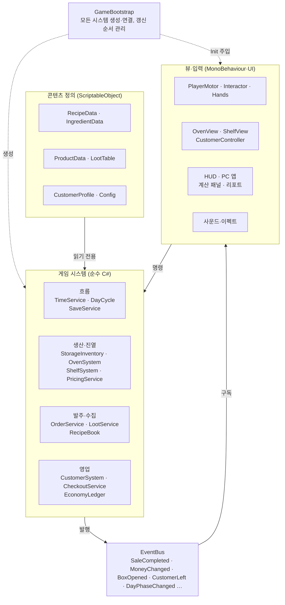

# 아키텍처

데이터·시스템·표현을 분리하고, 그 사이를 이벤트 버스로 잇는다. 시스템은 데이터를 읽기만 하고, 화면은 이벤트를 구독해서 반응한다. 이 문서는 전체 그림이고, 클래스 단위 설계는 [게임 구조 설계](design/README.md)에 있다.

## 계층 구조



## 설계 원칙

- **부트스트랩이 연결한다**: 싱글톤 없이 `GameBootstrap`이 시스템을 생성하고 주입한다 ([ADR 0003](decisions/0003-composition-root.md)).
- **모델과 뷰 분리**: 규칙은 순수 C# 모델이, 표시는 MonoBehaviour 뷰가 맡는다. 진실은 모델에 있다 ([ADR 0004](decisions/0004-model-view-split.md)).
- **데이터 드리븐**: 밸런스 수치와 콘텐츠는 ScriptableObject 에셋에 둔다. 새 빵·상품·손님은 에셋 추가만으로 들어간다.
- **이산적인 변화는 이벤트, 연속적인 값은 직접 읽기**: 판매·돈 변화는 이벤트로 알리고, 오븐 진행 바·시계는 뷰가 모델을 읽는다.
- **시간은 한 곳에서**: 모든 시간 계산은 `TimeService`를 거친다. 게임 코드에서 `Time.deltaTime`을 직접 쓰지 않는다.
- **재현 가능한 랜덤**: 박스 개봉, 손님 생성 등 모든 난수는 시드 고정 `Rng`를 거치고, 난수 상태도 세이브에 저장한다.

## 폴더 구성

```
Assets/_Project/
  Scripts/       BakeryShop.Runtime 어셈블리
    Core/        GameBootstrap, GameContext, EventBus, TimeService, DayCycle, Rng, SaveService
    Data/        ScriptableObject 정의 (Recipe, Ingredient, Product, LootTable, CustomerProfile, Config)
    Player/      PlayerInputReader, PlayerMotor, Interactor, Hands, IInteractable, IHoldable
    Systems/     Storage, Oven, Shelf, Pricing, Order, Loot, RecipeBook, Customer, Checkout, Economy
    UI/          HUD, PC 앱, 오븐·계산·리포트 패널
  Data/          ScriptableObject 에셋 인스턴스
  Tests/
    EditMode/    BakeryShop.Tests.EditMode 어셈블리
```

전체 폴더와 어셈블리 구성은 [개발 환경 셋업](SETUP.md)을 참고한다.
