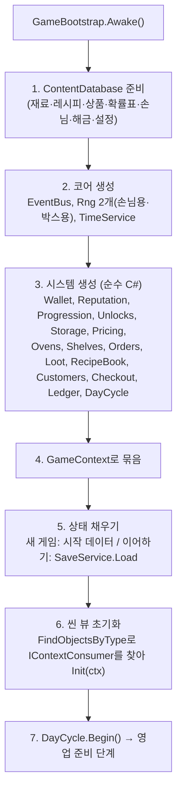
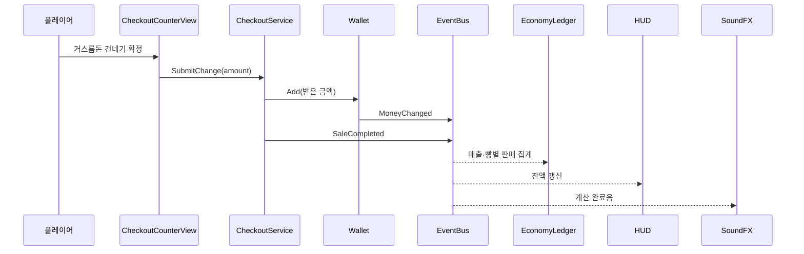
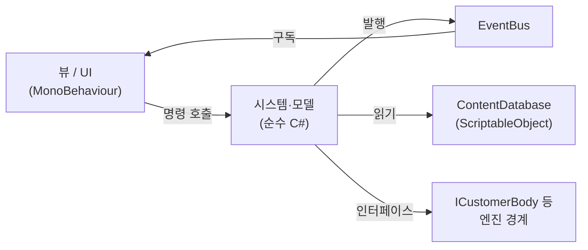

# 01. 런타임 구조

게임은 **부트스트랩 하나가 모든 시스템을 만들고 연결**하는 구조다. 싱글톤과 전역 static 상태를 쓰지 않고, 규칙 로직은 순수 C# 모델에, 화면과 물리는 MonoBehaviour 뷰에 둔다.

## 씬 구성

| 씬 | 역할 |
| --- | --- |
| `Title` | 새 게임 / 이어하기 선택, 설정 |
| `Shop` | 게임 플레이 전체 (매장, 창고, 문 앞 배송 지점) |

`Title`은 선택 결과를 `LaunchRequest`(새 게임인지, 어떤 세이브 슬롯인지)로 남기고 `Shop`을 로드한다. 매장이 하나뿐이라 씬을 나누지 않는다.

`Shop` 씬의 구성과 가구의 좌표는 [11 문서](11-shop-layout.md)에 있다.

## 부트스트랩 (Composition Root)

`GameBootstrap`은 씬에 하나만 있는 MonoBehaviour로, 게임의 시작점이다.



- `GameContext`는 생성된 시스템을 담는 단순한 묶음이다. 서비스 로케이터처럼 아무 데서나 꺼내 쓰지 않고, 뷰와 팩토리가 `Init(GameContext ctx)` 시점에 **필요한 것만 꺼내 필드로 보관**한다.
- 런타임에 생성되는 오브젝트(손님, 빵 뷰, 배송 박스)는 팩토리가 생성 직후 `Init`을 호출해 주입한다.
- 초기화 순서가 코드 한 곳에 순서대로 적혀 있어서, `Awake`/`Start` 실행 순서에 따른 null 참조 문제가 생기지 않는다.

이 결정의 이유는 [ADR 0003](../decisions/0003-composition-root.md)에 있다.

## 모델과 뷰의 분리

| 계층 | 형태 | 예 | 테스트 |
| --- | --- | --- | --- |
| 모델 | 순수 C# 클래스 | `OvenModel`, `ShelfModel`, `StorageInventory`, `CustomerBrain`, `CheckoutSession` | EditMode 단위 테스트 |
| 뷰 | MonoBehaviour | `OvenView`, `ShelfView`, `CustomerController`, `CheckoutCounterView` | 플레이 테스트 |
| 엔진 경계 | 인터페이스 | `ICustomerBody` (NavMeshAgent 감싸기) | 가짜 구현으로 대체 |

규칙:

1. **진실은 모델에 있다.** 선반에 빵이 몇 개 있는지는 `ShelfModel`이 알고, `ShelfView`는 그 숫자만큼 빵 오브젝트를 보여줄 뿐이다. 세이브는 모델만 저장한다.
2. **모델은 `UnityEngine.Object`를 참조하지 않는다.** 엔진 기능이 필요하면 인터페이스로 받는다. 손님 FSM은 `NavMeshAgent` 대신 `ICustomerBody.MoveTo()`를 호출하므로, 테스트에서는 즉시 도착하는 가짜 몸체로 돌릴 수 있다.
3. **ScriptableObject 정의는 읽기 전용이다.** 플레이 중에 SO 필드를 바꾸지 않는다 (에디터에서 플레이 모드를 끝내도 값이 남는 문제 방지).

자세한 이유는 [ADR 0004](../decisions/0004-model-view-split.md)에 있다.

## 시스템 목록

| 시스템 | 책임 | 주요 의존 |
| --- | --- | --- |
| `TimeService` | 시뮬레이션 시간, 영업 시계, 일시정지 | - |
| `DayCycle` | 하루 단계 전환, 하루 마무리 단계 실행 | TimeService |
| `Wallet` | 잔액 (원 단위 정수) | - |
| `ReputationService` | 평판 0~1000. 변화 규칙은 `ReputationRules`가 이벤트를 구독해 적용 | - |
| `ProgressionService` | 경험치, 레벨. 획득 규칙은 `XpRules`가 이벤트를 구독해 적용 | - |
| `UnlockService` | 해금 구매 (레시피 라이선스, 가구, 트레이) | Wallet, Progression, RecipeBook, Ovens, Shelves, Trays |
| `StorageInventory` | 창고 재료 수량 | - |
| `PricingService` | 레시피별 판매가 | ContentDatabase |
| `OvenSystem` | 오븐 모델들, 굽기 시작·꺼내기, 품질 판정 | TimeService, Storage, RecipeBook, Trays |
| `TraySystem` | 트레이의 개수, 빵이 올라가 있는 트레이 목록 | - |
| `ShelfSystem` | 진열대 모델들, 진열·집기, 빵 나이 먹이기 | Trays, Pricing |
| `OrderService` | 발주, 배송 대기열 | Wallet, TimeService |
| `BoxService` | 박스 개봉 (재료 묶음은 창고로, 미스터리 박스는 뽑기) | Storage, LootService |
| `LootService` | 확률표 뽑기, 천장 | 박스용 Rng |
| `RecipeBook` | 아는 레시피, 핵심 재료 힌트, 실험 판정과 기록 | Storage |
| `CustomerSpawner` | 손님 생성 속도, 빵 냄새 | TimeService, Reputation, Progression, 손님용 Rng |
| `CustomerSystem` | 손님 생성, 손님 두뇌(FSM) 갱신, 방문 계획, 구매 판단 | Spawner, Shelves, Pricing, CheckoutQueue |
| `CheckoutService` | 결제 세션 | Customers, Pricing, Wallet |
| `ObjectiveTracker` | 목표 리스트(온보딩), 데모 목표 | 이벤트 구독 |
| `EconomyLedger` | 하루 집계, 일일 리포트 | 이벤트 구독 |
| `SaveService` | 저장·불러오기 | 모든 모델의 스냅샷 |

모든 시스템은 `EventBus`를 받는다 (표에서는 생략). 평판·경험치·리포트처럼 "일어난 일에 반응만 하는" 시스템은 다른 시스템을 직접 부르지 않고 이벤트만 구독한다.

시스템을 만들고 연결하는 코드는 `GameComposer.Compose()`(순수 C#)에 있고 `GameBootstrap`은 그것을 부른 뒤 씬의 뷰를 연결한다. 그래서 EditMode 테스트에서도 씬 없이 게임 전체를 만들어 하루를 돌릴 수 있다. 시스템별 공개 API와 작업 순서는 [구현 계획](../plan/README.md)에 있다.

## 갱신 순서 (Tick)

시스템마다 `Update()`를 따로 두지 않고, 부트스트랩이 정해진 순서로 한 번씩 호출한다.

```
GameBootstrap.Update() → GameLoop.Tick(context, Time.deltaTime)
  1. TimeService.Advance(realDelta)          → 이번 프레임의 simDelta 계산 (일시정지면 0)
  2. DayCycle.Tick()                         → 영업 종료 시각 확인, 단계 전환
  3. OrderService.Tick()                     → 배송 도착 처리
  4. OvenSystem.Tick()                       → 다 익음·탐 순간을 감지해 이벤트 발행
  5. CustomerSystem.Tick()                   → 손님 생성(CustomerSpawner), 각 손님 FSM 갱신, 나간 손님 반환
```

순서가 코드에 고정되어 있어 "오븐이 먼저 도는지 시간이 먼저 도는지"에 따라 결과가 바뀌는 문제가 없다. 뷰(MonoBehaviour)의 `Update`는 화면 표시만 한다.

## 이벤트 버스

타입별 구조체 이벤트를 쓰는 인스턴스 기반 버스다. 부트스트랩이 하나 만들어 시스템과 뷰에 전달한다.

```csharp
public sealed class EventBus
{
    public void Subscribe<T>(Action<T> handler) where T : struct;
    public void Unsubscribe<T>(Action<T> handler) where T : struct;
    public void Publish<T>(in T evt) where T : struct;
    public Action<Type, object> Trace;      // 개발용: 발행되는 모든 이벤트를 받는다
}
```

사용 원칙:

- **이산적인 변화는 이벤트(push), 연속적인 값은 직접 읽기(pull).** 판매 완료·돈 변화·단계 전환은 이벤트로 알리고, 오븐 진행 바나 시계처럼 매 프레임 바뀌는 값은 뷰가 모델을 읽는다. 매 프레임 이벤트를 쏘지 않는다.
- 씬에 고정된 뷰는 `Init`에서 구독하고 `OnDestroy`에서 해제한다. 풀을 쓰는 뷰는 꺼낼 때 구독하고 돌려놓을 때 해제한다. 해제를 빠뜨리면 풀에 돌아간 오브젝트가 계속 이벤트를 받는다.
- 개발 빌드에서는 발행되는 모든 이벤트를 로그로 남길 수 있는 옵션을 둔다. 트러블슈팅 때 "무슨 순서로 무엇이 일어났는지"를 확인하는 도구다.

### 이벤트 목록

| 이벤트 | 내용 | 발행 |
| --- | --- | --- |
| `DayPhaseChanged` | 날짜, 이전 단계, 다음 단계 | DayCycle |
| `DayAdvanced` | 새 날짜 (하루 마무리 단계가 모두 끝난 뒤. 세이브가 이때 저장한다) | DayCycle |
| `DaySettled` | 일일 리포트 | EconomyLedger |
| `MoneyChanged` | 잔액, 변화량, 사유 (판매·발주·해금·임대료·되팔기·지원금) | Wallet |
| `ReputationChanged` | 평판, 변화량 | ReputationService |
| `XpGained` / `LevelUp` | 얻은 양과 누적 / 새 레벨 | ProgressionService |
| `UnlockPurchased` | 해금 ID | UnlockService |
| `StorageChanged` | 재료 ID, 변화량, 남은 수량 | StorageInventory |
| `OrderPlaced` / `OrderDelivered` | 주문 ID, 상품 ID | OrderService |
| `BoxOpened` | 상품 ID, 나온 재료 목록, 최고 희귀도 | BoxService |
| `KeyIngredientFound` | 재료 ID, 짝이 되는 레시피 ID (처음 얻었을 때 한 번) | RecipeBook |
| `ExperimentTried` | 핵심 재료 ID, 맞은 개수, 칸 수, 발견 여부 | RecipeBook |
| `RecipeDiscovered` | 레시피 ID | RecipeBook |
| `BakingStarted` | 오븐 ID, 레시피 ID | OvenSystem |
| `OvenReady` / `OvenBurnt` | 오븐 ID (다 익은 순간 / 탄 순간에 한 번) | OvenSystem |
| `BakingCollected` | 오븐 ID, 레시피 ID, 개수, 품질 | OvenSystem |
| `TraysChanged` / `TrayEmptied` | 빈 트레이 수, 전체 트레이 수 / 비어서 돌아온 트레이의 개체 ID | TraySystem |
| `ShelfChanged` | 진열대 ID, 칸 번호 | ShelfSystem |
| `PriceChanged` | 레시피 ID, 판매가 | PricingService |
| `AromaStarted` | 지속 시간 | CustomerSpawner |
| `CustomerEntered` / `CustomerLeft` | 손님 ID, 성향 / 떠난 이유 | CustomerSystem |
| `CustomerAtCounter` | 손님 ID (계산 위치에 도착) | CustomerSystem |
| `CheckoutStarted` | 손님 ID, 품목, 결제 수단 | CheckoutService |
| `DemandMissed` | 레시피 ID (찾았지만 진열대에 없던 빵) | CustomerSystem |
| `PriceRejected` | 레시피 ID (있었지만 비싸거나 예산을 넘어 안 산 빵) | CustomerSystem |
| `PaymentRejected` | 손님 ID (거스름돈 부족, 카드 과다 입력) | CheckoutService |
| `SaleCompleted` | 손님 ID, 품목, 합계, 받은 금액, 결제 수단 (덜 받은 금액 = 받은 금액 − 합계) | CheckoutService |
| `BreadDiscarded` | 레시피 ID, 개수, 판매가 기준 금액, 사유 (탐·보관 기한·오븐 비우기·쓰레기통·줄 이탈) | OvenSystem, ShelfSystem, TraySystem, CustomerSystem |
| `ObjectiveCompleted` / `DemoGoalReached` | 목표 ID / - | ObjectiveTracker |
| `TheftAttempted` / `TheftResolved` (MVP 이후) | 손님 ID, 레시피 ID, 결과, 금액 ([07 문서](07-theft-and-disorder.md)) | CustomerSystem |

### 예: 빵 하나가 팔릴 때



`CheckoutService`는 HUD나 사운드가 있는지 모른다. 경험치와 평판도 같은 `SaleCompleted`를 구독해 오른다. 판매에 반응하는 것을 추가해도 결제 코드는 바뀌지 않는다.

## 의존성 규칙



- 화살표 반대 방향 참조는 금지한다. 시스템이 뷰를 직접 부르지 않는다.
- 시스템끼리는 생성자에서 받은 참조로 직접 호출해도 된다(예: `OvenSystem`이 `StorageInventory.TryConsume` 호출). 다만 결과를 여러 곳에 알려야 하면 이벤트를 쓴다.
