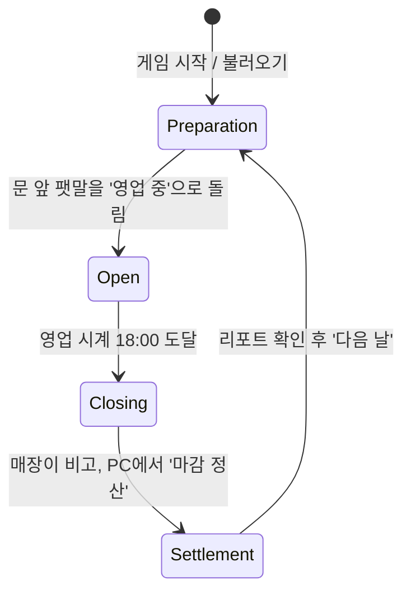

# 02. 하루 흐름과 시간

하루는 **준비 → 영업 → 마감 → 정산** 네 단계로 돌고, 시간은 두 개의 시계로 나눈다. 준비 단계에는 영업 시계가 멈춰 있어 플레이어가 서두르지 않고 "오늘 무엇을 몇 개 구울지"를 고민할 수 있다.

## 하루 단계

| 단계 | 영업 시계 | 손님 입장 | 발주 | 굽기·진열·가격 | 계산대 | 비고 |
| --- | --- | --- | --- | --- | --- | --- |
| 준비 (`Preparation`) | 멈춤 (09:00) | 없음 | 가능 | 가능 | 없음 | 시간 제한 없음 |
| 영업 (`Open`) | 진행 | 생성됨 | 가능 | 가능 | 운영 | 하루의 대부분 |
| 마감 (`Closing`) | 멈춤 (18:00) | 새 손님 없음 | 가능 | 가능 | 운영 | 남은 손님만 처리 |
| 정산 (`Settlement`) | - | - | 불가 | 불가 | - | 하루 마무리 처리, 자동 저장, 리포트 |

- `DayCycle`은 단계 전환 규칙을 한 곳에 모은 상태 기계다. 전환은 `TryOpenShop()`, `TrySettle()`, `StartNextDay()` 같은 명령으로만 일어나고, 조건이 안 맞으면 `false`를 돌려준다 (예: 손님이 남아 있으면 정산 불가).
- 전환 시 `DayPhaseChanged`를 발행하고, 각 시스템이 구독해서 자기 동작을 켜고 끈다. 예를 들어 `CustomerSystem`은 `Open`에서만 손님을 만든다.

## 두 개의 시계

| 시계 | 단위 | 흐르는 때 | 쓰는 곳 |
| --- | --- | --- | --- |
| 시뮬레이션 시간 (`SimTime`) | 초 | 일시정지가 아니면 항상 | 오븐 굽기, 배송 대기, 손님 인내심 |
| 영업 시계 (`ShopClock`) | 게임 분 (0~1439) | `Open` 단계에서만 | HUD 시계, 시간대별 손님 수, 영업 종료 |

하나의 시계로 처리하면 "준비 단계에 시간이 멈춰 있어서 오븐도 안 구워지는" 문제가 생긴다. 굽기는 실제 플레이 시간을 따르고, 영업 시간은 영업 중에만 흐르게 나눈 이유다.

설정값 (`DayConfig` ScriptableObject):

| 항목 | 기본값 |
| --- | --- |
| 개점 시각 | 09:00 (540분) |
| 폐점 시각 | 18:00 (1080분) |
| 영업 시간의 실제 길이 | 360초 (6분) → 게임 1.5분/실제 1초 |
| 시간대별 손님 생성 곡선 | AnimationCurve (점심·퇴근 시간대에 높게) |

### 규칙

- 모든 시뮬레이션 시간 계산(오븐, 배송, 손님, 영업 시계)은 `TimeService`가 주는 `simDelta`만 쓴다. 이 코드에서는 `Time.deltaTime`, `Time.time`을 직접 쓰지 않는다. 일시정지·배속을 한 곳에서 처리하기 위함이다.
- 플레이어 이동·시점, 화면 연출처럼 화면 프레임을 따르는 표현 코드는 예외로 `Time.deltaTime`을 쓴다. 일시정지 때는 입력 모드가 바뀌어 플레이어 입력 자체가 꺼진다.
- 일시정지는 일시정지 메뉴에서만 걸린다. PC 앱이나 오븐 패널을 열어도 시간은 흐른다 (영업 중 긴장감 유지).
- 오븐처럼 "언제 시작했는지"가 중요한 모델은 시작 시점의 `SimTime`을 저장하고 진행도를 `(현재 - 시작) / 굽는 시간`으로 계산한다. 매 프레임 `progress += delta`로 누적하면 오차가 쌓이고 세이브 복원이 어려워진다.

## 하루 마무리 처리

`Settlement`에 들어가는 순간 아래 순서로 처리한다. 순서가 중요해서 `DayCycle` 안에 한 메서드로 고정한다.

1. **손에 든 물건 내려놓기**: 플레이어가 들고 있던 박스나 트레이를 발밑에 내려놓는다 (월드 아이템이 된다).
2. **오븐 비우기**: 오븐 안에 남은 빵은 폐기한다 (`BreadDiscarded`). 마감 직전에 굽지 않게 만드는 규칙이다.
3. **빵 나이 먹이기**: 선반과 트레이의 모든 빵의 `daysOld`를 1 올리고, 레시피의 보관 일수를 넘긴 빵은 폐기한다.
4. **남은 주문 배송**: 아직 도착하지 않은 주문은 문 앞에 박스로 놓는다.
5. **일일 리포트 생성**: `EconomyLedger`가 집계를 마감하고 `DaySettled`를 발행한다.
6. **날짜 증가 후 자동 저장**: 저장 시점의 상태는 "다음 날 준비 단계 시작"이다.
7. **리포트 표시**: 플레이어가 '다음 날'을 누르면 `Preparation`으로 넘어간다.

저장을 리포트 표시보다 먼저 하므로, 리포트 화면에서 게임을 꺼도 하루가 날아가지 않는다. 불러오면 항상 다음 날 준비 단계에서 시작한다.

## 신선도는 날짜 단위

빵의 신선도는 실시간으로 떨어지지 않고 **날짜 단위**로 관리한다 ([ADR 0006](../decisions/0006-day-based-freshness.md)).

| `daysOld` | 상태 | 효과 |
| --- | --- | --- |
| 0 | 오늘 구움 | 정상 |
| 1 ~ 보관 일수 | 하루 이상 지남 | 손님 구매 확률 감소 |
| 보관 일수 초과 | 폐기 | 하루 마무리 때 자동 폐기, 손실로 집계 |

예: 보관 일수 1일인 크루아상은 1일차에 구우면 2일차까지 팔 수 있고, 2일차 마무리 때 남아 있으면 폐기된다.
