# 03. 데이터 모델

데이터는 두 종류로 나눈다. **콘텐츠 정의**는 ScriptableObject로 만들고 플레이 중에 바뀌지 않는다. **런타임 상태**는 순수 C# 객체이고 세이브에 저장된다. 둘은 문자열 ID로만 연결한다.

```mermaid
flowchart LR
    subgraph Content["콘텐츠 정의 (ScriptableObject, 읽기 전용)"]
        Ing[IngredientData]
        Rec[RecipeData]
        Prod[ProductData]
        Loot[LootTable]
        Cust[CustomerProfile]
        Cfg[DayConfig · EconomyConfig]
    end
    subgraph State["런타임 상태 (순수 C#, 세이브 대상)"]
        Storage[StorageInventory]
        Shelf[ShelfModel]
        Tray[TrayModel]
        Oven[OvenModel]
        Orders[Order 목록]
        Book[RecipeBook 상태]
        Wallet[Wallet · Reputation]
    end
    DB[ContentDatabase<br/>id → 정의 조회] --- Content
    State -->|"문자열 ID로 참조"| DB
```



## 콘텐츠 정의 (ScriptableObject)

### `IngredientData` 재료

| 필드 | 타입 | 설명 |
| --- | --- | --- |
| `id` | string | 예: `ing.butter` |
| `displayName`, `icon` | string, Sprite | 표시용 |
| `rarity` | `Rarity` | Common / Fine / Rare / Legendary |
| `resellPrice` | int | 되팔 때 받는 금액 (원) |

### `RecipeData` 레시피

| 필드 | 타입 | 설명 |
| --- | --- | --- |
| `id` | string | 예: `bread.croissant` |
| `displayName`, `icon`, `breadPrefab` | | 표시용 |
| `ingredients` | List<`IngredientAmount`> | 한 판에 필요한 재료와 수량 |
| `yield` | int | 한 판에 나오는 개수 |
| `bakeSeconds` | float | 다 익기까지의 시간 (SimTime) |
| `perfectWindowSeconds` | float | 다 익은 뒤 '완벽' 판정 구간 |
| `burnAfterSeconds` | float | 다 익은 뒤 이 시간이 지나면 탐 |
| `marketPrice` | int | 시세 (원). 손님 가격 판단 기준 |
| `shelfLifeDays` | int | 보관 일수 |
| `isSecret`, `hint` | bool, string | 도감에서 발견해야 하는 레시피인지, 미발견 시 힌트 |

### `ProductData` 발주 상품

| 필드 | 타입 | 설명 |
| --- | --- | --- |
| `id` | string | 예: `product.flour.10`, `product.box.basic` |
| `kind` | `ProductKind` | `IngredientPack`(내용물 고정) / `MysteryBox`(랜덤) |
| `cost` | int | 구매가 (원) |
| `deliverySeconds` | float | 주문 후 도착까지 (SimTime) |
| `contents` | List<`IngredientAmount`> | `IngredientPack`일 때 내용물 |
| `lootTable` | LootTable | `MysteryBox`일 때 확률표 |
| `boxPrefab` | GameObject | 배송 박스 모양 |

### `LootTable` 미스터리 박스 확률표

| 필드 | 타입 | 설명 |
| --- | --- | --- |
| `id` | string | 예: `loot.basic` |
| `rollsPerBox` | int | 박스 하나에서 뽑는 재료 수 |
| `entries` | List<(`IngredientData`, `weight`)> | 가중치 |
| `pityThreshold` | int | 이 횟수 동안 Rare 이상이 안 나오면 다음 개봉에서 보장 |
| `pityMinRarity` | `Rarity` | 천장으로 보장하는 최소 희귀도 |

### `CustomerProfile` 손님 성향

| 필드 | 타입 | 설명 |
| --- | --- | --- |
| `id` | string | 예: `customer.student` |
| `prefabs` | List<GameObject> | 외형 변형 |
| `spawnWeight` | float | 등장 비중 |
| `preferences` | List<(`RecipeData`, `weight`)> | 선호 빵 |
| `budgetMin`, `budgetMax` | int | 한 번 방문 예산 (원) |
| `maxItems` | int | 최대 구매 개수 |
| `priceSensitivity` | AnimationCurve | x = 가격/시세, y = 구매 의향 배율 |
| `patienceSeconds` | float | 계산 줄에서 기다리는 한계 |
| `cashRatio` | float | 현금 결제 비율 (나머지는 카드) |

### 설정

- `DayConfig`: 개점·폐점 시각, 영업 시간의 실제 길이, 시간대별 손님 생성 곡선 ([02 문서](02-day-cycle-and-time.md))
- `EconomyConfig`: 시작 금액, 시작 재료, 처음부터 해금된 레시피, 품질별 가격 배율, 평판 변화량

### `ContentDatabase`

모든 정의를 목록으로 들고 있는 SO 하나. 시작할 때 `id → 정의` 딕셔너리를 만들고, 런타임 상태는 이 조회만 거친다. 중복 ID와 빈 ID는 EditMode 테스트로 막는다.

## 런타임 상태

```csharp
public enum BreadQuality { Undercooked, Normal, Perfect, Burnt }

public struct BreadInstance
{
    public string RecipeId;
    public BreadQuality Quality;
    public int DaysOld;
}

public sealed class StorageInventory   // 창고: 재료 수량
{
    public int Count(string ingredientId);
    public void Add(string ingredientId, int amount);
    public bool TryConsume(IReadOnlyList<IngredientAmount> cost);   // 전부 있을 때만 차감
}

public sealed class ShelfModel          // 선반: 칸마다 한 종류의 빵
{
    public string PersistentId;
    public ShelfSlot[] Slots;
}

public sealed class ShelfSlot
{
    public string RecipeId;              // 비어 있으면 null
    public int Capacity;
    public List<BreadInstance> Breads;   // 앞쪽이 먼저 진열된 빵
}

public sealed class TrayModel           // 오븐에서 꺼낸 빵을 담아 나르는 트레이
{
    public string RecipeId;
    public List<BreadInstance> Breads;
}

public sealed class OvenModel
{
    public string PersistentId;
    public string RecipeId;             // 비어 있으면 null
    public double StartSimTime;
    public BreadQuality QualityAt(double now, RecipeData recipe);
}
```

- **재료는 수량, 빵은 개체.** 재료는 창고에 "버터 12개"처럼 숫자로만 있고, 빵은 품질과 나이가 달라서 하나하나 `BreadInstance`로 관리한다.
- **품질은 꺼내는 순간 확정된다.** `OvenModel`은 시작 시각만 들고 있고, 꺼낼 때 경과 시간으로 품질을 계산한다. 탄 빵은 트레이에 담기지 않고 바로 폐기된다.
- **선반 한 칸에는 한 종류만** 진열한다. 손님은 칸의 맨 앞(먼저 진열된 빵)부터 집는다.

## 돈과 가격

- 금액은 **원 단위 `int`**로만 다룬다. `float`를 쓰면 거스름돈 계산에서 오차가 생긴다.
- 판매가는 **레시피마다 하나**를 플레이어가 정한다 (`PricingService`). 처음에는 시세와 같다.
- 실제 계산 금액 = 판매가 × 품질 배율, 100원 단위 반올림. 품질 배율은 `EconomyConfig`에 둔다 (예: 덜 익음 0.7, 보통 1.0, 완벽 1.2).

## ID 규칙

| 종류 | 형식 | 예 | 부여 |
| --- | --- | --- | --- |
| 콘텐츠 ID | `분류.이름` 소문자 | `bread.croissant`, `ing.truffle_salt` | SO 인스펙터에서 직접 입력, 출시 후 변경 금지 |
| 씬 고정 오브젝트 ID | `종류.번호` | `oven.01`, `shelf.03` | 씬에 배치한 오븐·선반에 인스펙터로 입력 |
| 런타임 개체 ID | 정수 | `1042` | `EntityIdAllocator`가 순서대로 발급, 다음 번호도 세이브에 저장 |

SO 에셋 참조를 그대로 세이브하지 않고 문자열 ID를 쓰는 이유는, 에셋 이름이나 위치를 바꿔도 기존 세이브가 깨지지 않게 하기 위함이다.

## MVP 콘텐츠 초안

아래 수치는 밸런싱 전 초기값이다.

| 레시피 | 재료 | 개수 | 시세 | 보관 | 비고 |
| --- | --- | --- | --- | --- | --- |
| 식빵 | 밀가루 2, 우유 1 | 6 | 3,000원 | 2일 | 시작 해금 |
| 크루아상 | 밀가루 1, 버터 2 | 6 | 3,500원 | 1일 | 시작 해금 |
| 단팥빵 | 밀가루 1, 팥 1, 설탕 1 | 6 | 2,500원 | 1일 | 시작 해금 |
| 소금빵 | 밀가루 1, 버터 1, 소금 1 | 6 | 3,000원 | 1일 | 발주 레벨로 해금 |
| 바게트 | 밀가루 2, 소금 1 | 4 | 4,000원 | 1일 | 발주 레벨로 해금 |
| 트러플 소금빵 | 밀가루 1, 버터 1, 트러플 소금 1 | 4 | 9,000원 | 1일 | 비밀 레시피 (Rare) |
| 딸기 크루아상 | 밀가루 1, 버터 2, 제철 딸기 1 | 4 | 8,000원 | 1일 | 비밀 레시피 (Rare) |
| 황금 브리오슈 | 밀가루 1, 버터 1, 달걀 1, 황금 버터 1 | 2 | 20,000원 | 1일 | 비밀 레시피 (Legendary) |
