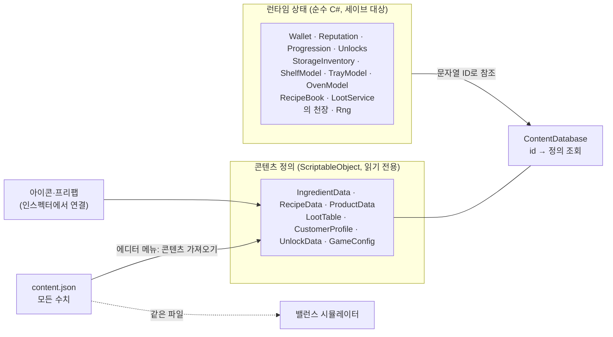

# 03. 데이터 모델

데이터는 두 종류로 나눈다. **콘텐츠 정의**는 플레이 중에 바뀌지 않는 수치와 외형이고, **런타임 상태**는 플레이하면서 바뀌고 세이브에 저장되는 값이다. 둘은 문자열 ID로만 연결한다.



## 수치는 `content.json`, 외형은 ScriptableObject

- 가격, 시간, 확률 같은 **수치는 전부** [`Assets/_Project/Data/content.json`](../../Assets/_Project/Data/content.json)에 있다. 사람이 읽는 표는 [12 문서](12-content-tables.md)다.
- 에디터 메뉴 **BakeryShop → 콘텐츠 가져오기**가 JSON을 읽어 `Assets/_Project/Data/Generated/`의 ScriptableObject를 만들거나 갱신한다. ID가 같은 에셋은 수치만 덮어쓰고, 인스펙터에서 연결한 아이콘·프리팹은 그대로 둔다.
- 게임은 런타임에 JSON을 읽지 않고 ScriptableObject만 쓴다. JSON은 에디터와 시뮬레이터를 위한 원본이다.
- 이유는 [ADR 0009](../decisions/0009-content-json-pipeline.md)에 있다.

## 콘텐츠 정의

모든 정의는 `id`와 `displayName`을 가진다. 아래 표는 그 밖의 필드다.

### `IngredientData` 재료

| 필드 | 타입 | 설명 |
| --- | --- | --- |
| `rarity` | `Rarity` | Common / Fine / Rare / Legendary |
| `resellPrice` | int | 되팔 때 받는 금액 |
| `icon` | Sprite | 외형 (인스펙터) |

### `RecipeData` 레시피

| 필드 | 타입 | 설명 |
| --- | --- | --- |
| `ingredients` | `IngredientAmount[]` | 한 판에 필요한 재료와 수량 |
| `yield` | int | 한 판에 나오는 개수 |
| `marketPrice` | int | 시세. 손님 가격 판단의 기준 |
| `bakeSeconds` | float | 다 익기까지 (SimTime) |
| `perfectWindowSeconds` | float | 다 익은 뒤 완벽 판정 구간 |
| `burnAfterSeconds` | float | 다 익은 뒤 이 시간을 넘기면 탐 |
| `shelfLifeDays` | int | 보관 일수 |
| `secret` | bool | 실험으로 발견해야 하는 레시피인지 |
| `keyIngredientId` | string | 비밀 레시피의 핵심 재료 |
| `hint` | string | 도감 힌트 문장 |
| `icon`, `breadPrefab` | Sprite, GameObject | 외형 (인스펙터) |

### `ProductData` 발주 상품

| 필드 | 타입 | 설명 |
| --- | --- | --- |
| `kind` | `ProductKind` | `IngredientPack` (내용물 고정) / `MysteryBox` (랜덤) |
| `cost` | int | 구매가 |
| `requiredLevel` | int | 이 레벨부터 주문할 수 있다 |
| `contents` | `IngredientAmount[]` | `IngredientPack`의 내용물 |
| `lootTableId` | string | `MysteryBox`의 확률표 |
| `boxPrefab` | GameObject | 외형 (인스펙터) |

### `LootTable` 미스터리 박스 확률표

| 필드 | 타입 | 설명 |
| --- | --- | --- |
| `rollsPerBox` | int | 박스 하나의 뽑기 수 |
| `entries` | `LootEntry[]` | 재료 ID, 가중치, 한 번에 나오는 개수 |
| `pityThreshold` | int | 이 횟수만큼 연속으로 꽝이면 다음 박스에서 보장 |
| `pityMinRarity` | `Rarity` | 보장하는 최소 희귀도 |

### `CustomerProfile` 손님 성향

| 필드 | 타입 | 설명 |
| --- | --- | --- |
| `spawnWeightByLevel` | float[] | 레벨별 등장 비중 |
| `budgetMin`, `budgetMax` | int | 한 번 방문의 예산 |
| `maxItems` | int | 사려는 빵의 최대 개수 |
| `patienceSeconds` | float | 계산을 기다리는 한계 |
| `cashRatio` | float | 현금으로 결제할 확률 |
| `priceSensitivity` | `CurvePoint[]` | x = 표시가 ÷ 시세, y = 구매 확률. 점 사이는 직선 |
| `preferences` | `RecipeWeight[]` | 좋아하는 빵의 가중치 |
| `defaultPreference` | float | 목록에 없는 빵의 가중치 |
| `theftChance`, `messiness` | float | MVP에서는 0. [07 문서](07-theft-and-disorder.md)의 확장에서 사용 |
| `prefabs` | GameObject[] | 외형 (인스펙터) |

가격 민감도는 Unity의 `AnimationCurve` 대신 점 목록(`PiecewiseCurve`)을 쓴다. 순수 C#으로 계산해서 테스트할 수 있고, 시뮬레이터와 같은 결과를 낸다.

### `UnlockData` 해금

| 필드 | 타입 | 설명 |
| --- | --- | --- |
| `kind` | `UnlockKind` | `RecipeLicense` / `Furniture` / `Tray` |
| `targetId` | string | 레시피 ID 또는 가구의 고정 ID. `Tray`는 비어 있다 |
| `requiredLevel` | int | 이 레벨부터 살 수 있다 |
| `cost` | int | 가격 |

### `GameConfig` 설정

`content.json`의 `config` 전체를 담는 ScriptableObject 하나다. 영업 시간, 시간대 곡선, 시작 상태, 임대료, 품질 배율, 손님 수, 평판·경험치 규칙 등. 항목은 [12 문서의 설정값](12-content-tables.md#설정값)에 있다.

### `ContentDatabase`

모든 정의를 목록으로 들고 있는 ScriptableObject 하나. 시작할 때 `id → 정의` 딕셔너리를 만들고, 시스템은 이 조회만 거친다. 아래를 EditMode 테스트로 확인한다.

- ID가 비어 있거나 중복되지 않는다.
- 레시피·상품·확률표·손님·해금이 가리키는 ID가 모두 존재한다.
- 비밀 레시피마다 핵심 재료가 있고, 핵심 재료 하나는 레시피 하나에만 쓰인다.
- 확률표의 가중치 합이 0보다 크고, 천장이 보장할 항목이 하나 이상 있다.

## 런타임 상태

```csharp
public enum BreadQuality { Undercooked, Normal, Perfect, Burnt }

public struct BreadInstance
{
    public string RecipeId;
    public BreadQuality Quality;
    public int DaysOld;                  // 구운 날 0, 하루 마무리 때마다 +1
}

public sealed class StorageInventory     // 창고: 재료 수량
{
    public int Count(string ingredientId);
    public void Add(string ingredientId, int amount);
    public bool Has(IReadOnlyList<IngredientAmount> cost);
    public bool TryConsume(IReadOnlyList<IngredientAmount> cost);   // 전부 있을 때만 차감
}

public sealed class ShelfModel           // 진열대: 칸마다 한 종류의 빵
{
    public string Id;                    // "shelf.01"
    public bool Unlocked;
    public ShelfSlot[] Slots;
}

public sealed class ShelfSlot
{
    public string RecipeId;              // 비어 있으면 null. 빵이 다 빠지면 다시 null
    public int Capacity;
    public List<BreadInstance> Breads;   // 앞쪽이 먼저 진열된 빵
}

public sealed class TrayModel            // 오븐에서 꺼낸 빵을 담아 나르는 트레이
{
    public int EntityId;
    public string RecipeId;
    public List<BreadInstance> Breads;
}

public sealed class OvenModel
{
    public string Id;                    // "oven.01"
    public bool Unlocked;
    public string RecipeId;              // 비어 있으면 null
    public double StartSimTime;
}
```

| 상태 | 가진 값 | 비고 |
| --- | --- | --- |
| `Wallet` | 잔액 (int) | 지출이 잔액을 넘으면 실패. 임대료만 음수를 허용하고 지원금이 메운다 |
| `ReputationService` | 평판 0~1000 | 별 표시는 200점에 하나 |
| `ProgressionService` | 경험치, 레벨 | 레벨은 경험치에서 계산 |
| `UnlockService` | 구매한 해금 ID 집합 | 레시피 라이선스, 가구, 트레이 |
| `OvenSystem` | 오븐 모델들 | 굽기 시작 때 빈 트레이 하나를 예약한다 |
| `TraySystem` | 전체 트레이 수, 빵이 올라가 있는 트레이 목록 | 빈 트레이 수 = 전체 − 오븐 안 − 빵이 올라간 트레이. 트레이가 비면 돌아온다 |
| `ShelfSystem` | 진열대 모델들 | 잠긴 진열대에는 올릴 수 없다 |
| `RecipeBook` | 알고 있는 레시피, 처음 얻은 핵심 재료, 실험 기록 | [09 문서](09-mystery-box-and-recipe-book.md) |
| `LootService` | 확률표별 연속 꽝 횟수 | 천장 |
| `PricingService` | 레시피별 판매가 | 처음 값은 시세 |
| `Rng` ×2 | 손님용, 박스용 난수 상태 (uint) | 스트림을 나눠 서로 영향을 주지 않게 |

규칙:

- **재료는 수량, 빵은 개체.** 재료는 "버터 12개"처럼 숫자로만 있고, 빵은 품질과 나이가 달라서 하나씩 `BreadInstance`로 다룬다.
- **품질은 꺼내는 순간 확정된다.** `OvenModel`은 시작 시각만 들고 있고, 꺼낼 때 경과 시간으로 품질을 계산한다 (`BakeMath.QualityAt`). 탄 빵은 트레이에 담기지 않고 바로 폐기된다.
- **진열대 한 칸에는 한 종류만** 놓는다. 손님은 칸의 맨 앞(먼저 진열된 빵)부터 집는다.

## 돈과 가격

- 금액은 **원 단위 `int`**로만 다룬다. `float`를 쓰면 거스름돈 계산에서 오차가 생긴다.
- 판매가는 **레시피마다 하나**를 플레이어가 정한다. 시세의 50%~250%, 100원 단위.
- 표시가와 결제 금액의 계산은 [08 문서](08-progression-and-economy.md#가격과-결제-금액)에 있다. 계산은 `PriceMath`(순수 함수) 한 곳에서만 한다.

## ID 규칙

| 종류 | 형식 | 예 | 부여 |
| --- | --- | --- | --- |
| 콘텐츠 ID | `분류.이름` 소문자 | `bread.croissant`, `ing.truffle_salt`, `unlock.oven.02` | `content.json`에 적는다. 한번 정하면 바꾸지 않는다 |
| 가구 고정 ID | `종류.번호` | `oven.01`, `shelf.03` | 씬에 배치한 가구의 인스펙터에 적는다 ([11 문서](11-shop-layout.md)) |
| 런타임 개체 ID | 정수 | `1042` | `EntityIdAllocator`가 순서대로 발급. 다음 번호도 세이브에 저장 |

세이브에 에셋 참조가 아니라 문자열 ID를 저장하는 이유는, 에셋의 이름이나 위치를 바꿔도 기존 세이브가 깨지지 않게 하기 위함이다.
