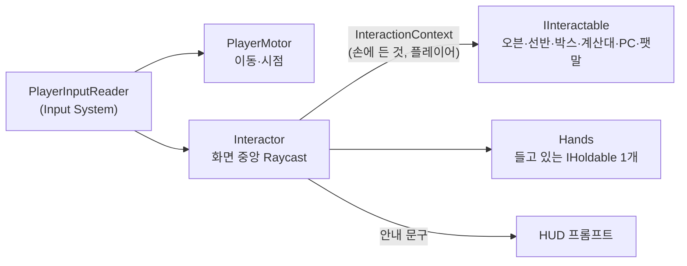

# 04. 플레이어와 상호작용

플레이어는 **바라보고(Interactor), 들고(Hands), 상호작용한다(IInteractable)**. 플레이어 코드는 대상이 오븐인지 선반인지 모르고, 대상이 "지금 손에 든 것으로 무엇을 할 수 있는지"를 스스로 판단한다.

## 구성



| 컴포넌트 | 책임 |
| --- | --- |
| `PlayerInputReader` | Input System 액션을 읽어 다른 컴포넌트에 전달. 입력 모드 전환 (게임 / UI) |
| `PlayerMotor` | CharacterController 이동, 마우스 시점 |
| `Interactor` | 매 프레임 Raycast로 대상을 찾고, 안내 문구를 HUD에 넘기고, 입력이 오면 상호작용 실행 |
| `Hands` | 들고 있는 물건 하나 (`IHoldable`), 들기·내려놓기·던지기 |

## 인터페이스

```csharp
public readonly struct InteractionContext
{
    public readonly IHoldable Held;      // 아무것도 안 들었으면 null
    public readonly Hands Hands;
}

public interface IInteractable
{
    // null이면 이 상황에서는 할 수 있는 게 없다는 뜻 (프롬프트 숨김)
    string GetPrompt(in InteractionContext ctx);
    void Interact(in InteractionContext ctx);
}

public interface IHoldable
{
    HoldableKind Kind { get; }           // Box, Tray
    void OnPickedUp(Hands hands);
    void OnDropped(Vector3 position, Quaternion rotation);
}
```

- `GetPrompt`가 `null`이 아닌 경우에만 상호작용할 수 있다. 판단과 안내 문구를 한 메서드에서 만들어, "안내는 뜨는데 실제로는 안 되는" 불일치를 막는다.
- 새 상호작용 대상을 추가해도 `Interactor`는 바뀌지 않는다.

## 상호작용 표

손에 든 것과 바라보는 대상에 따라 결과가 정해진다.

| 대상 \ 손 | 빈손 | 배송 박스 | 빵 트레이 |
| --- | --- | --- | --- |
| 배송 박스 (바닥) | 들기 | - | - |
| 창고 구역 | - | 박스 열기 → 재료가 창고로 (미스터리 박스면 개봉 연출) | - |
| 오븐 (비어 있음) | 굽기 패널 열기 (레시피 선택 / 재료 조합 실험) | - | - |
| 오븐 (굽는 중) | 꺼내기 → 트레이를 손에 듦 | - | - |
| 선반 칸 | 가격 확인 | - | 진열 (같은 빵이거나 빈 칸, 남는 개수는 트레이에 남음) |
| 빵 트레이 (바닥) | 들기 | - | - |
| 계산대 위 빵 | 스캔 | - | - |
| 발주 PC | PC 앱 열기 (발주·가격·도감·리포트) | - | - |
| 팻말 | 영업 시작 (준비 단계에서만) | - | - |
| 바닥 | - | 내려놓기 | 내려놓기 |

- 박스는 **창고 구역에서만** 열 수 있다. 문 앞에서 창고까지 들고 오는 동선이 레퍼런스의 손맛이다.
- 미스터리 박스는 열 때 재료가 하나씩 튀어나오며 희귀도별 빛·소리 연출이 붙는다. 연출이 끝나기 전에도 결과는 이미 모델에 반영되어 있다.

## 입력

Input System 액션 맵 두 개를 쓴다.

| 맵 | 액션 | 기본 키 |
| --- | --- | --- |
| `Player` | Move, Look, Interact, Drop, Pause | WASD, 마우스, E / 좌클릭, G, Esc |
| `UI` | Navigate, Submit, Cancel, Point, Click | 기본 UI 입력 |

PC 앱·오븐 패널·계산 패널이 열리면 `UI` 맵으로 바꾸고 커서를 풀며, 닫으면 `Player` 맵과 커서 잠금으로 돌아간다. 전환은 `PlayerInputReader.SetMode()` 한 곳에서만 한다. 패널마다 따로 커서를 건드리면 "패널을 닫았는데 커서가 안 잠기는" 문제가 생기기 쉽다.

## 들고 있는 물건의 물리

손에 든 물건은 Rigidbody를 **kinematic**으로 바꾸고 카메라 앞 고정 위치를 따라가게 한다. 내려놓으면 다시 물리를 켠다. 들고 있는 동안에는 별도 레이어로 두어 벽·선반과 충돌하지 않게 한다. 이 부분은 [트러블슈팅 후보](../troubleshooting/README.md) 1번과 연결되므로 처음 구현할 때부터 전후를 기록한다.
