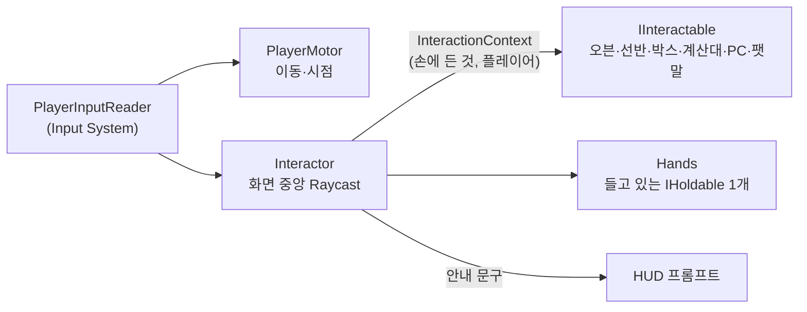

# 04. 플레이어와 상호작용

플레이어는 **바라보고(Interactor), 들고(Hands), 상호작용한다(IInteractable)**. 플레이어 코드는 대상이 오븐인지 선반인지 모르고, 대상이 "지금 손에 든 것으로 무엇을 할 수 있는지"를 스스로 판단한다.

## 구성



| 컴포넌트 | 책임 |
| --- | --- |
| `PlayerInputReader` | Input System 액션을 읽어 다른 컴포넌트에 전달. 입력 모드 전환 (게임 / UI) |
| `PlayerMotor` | CharacterController 이동, 마우스 시점 |
| `Interactor` | 매 프레임 Raycast로 대상을 찾고, 안내 문구를 HUD에 넘기고, 입력이 오면 상호작용 실행 |
| `Hands` | 들고 있는 물건 하나 (`IHoldable`), 들기·내려놓기·떨어뜨리기, 내려놓을 공간 검사 |
| `InteractionResolver` | 바라보는 대상과 손 상태로 "지금 E를 누르면 무엇을 하는지"를 정하는 순수 함수. 테스트 대상 |

## 인터페이스

```csharp
public readonly struct InteractionContext
{
    public readonly IHands Hands;
    public IHoldable Held => Hands?.Held;   // 아무것도 안 들었으면 null
}

public interface IInteractable
{
    // null이면 이 상황에서는 할 수 있는 게 없다는 뜻 (프롬프트 숨김)
    string GetPrompt(in InteractionContext ctx);
    void Interact(in InteractionContext ctx);
}

public interface IHoldable
{
    HoldableKind Kind { get; }           // Box, Tray
    string DisplayName { get; }
    Vector3 HalfExtents { get; }         // 내려놓을 공간 검사용
    void OnPickedUp(Transform holdAnchor);
    void OnDropped(Vector3 position, Quaternion rotation);
}

public interface IHands                  // 대상이 손에 접근할 때 쓰는 최소 인터페이스
{
    IHoldable Held { get; }
    bool TryPickUp(IHoldable item);
}
```

대상은 `Hands` 컴포넌트가 아니라 `IHands`만 안다. 그래서 `InteractionResolver` 같은 판단 로직을 가짜 손으로 테스트할 수 있다.

판단 우선순위 (`InteractionResolver.Resolve`):

1. 바라보는 대상이 안내 문구를 내놓으면 그 대상과 상호작용
2. 아니면, 무언가 들고 있고 바라보는 곳이 비어 있는 윗면이면 내려놓기 (박스 위를 보면 쌓기)
3. 둘 다 아니면 아무것도 안 함

- `GetPrompt`가 `null`이 아닌 경우에만 상호작용할 수 있다. 판단과 안내 문구를 한 메서드에서 만들어, "안내는 뜨는데 실제로는 안 되는" 불일치를 막는다.
- 새 상호작용 대상을 추가해도 `Interactor`는 바뀌지 않는다.

## 상호작용 표

손에 든 것과 바라보는 대상에 따라 결과가 정해진다.

| 대상 \ 손 | 빈손 | 배송 박스 | 빵 트레이 |
| --- | --- | --- | --- |
| 배송 박스 (바닥) | 들기 | 그 위에 쌓기 | 그 위에 놓기 |
| 창고 선반 | - | 박스 열기 → 재료가 창고로 (미스터리 박스면 개봉 연출) | - |
| 오븐 (비어 있음) | 오븐 패널 열기 (굽기 / 실험) | - | - |
| 오븐 (굽는 중, 절반 미만) | 오븐 패널 열기 (실험만) | - | - |
| 오븐 (굽는 중, 절반 이상) | 꺼내기 → 트레이를 손에 듦. 탔으면 폐기 | - | - |
| 진열대 칸 | - (가격표로 이름·가격·수량 확인) | - | 진열 (빈 칸이거나 같은 빵. 남는 빵은 트레이에 남음) |
| 빵 트레이 (바닥·작업대) | 들기 | - | - |
| 쓰레기통 | - | - | 트레이의 빵 버리기 |
| 계산대 위 빵 | 스캔 | - | - |
| 발주 PC | PC 패널 열기 | - | - |
| 팻말 | 영업 시작 (준비 단계에서만) | - | - |
| 잠긴 가구 | 해금 안내 표시 | - | - |
| 바닥·작업대 등 평평한 윗면 | - | 내려놓기 | 내려놓기 |

- 박스는 **창고 선반에서만** 열 수 있다. 문 앞에서 창고까지 들고 가는 동선이 레퍼런스의 손맛이다.
- 미스터리 박스는 열 때 재료가 하나씩 튀어나오며 희귀도별 빛·소리 연출이 붙는다. 연출이 끝나기 전에도 결과는 이미 모델에 반영되어 있다 ([09 문서](09-mystery-box-and-recipe-book.md)).
- 트레이의 빵이 0개가 되면 트레이는 사라지고 오븐의 빈 트레이 수가 하나 늘어난다.
- 진열대에서 빵을 다시 꺼내는 기능은 MVP에 없다. 하루 지난 빵은 자동으로 할인되어 팔린다.

## 입력

Input System 에셋은 `Assets/_Project/Input/BakeryControls.inputactions`이다.

| 맵 | 액션 | 기본 키 |
| --- | --- | --- |
| `Player` | Move, Look, Interact, Drop | WASD, 마우스, E / 좌클릭, G |
| `Global` | Pause | Esc. 입력 모드와 상관없이 항상 켜져 있다 |
| `UI` (패널 작업 때 추가) | Navigate, Submit, Cancel, Point, Click | 기본 UI 입력 |

Pause를 `Player` 맵에 두면 UI 모드에서 `Player` 맵이 꺼질 때 같이 꺼져서, 메뉴를 Esc로 닫을 수 없다. 그래서 항상 켜져 있는 `Global` 맵으로 분리했다.

PC 앱·오븐 패널·계산 패널이 열리면 `UI` 맵으로 바꾸고 커서를 풀며, 닫으면 `Player` 맵과 커서 잠금으로 돌아간다. 전환은 `PlayerInputReader.SetMode()` 한 곳에서만 한다. 패널마다 따로 커서를 건드리면 "패널을 닫았는데 커서가 안 잠기는" 문제가 생기기 쉽다.

## 들고 있는 물건의 물리

손에 든 물건은 Rigidbody를 **kinematic**으로 바꾸고 충돌을 끈 채 카메라 앞 `HoldAnchor`를 따라가게 한다. 충돌을 켜 두면 플레이어 캡슐을 밀어내거나 벽에 걸리기 때문이다. 내려놓으면 다시 물리를 켠다.

### 벽·가구에 파고들지 않게: 접어 들기

충돌을 끄면 플레이어 몸은 벽 앞에서 멈춰도 0.9m 앞의 물건은 벽을 통과한다 (첫 플레이 테스트에서 확인). 그래서 앞이 막히면 물건을 **화면 아래쪽, 몸 가까이로 접어 든다.**

- 물건은 두 자세를 잇는 선 위에서만 움직인다. **편 자세**는 평소 위치(카메라 기준 `(0, −0.3, 0.9)`), **접은 자세**는 `(0, −0.5, 0.2)`다.
- 매 프레임 `LateUpdate`에서 접은 자세 → 편 자세 방향으로 물건 크기의 `BoxCast`를 하고, 처음 막히는 곳 바로 앞에 물건을 둔다. 접은 자세에서 이미 겹쳐 있으면 완전히 접는다.
- 막히면 **즉시** 물러나고, 풀리면 **일정 속도로** 돌아간다 (`HoldDistanceMath`). 즉시 돌아가면 벽 모서리를 지날 때 물건이 튀어 보인다.
- 플레이어 자신의 캡슐은 장애물에서 뺀다 (접은 자세는 항상 캡슐과 겹친다).

**눈 쪽으로 당기지 않는 이유.** 처음에는 카메라 → 물건 방향으로 당겼다 (최소 0.4m). 그 선의 끝이 눈이라서 막힐수록 물건이 화면을 가렸고, 탁자에 올려놓으려고 다가가면 상자가 화면을 덮어 앞이 보이지 않았다 (두 번째 플레이 테스트). 계산해 보면 탁자 앞에서 35도 아래를 볼 때 0.5m 상자의 윗면이 화면 중앙보다 11도 위까지 올라온다. 접는 경로에서는 어느 지점에서도 상자 윗면이 화면 중앙보다 아래에 있다 (회귀 테스트 `PoseOnPath_BlockedPose_StaysBelowTheViewCenter`).

| 상황 | 눈 쪽으로 당기기 (이전) | 접어 들기 (현재) |
| --- | --- | --- |
| 탁자 앞 0.45m, 35도 아래를 봄 | 상자 윗면이 화면 중앙 위 11.6도, 조준점을 가림 | 화면 중앙 아래 10.3도, 가리지 않음 |
| 벽 앞 0.45m, 정면을 봄 | 상자 앞면이 눈앞 0.13m, 화면 대부분을 가림 | 화면 맨 아래에 윗면만 조금 보임 |
| 바닥을 내려다봄 | 변화 없음 | 변화 없음 |

- 검토한 다른 방법: 오버레이 카메라(손에 든 물건만 따로 그려 항상 앞에 보이게 한다. 벽 속에 있는 물건이 벽 앞에 그려져 원근이 어긋나고, 그림자와 조명이 맞지 않는다), 플레이어 이동 막기(CharacterController에 콜라이더를 덧붙일 수 없어 구현 부담이 큼).

### 내려놓는 순간: 물리 자세를 먼저 맞춘다

`Physics.autoSyncTransforms`가 꺼져 있으면(기본값) 물리 엔진은 Transform의 변경을 **다음 FixedUpdate 직전**에야 받아들인다. 내려놓을 때 Transform만 옮기고 콜라이더를 켜면, 그 프레임이 끝날 때까지 물리 엔진 안에서는 콜라이더가 "들고 있던 자리"에 있다. 아래를 내려다볼 때 들고 있던 자리는 플레이어 몸 안이다. 같은 프레임의 `CharacterController.Move`가 몸 안에 생긴 콜라이더와의 겹침을 풀려고 플레이어를 밀어 올리는 것으로 본다 (트러블슈팅 #3의 가설 3. Unity에서 확인 예정).

그래서 `HoldableObject.OnDropped`는 콜라이더를 켜기 **전에** `Rigidbody.position`/`rotation`을 직접 맞추고 `Physics.SyncTransforms()`를 부른다. 보간은 자세를 맞춘 뒤에 켠다.

### 플레이어 몸에 내려놓지 않게: 캡슐 직접 검사

`Physics.CheckBox`는 CharacterController의 반지름만 보고 스킨(`skinWidth`)은 보지 않는다. 또 상자를 0.95배로 줄여 검사한다. 플레이어 몸만큼은 물리 쿼리에 맡기지 않고, **반지름 + 스킨** 크기의 캡슐과 상자가 겹치는지를 `PlacementMath`로 직접 계산해 막는다. 벽·가구·다른 물건은 그대로 물리 쿼리로 검사한다.

이 검사는 "몸에 걸치게 내려놓으면 플레이어가 올라간다"는 버그의 원인(가설 1)이라고 보고 넣었지만, 넣은 뒤에도 버그가 남았다. 원인은 위의 물리 자세 문제로 보고 있다. 검사 자체는 몸과 겹치는 자리를 막는 안전장치로 남겨 둔다.

### 디버그 표시 (Scene 뷰)

| 표시 | 의미 |
| --- | --- |
| 초록 상자 | 지금 E를 누르면 이 자리에 내려놓을 수 있음 |
| 빨강 상자 | 이 자리는 막혀 있음 |
| 노란 구 2개 | 공간 검사가 "플레이어 몸"으로 보는 캡슐 (스킨 포함) |
