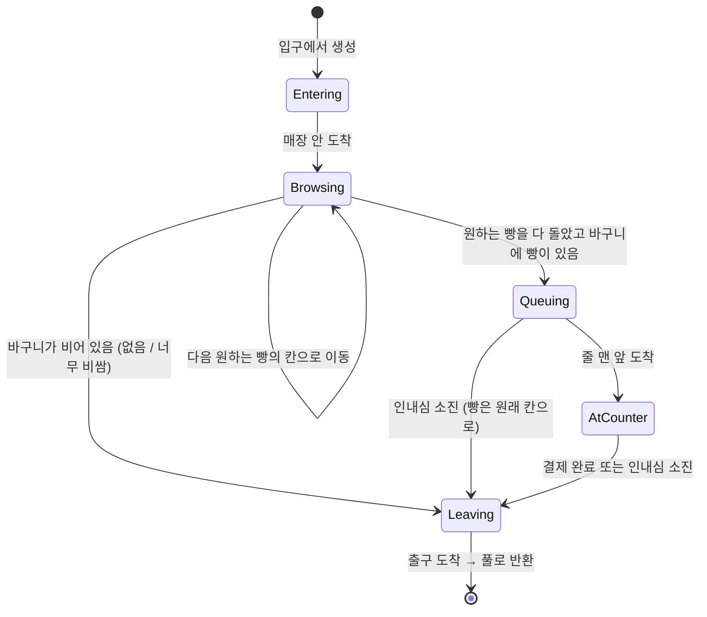
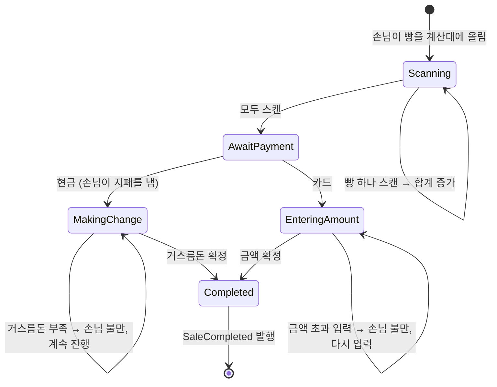

# 05. 손님과 계산

손님은 **사고 싶은 빵 목록을 들고 들어와, 선반을 돌며 살지 말지 판단하고, 줄을 서서 계산한 뒤 나간다**. 손님의 판단은 순수 C# `CustomerBrain`이 하고, 이동은 `ICustomerBody`를 통해 NavMeshAgent가 한다.

## 손님 상태 기계



| 상태 | 하는 일 |
| --- | --- |
| `Entering` | 입구 안쪽 지점으로 이동 |
| `Browsing` | 원하는 빵이 있는 가장 가까운 칸으로 이동 → 도착하면 구매 판단 → 다음 빵 |
| `Queuing` | 계산 줄 끝에 서고, 앞사람이 빠지면 한 칸씩 전진. 인내심 감소 |
| `AtCounter` | 바구니의 빵을 계산대에 올리고 결제를 기다림. 인내심 감소 |
| `Leaving` | 출구로 이동, `CustomerLeft` 발행 (떠난 이유 포함) |

줄에서 기다리다 떠나는 손님의 빵은 원래 칸에 자리가 있으면 돌려놓고, 없으면 폐기로 처리한다. 손님이 직접 돌아가 놓는 동작은 만들지 않고 모델에서 바로 처리한다.

각 상태는 `IState`(`Enter`, `Tick`, `Exit`)를 구현한다. 하루 단계 상태 기계, 결제 세션과 같은 패턴이다.

## 엔진 경계: `ICustomerBody`

```csharp
public interface ICustomerBody
{
    Vector3 Position { get; }
    void MoveTo(Vector3 destination);
    bool HasArrived { get; }
    void Stop();
    void PlayGesture(CustomerGesture gesture);   // 집기, 불만, 결제 등
}
```

`CustomerController`(MonoBehaviour)가 NavMeshAgent와 애니메이터로 이 인터페이스를 구현한다. 테스트에서는 `MoveTo` 즉시 도착하는 가짜 몸체를 넣어, "선반이 비었을 때 손님이 빈손으로 떠나는지" 같은 시나리오를 에디터 플레이 없이 검증한다.

## 들어올 때: 원하는 빵 정하기

1. `CustomerProfile.preferences` 가중치로 1 ~ `maxItems`개의 레시피를 뽑는다.
2. 예산은 `budgetMin` ~ `budgetMax` 사이에서 정한다.
3. 선반에 아예 없는 레시피는 바로 **놓친 수요**로 기록하고 (`DemandMissed`), 남은 목록만 돌아다닌다.

놓친 수요는 일일 리포트의 "찾았지만 없던 빵"으로 보여준다. 플레이어가 다음 날 무엇을 더 구울지 데이터로 판단하게 하는 장치다.

## 선반 앞에서: 구매 판단

칸에 도착하면 맨 앞 빵 하나에 대해 판단한다.

```
구매 확률 = priceSensitivity(판매가 / 시세) × 신선도 배율(daysOld) × 평판 배율
조건: 지금까지 담은 금액 + 이 빵 가격 ≤ 예산
```

- `priceSensitivity`는 손님 성향별 AnimationCurve다. 학생은 시세보다 조금만 비싸도 급격히 떨어지고, 직장인은 완만하게 떨어지는 식으로 성향을 데이터로 만든다.
- 사기로 하면 빵을 칸에서 즉시 빼서 바구니에 담는다 (`ShelfChanged`). 다른 손님과 같은 빵을 두고 겹치지 않도록 예약 대신 "먼저 집은 사람이 가져간다"로 단순화했다.
- 도착했는데 다른 손님이 먼저 가져가 칸이 비었으면 놓친 수요로 기록한다.
- 확률 계산은 `PurchaseDecision.Evaluate(...)` 순수 함수로 분리해 테스트한다.

## 손님 생성

```
시간당 생성 수 = 기본 생성 수 × 시간대 곡선(영업 시계) × 평판 배율
```

- 다음 손님까지의 간격은 시드 고정 `Rng`로 뽑는다.
- 동시에 매장에 있을 수 있는 손님 수에 상한을 둔다 (성능과 계산 줄 길이 관리).
- 손님 오브젝트는 풀에서 꺼내고, 나가면 상태를 초기화해 돌려놓는다. 초기화를 빠뜨린 필드가 다음 손님에게 남는 문제를 막기 위해 `Reset()` 한 곳에서 모든 필드를 되돌린다.

## 계산 줄

- 계산대 앞에 줄 서는 자리(`QueueSlot`)를 미리 배치한다. 손님 수가 자리 수보다 많으면 매장 안을 더 둘러보며 기다린다.
- 손님끼리의 위치는 NavMesh 회피에 맡기지 않고 **줄 자리를 목적지로 하나씩 배정**한다. 회피만으로 줄을 세우면 계산대 앞에서 서로 밀거나 끼이기 쉽다.

## 결제 세션

계산대의 진행은 `CheckoutSession`(순수 C#) 상태 기계가 관리한다.



| 결제 | 플레이어가 하는 일 | 실수했을 때 |
| --- | --- | --- |
| 현금 | 손님이 낸 돈을 보고, 금고 UI에서 지폐·동전을 골라 거스름돈을 만든 뒤 확정 | 덜 주면 손님이 불만을 표시하고 확정이 안 됨 (평판 하락). 더 주면 확정되지만 차액만큼 손해 |
| 카드 | 단말기 키패드에 합계를 입력하고 확정 | 더 많이 입력하면 손님이 거부하고 다시 입력 (평판 하락). 적게 입력하면 확정되지만 덜 받은 만큼 손해 |

- 손님이 내는 현금은 합계 이상의 지폐 조합으로 정한다 (예: 7,500원 → 10,000원 또는 8,000원).
- 화폐 단위: 100원, 500원 동전 / 1,000원, 5,000원, 10,000원, 50,000원 지폐.
- 판매가 끝나면 `SaleCompleted`에 실수 여부와 손익을 담아 발행하고, 리포트에 "계산 실수 손실"로 집계한다.

## 평판

평판은 0~100 정수이며 손님 생성 수와 구매 확률에 영향을 준다. 변화량은 `EconomyConfig`에 둔다.

| 일 | 평판 |
| --- | --- |
| 완벽 품질 빵 판매 | 소폭 상승 |
| 결제 완료 | 소폭 상승 |
| 원하는 빵이 하나도 없어 빈손으로 떠남 | 하락 |
| 줄에서 기다리다 떠남 | 크게 하락 |
| 거스름돈 부족, 카드 과다 입력 | 하락 |
| 도감 완성도 단계 달성 | 상승 |
