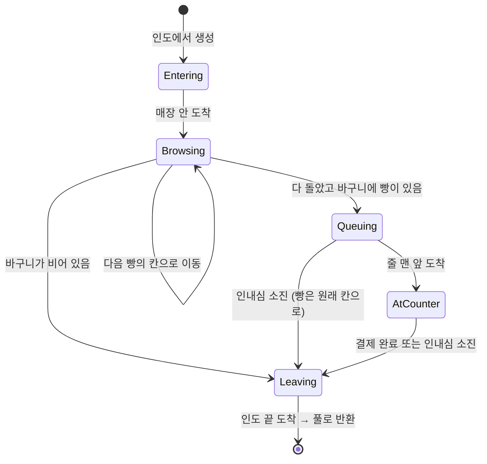
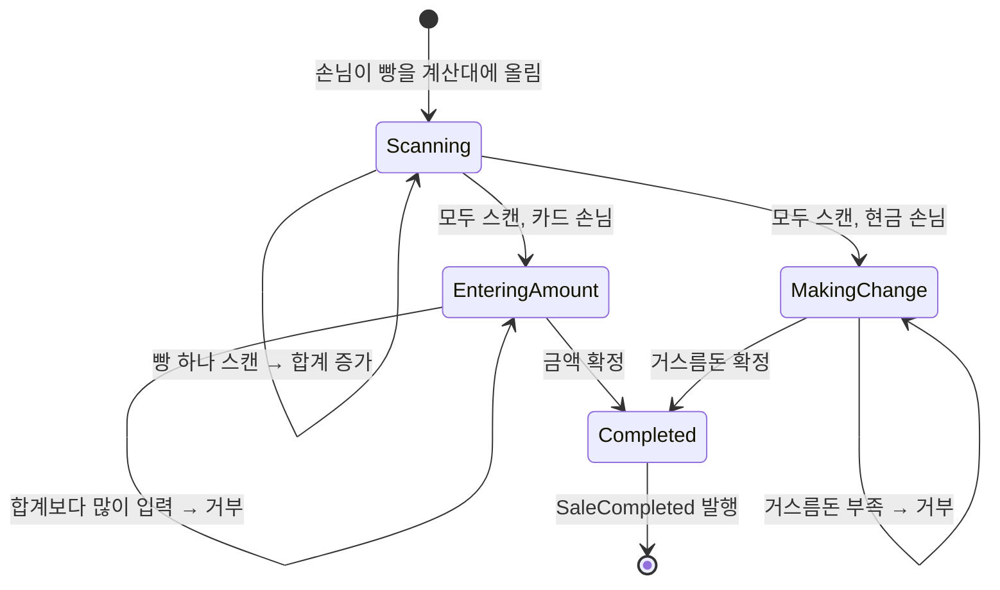

# 05. 손님과 계산

손님은 **사고 싶은 빵 목록을 들고 들어와, 진열대를 돌며 살지 말지 판단하고, 줄을 서서 계산한 뒤 나간다**. 손님의 판단은 순수 C# `CustomerBrain`이 하고, 이동은 `ICustomerBody`를 통해 NavMeshAgent가 한다. 수치는 [12 문서](12-content-tables.md#손님-성향)에 있다.

## 손님 상태 기계



| 상태 | 하는 일 |
| --- | --- |
| `Entering` | 인도의 생성 지점에서 출입문 안쪽 입장 지점까지 이동 |
| `Browsing` | 원하는 빵이 있는 가장 가까운 칸 앞으로 이동 → 도착 후 `browseSecondsPerItem`(4초) 둘러봄 → 구매 판단 → 다음 빵 |
| `Queuing` | 줄 자리를 배정받아 서고, 앞사람이 빠지면 한 칸씩 전진. 인내심 감소 |
| `AtCounter` | 바구니의 빵을 계산대에 올리고 기다림. 플레이어가 첫 빵을 스캔하기 전까지만 인내심 감소 |
| `Leaving` | 인도의 퇴장 지점으로 이동, `CustomerLeft` 발행 (떠난 이유 포함) |

- 각 상태는 `IState<CustomerContext>`를 구현하고, `Tick`이 다음 상태를 돌려준다. `CustomerBrain`에는 상태별 분기를 두지 않는다. 하루 단계, 결제 세션과 같은 패턴이다.
- MVP 이후 절도 확장에서 `Concealing`, `Fleeing`, `Caught` 상태가 추가된다 ([07 문서](07-theft-and-disorder.md)). 위 구조 덕분에 상태를 추가하는 것만으로 붙는다.
- 줄에서 기다리다 떠나는 손님의 빵은 원래 칸에 자리가 있으면 돌려놓고, 없으면 폐기한다. 손님이 직접 걸어가 놓는 동작은 만들지 않고 모델에서 바로 처리한다.
- 계산 줄(4자리)이 꽉 차 있으면 손님은 마지막으로 본 칸 앞에서 3초마다 다시 확인하며 기다린다. 이때도 인내심이 줄어든다.

떠난 이유 (`LeaveReason`): `Paid`, `NoStock`(원하는 빵이 없음), `TooExpensive`(있었지만 비싸거나 예산 초과), `QueueTimeout`. 바구니가 빈 채로 떠날 때, 원하는 빵 중 하나라도 재고가 없었으면 `NoStock`, 아니면 `TooExpensive`다.

## 엔진 경계: `ICustomerBody`

```csharp
public interface ICustomerBody
{
    Vector3 Position { get; }
    void MoveTo(Vector3 destination);
    bool HasArrived { get; }
    void Stop();
    void ShowBubble(CustomerBubble bubble, string recipeId = null);   // 없네…, 비싸다, !
}
```

`CustomerController`(MonoBehaviour)가 NavMeshAgent로 이 인터페이스를 구현한다. 테스트에서는 `MoveTo` 즉시 도착하는 가짜 몸체를 넣어, "선반이 비었을 때 빈손으로 떠나는지" 같은 시나리오를 에디터 플레이 없이 검증한다.

매장의 위치 정보도 인터페이스로 받는다. 씬의 `ShopLayout`이 구현하고 좌표는 [11 문서](11-shop-layout.md)를 따른다.

```csharp
public interface IShopLayout
{
    Vector3 SpawnPoint(int index);              // 인도의 생성·퇴장 지점 (2곳)
    Vector3 EntryPoint { get; }
    Vector3 SlotStandPoint(SlotRef slot);       // 진열대 칸 앞에 서는 자리
    Vector3 QueuePoint(int index);              // 0 = 계산 위치, 1~4 = 줄
}
```

## 들어올 때: 방문 계획

`CustomerPlanner.Create(profile, menu, rng)`가 만든다 (순수 함수).

1. **메뉴 정하기**: 메뉴 = 라이선스가 있는 일반 레시피 전부 + **지금 진열대에 1개 이상 놓인** 비밀 레시피.
2. **원하는 빵**: 1 ~ `maxItems`개를 성향의 선호 가중치로, 같은 빵이 겹치지 않게 뽑는다.
3. **예산**: `budgetMin` ~ `budgetMax` 사이 100원 단위.
4. **결제 수단**: `cashRatio` 확률로 현금, 아니면 카드.

일반 레시피는 진열하지 않아도 손님이 찾는다 (없으면 놓친 수요). 비밀 레시피는 진열했을 때만 찾는다. 핵심 재료가 없어서 못 굽는 날에 평판이 떨어지지 않게 하기 위해서다.

## 진열대 앞에서: 구매 판단

원하는 빵마다 한 번씩, 칸의 맨 앞 빵을 두고 판단한다. `PurchaseDecision.Evaluate(...)` 순수 함수다.

| 순서 | 조건 | 결과 |
| --- | --- | --- |
| 1 | 그 빵이 진열대 어디에도 없음 | 놓친 수요 (`DemandMissed`), 말풍선 "없네…" |
| 2 | 담은 금액 + 표시가 > 예산 | 사지 않음 (`PriceRejected`), 말풍선 "비싸다" |
| 3 | 난수 ≥ 구매 확률 | 사지 않음 (`PriceRejected`), 말풍선 "비싸다" |
| 4 | 그 외 | 칸에서 빵을 빼서 바구니에 담음 (`ShelfChanged`) |

```
구매 확률 = 가격 민감도( 표시가 ÷ 시세 ) × (덜 익은 빵이면 0.6)
```

- 표시가, 가격 민감도 곡선은 [08 문서](08-progression-and-economy.md#가격과-결제-금액)에 있다.
- 사기로 하면 빵을 칸에서 즉시 뺀다. 두 손님이 같은 빵을 노려도 먼저 도착한 손님이 가져가고, 늦게 온 손님은 1번(놓친 수요)이 된다. 예약 처리를 두지 않아 단순하다.
- 놓친 수요와 "비싸서 안 산 횟수"는 빵별로 정산 리포트에 나온다. 다음 날의 생산량과 가격을 정하는 근거다.

## 손님 생성

`CustomerSpawner`가 영업 단계에서만 만든다.

```
오늘의 목표 손님 수 = 레벨의 기본 손님 수 × (0.7 + 0.6 × 평판 ÷ 1000)       ← 개점할 때 한 번 계산
생성 속도(명/초)   = 목표 손님 수 ÷ 영업 시간(360초) × 시간대 곡선(영업 시계) ÷ 곡선 평균 × (빵 냄새 중이면 1.4)
```

- 매 틱 `누적 += 생성 속도 × simDelta`를 하고, 누적이 문턱을 넘으면 한 명을 만든다. 문턱은 만들 때마다 `-ln(1 - 난수)`로 새로 뽑는다. 프레임 속도와 상관없이 같은 분포가 나오고, 손님이 몰리는 순간과 한가한 순간이 자연스럽게 생긴다.
- 매장 안 손님이 상한(10명)이면 만들지 않고 누적을 유지한다.
- 성향은 그 레벨의 `spawnWeightByLevel` 가중치로 뽑는다.
- 손님 오브젝트는 풀에서 꺼내고, 나가면 `Reset()` 한 곳에서 모든 필드를 되돌린 뒤 돌려놓는다.

## 계산 줄

- 계산대 앞에 계산 위치 1곳과 줄 자리 4곳이 있다 (`CheckoutQueue`, 총 5명).
- 손님끼리의 위치는 NavMesh 회피에 맡기지 않고 **자리를 하나씩 배정**한다. 회피만으로 줄을 세우면 계산대 앞에서 서로 밀거나 끼이기 쉽다.

## 결제 세션

계산대의 진행은 `CheckoutSession`(순수 C#) 상태 기계가 관리한다.



| 결제 | 플레이어가 하는 일 | 실수했을 때 |
| --- | --- | --- |
| 카드 | 키패드에 합계를 입력하고 결제 | 많이 입력하면 손님이 거부하고 다시 입력 (평판 −5). 적게 입력하면 그대로 결제되고 덜 받은 만큼 손해 |
| 현금 | 손님이 낸 돈을 보고, 지폐·동전을 골라 거스름돈을 만들어 건넴 | 덜 주면 손님이 거부하고 다시 (평판 −5). 더 주면 그대로 끝나고 차액만큼 손해 |

- 결제 금액은 빵마다 `표시가 × 품질 배율`을 100원 단위로 반올림한 값의 합이다.
- 화폐 단위: 100원, 500원 동전 / 1,000원, 5,000원, 10,000원, 50,000원 지폐.
- 거부는 한 손님에게 여러 번 일어나도 평판은 한 번만 깎는다.
- 판매가 끝나면 `SaleCompleted`에 품목, 받은 금액, 실수 손익을 담아 발행한다. 지갑, 경험치, 평판, 리포트가 이 이벤트 하나에 각자 반응한다.

### 손님이 내는 현금

`CashMath.Tender(total, rng)`가 정한다. 후보를 만들고 가중치로 하나를 뽑는다. 값이 같은 후보는 하나로 합친다.

| 후보 | 가중치 | 예 (합계 7,500원) |
| --- | --- | --- |
| 정확한 금액 | 2 | 7,500 |
| 1,000원 단위로 올림 | 3 | 8,000 |
| 5,000원 단위로 올림 | 3 | 10,000 |
| 10,000원 단위로 올림 | 3 | 10,000 |
| 50,000원 한 장 (합계 20,000원 이상이면 1, 아니면 0.3) | 1 / 0.3 | 50,000 |

## 평판

변화량과 손님 수에 미치는 영향은 [08 문서](08-progression-and-economy.md#평판)에 있다. `ReputationService`가 `CustomerLeft`, `SaleCompleted`, `RecipeDiscovered`를 구독해 반영한다.
