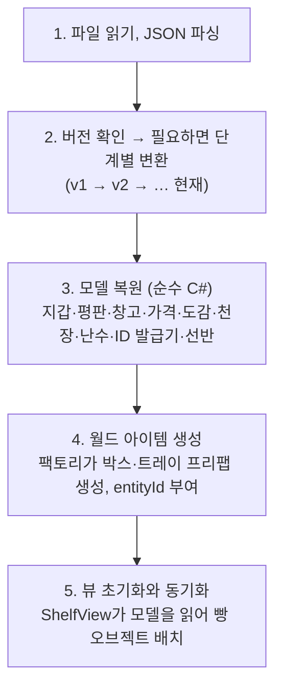

# 06. 세이브

**저장은 하루와 하루 사이에만 한다** ([ADR 0005](../decisions/0005-save-between-days.md)). 정산 단계에 들어가는 순간 하루 마무리 처리가 끝난 상태를 자동 저장하고, 불러오면 항상 다음 날 준비 단계에서 시작한다.

## 저장 시점에 비어 있는 것들

하루 마무리 처리([02 문서](02-day-cycle-and-time.md#하루-마무리-처리)) 덕분에 저장 시점에는 아래가 항상 비어 있다. 저장할 필요가 없으니 세이브 구조가 단순해진다.

| 대상 | 정산 진입 시 처리 | 세이브 |
| --- | --- | --- |
| 손님, 계산 줄, 결제 세션 | 마감 단계에서 모두 나감 | 저장 안 함 |
| 오븐 | 남은 빵 폐기 | 저장 안 함 |
| 배송 중인 주문 | 문 앞 박스로 도착 처리 | 저장 안 함 (박스는 월드 아이템으로 저장) |
| 손에 든 물건 | 발밑에 내려놓음 | 월드 아이템으로 저장 |
| 영업 시계 | 다음 날 09:00 | 저장 안 함 |

## 저장하는 것

```json
{
  "version": 1,
  "day": 3,
  "money": 152300,
  "reputation": 54,
  "rngState": 2463534242,
  "nextEntityId": 1043,
  "prices": [{ "recipeId": "bread.croissant", "price": 3800 }],
  "storage": [{ "ingredientId": "ing.butter", "count": 12 }],
  "unlockedRecipes": ["bread.white", "bread.croissant", "bread.redbean"],
  "discoveredRecipes": ["bread.truffle_salt"],
  "pity": [{ "lootTableId": "loot.basic", "count": 4 }],
  "shelves": [
    {
      "id": "shelf.01",
      "slots": [
        { "recipeId": "bread.croissant", "breads": [{ "quality": 2, "daysOld": 1 }] },
        { "recipeId": "", "breads": [] }
      ]
    }
  ],
  "worldItems": [
    { "entityId": 1040, "kind": "Box", "productId": "product.box.basic",
      "position": { "x": 1.2, "y": 0.0, "z": -3.4 }, "rotation": { "x": 0, "y": 0, "z": 0, "w": 1 } },
    { "entityId": 1041, "kind": "Tray", "tray": { "recipeId": "bread.white", "breads": [] },
      "position": { "x": 0.5, "y": 0.9, "z": 2.0 }, "rotation": { "x": 0, "y": 0, "z": 0, "w": 1 } }
  ],
  "history": [{ "day": 2, "revenue": 84000, "cost": 31000, "waste": 6500, "missedDemand": 7 }]
}
```

- `history`는 지난 일일 리포트 요약이다. 통계 그래프와 "어제보다 나아졌는지" 비교에 쓴다.
- 세이브 DTO(`SaveData`)는 런타임 모델과 별개의 단순 클래스다. 모델이 바뀌어도 세이브 형식은 버전을 올려서만 바꾼다.

## 형식과 파일

- `JsonUtility`를 쓴다. 딕셔너리와 다형성을 지원하지 않으므로 DTO는 리스트와 단순 필드로만 만든다. 월드 아이템도 상속 대신 `kind` 필드 하나로 구분한다.
- 경로: `Application.persistentDataPath/save_{슬롯}.json`
- **임시 파일에 쓴 뒤 교체**한다. `save_1.json.tmp`에 다 쓰고 나서 기존 파일을 `.bak`으로 옮기고 임시 파일 이름을 바꾼다. 쓰는 도중 게임이 꺼져도 이전 세이브가 남는다.

## 불러오기 순서



- **모델을 먼저, 오브젝트를 나중에.** 오브젝트가 서로를 참조하는 상태를 직렬화하지 않고, ID만 저장해 두었다가 모델 복원 후 연결한다.
- 선반은 씬에 배치된 `persistentId`로 찾는다. 세이브에 있는데 씬에 없는 ID는 경고 로그를 남기고 건너뛴다.
- 콘텐츠에서 사라진 레시피·재료 ID도 경고 로그 후 건너뛴다. 개발 중 콘텐츠를 지우거나 이름을 바꿨을 때 세이브가 통째로 깨지지 않게 한다.

## 버전 변환

```csharp
public interface ISaveMigration
{
    int FromVersion { get; }
    void Apply(SaveData data);   // FromVersion → FromVersion + 1
}
```

세이브 구조를 바꿀 때마다 변환기를 하나씩 추가하고, 불러올 때 현재 버전까지 순서대로 적용한다.

## 테스트

| 테스트 | 확인하는 것 |
| --- | --- |
| 왕복 테스트 | 상태 생성 → 저장 → 불러오기 → 모든 모델이 같은지 |
| 버전 변환 테스트 | v1 예시 JSON을 넣으면 현재 버전 형식으로 올라오는지 |
| 손상 대비 테스트 | 알 수 없는 ID가 섞인 세이브를 불러와도 나머지가 복원되는지 |

파일 대신 문자열로 저장·불러오기 할 수 있게 `ISaveStorage` 인터페이스를 두어, 테스트에서는 디스크를 건드리지 않는다.
