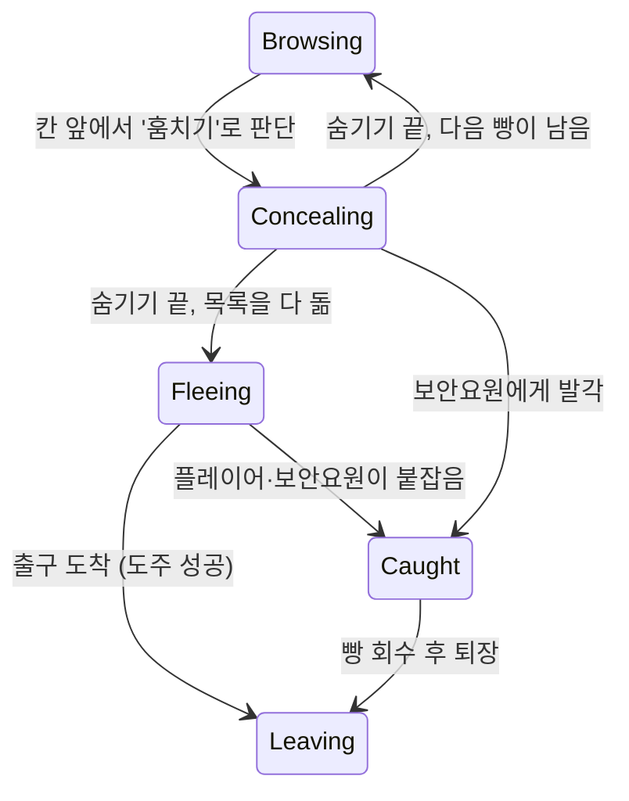
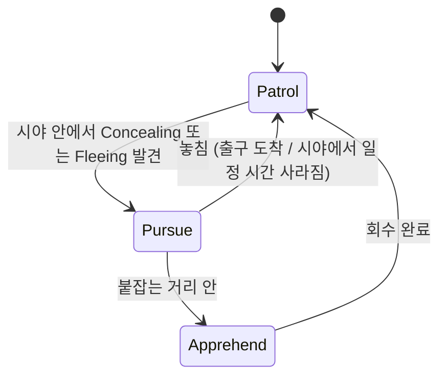

# 07. 절도·보안·매장 어지럽힘 (MVP 이후 확장)

MVP 이후 첫 확장으로, 영업 중 긴장 요소와 **"보안 비용 vs 도난 손실"** 판단을 더한다. 지금은 구현하지 않고, MVP 코드에 붙일 자리만 마련해 둔다 ([ADR 0007](../decisions/0007-theft-security-after-mvp.md)).

## 범위와 순서

| 단계 | 내용 | 새로 생기는 판단 |
| --- | --- | --- |
| 확장 1 | 절도 손님, 플레이어가 직접 붙잡기 | 계산대를 볼지, 매장을 돌아볼지 |
| 확장 2 | 보안요원 고용, CCTV·도난방지 게이트 업그레이드 | 인건비·설비비를 들일 만큼 도난이 많은지 |
| 확장 3 | 진열을 흐트러뜨리는 손님, 정리하기 | 정리에 시간을 쓸지, 굽기·계산을 먼저 할지 |

진열장을 부수는 대신 **흐트러뜨리기**로 정했다. 파손 연출, 수리 흐름까지 만들 필요가 없고, 빵집 분위기에도 맞는다.

## 절도

### 흐름

기존 손님 상태 기계([05 문서](05-customer-and-checkout.md))에 상태 두 개를 더한다.



| 상태 | 하는 일 | 단서 |
| --- | --- | --- |
| `Concealing` | 칸에서 빵을 집어 품에 숨긴다 (약 2초) | 두리번거리는 동작, 빵을 품에 넣는 동작 |
| `Fleeing` | 계산 줄을 건너뛰고 출구로 빠르게 걷는다 | 계산대를 지나쳐 출구로 감 |
| `Caught` | 멈춰서 빵을 돌려준다 | 붙잡힌 동작 |

- 훔친 빵은 칸에서 바로 빠진다 (구매와 같음). 회수하면 원래 칸에 자리가 있으면 돌려놓고, 없으면 창고 폐기로 처리한다. 계산 줄에서 떠나는 손님과 같은 규칙이다.
- 한 손님은 구매와 절도를 섞지 않는다. 들어올 때 '도둑'으로 정해지면 그 방문에서는 훔치기만 한다. 판단과 단서를 단순하게 유지하기 위해서다.

### 도둑이 되는 확률

```
도둑 확률 = 손님 성향의 절도 성향 × 혼잡도 배율 × 감시 배율
```

- **혼잡도 배율**: 매장 안 손님이 많을수록 올라간다. 바쁠 때 지켜보기 어렵다는 것을 반영한다.
- **감시 배율**: 보안요원·CCTV가 있으면 내려간다 (억지력). 보안 투자가 "잡는 것"뿐 아니라 "시도 자체를 줄이는 것"에도 효과가 있게 한다.
- 확률 계산은 `TheftDecision.Evaluate(...)` 순수 함수로 분리해 테스트한다. 구매 판단(`PurchaseDecision`)과 같은 방식이다.

### 플레이어가 붙잡기

- `Fleeing` 상태의 손님을 바라보면 `[E] 붙잡기`가 뜬다. 계산하지 않고 나가는 사람만 붙잡을 수 있게 해서, 무고한 손님을 잘못 붙잡는 경우를 만들지 않는다.
- `Concealing`은 붙잡을 수 없고 단서로만 보인다. 플레이어는 숨기는 장면을 보고 출구 쪽으로 미리 가야 한다.
- 붙잡으면 빵 회수, 평판 소폭 상승.

## 보안 (확장 2)

### 보안요원

PC 앱의 업그레이드에서 고용하고, 매일 정산 때 일급이 나간다. 고용 인원에 상한을 둔다.



- **감지**: 시야각과 거리 안에 있고, 사이에 선반·벽이 없을 때(Raycast) 본다. 시야 판정은 `GuardPerception.CanSee(...)` 순수 함수로 분리해 테스트한다.
- **추격**: 매 프레임 목적지를 바꾸면 NavMesh 경로를 계속 다시 계산하므로, 일정 간격으로만 갱신한다. 도둑이 출구에 가깝다면 도둑이 아니라 출구로 먼저 가서 막는다.
- **엔진 경계**: 손님과 같은 방식으로 `GuardBrain`(순수 C#)과 `IGuardBody`(NavMeshAgent)를 나눈다.

### 설비 업그레이드

| 업그레이드 | 효과 | 비용 |
| --- | --- | --- |
| CCTV | `Concealing` 중인 손님 머리 위에 표시가 떠서 플레이어가 놓치지 않는다. 감시 배율 감소 | 1회 구매 |
| 도난방지 게이트 | 도둑이 출구를 지날 때 경보가 울리고 잠깐 멈춘다. 붙잡을 시간이 생긴다 | 1회 구매 |

## 매장 어지럽힘 (확장 3)

- 어지르는 성향의 손님이 칸을 둘러본 뒤, 확률로 그 칸이 **흐트러짐** 상태가 된다. 빵이 비뚤게 놓이고 한두 개가 칸 앞에 떨어진다.
- 흐트러진 칸은 손님 구매 확률이 내려간다 (예: 0.7배). 떨어진 빵은 팔 수 없다.
- 칸을 바라보면 `[E] 정리하기`가 뜨고, 짧게 누르고 있으면 원래대로 돌아간다. 떨어진 빵은 줍거나 폐기한다.
- 파손·수리 없이 "치우는 데 시간이 든다"는 비용만 만든다.

## 데이터와 이벤트

### 콘텐츠 정의에 추가

| 위치 | 필드 | MVP 값 |
| --- | --- | --- |
| `CustomerProfile` | `theftChance` (절도 성향, 0~1) | 0 (도둑 없음) |
| `CustomerProfile` | `messiness` (어지르는 성향, 0~1) | 0 |
| `SecurityConfig` (새 SO) | 혼잡도·감시 배율 곡선, 숨기기 시간, 도주 속도, 보안요원 일급·속도·시야각·시야 거리·붙잡는 거리, 업그레이드 비용 | 확장 때 생성 |

### 이벤트에 추가

| 이벤트 | 내용 |
| --- | --- |
| `TheftAttempted` | 손님 ID, 레시피 ID, 개수 |
| `TheftResolved` | 손님 ID, 결과(도주 성공·플레이어가 잡음·보안요원이 잡음), 금액 |
| `ShelfDisturbed` / `ShelfTidied` | 선반 ID, 칸 번호 |

`CustomerLeft`의 떠난 이유에 **도주 성공**, **붙잡힘**을 추가한다.

### 정산 리포트에 추가

| 항목 | 의미 |
| --- | --- |
| 도난 손실 | 도주에 성공한 빵의 판매가 합계 |
| 회수 금액 | 붙잡아서 돌려받은 빵의 판매가 합계 |
| 보안 비용 | 보안요원 일급 합계 |

"보안 비용 < 회수 금액 + 줄어든 도난"인지가 리포트에 드러나야, 플레이어가 고용을 늘릴지 줄일지 데이터로 판단할 수 있다.

### 세이브에 추가

고용한 보안요원 수, 구매한 설비 목록. 흐트러진 칸은 하루 마무리 때 자동으로 정리되므로 저장하지 않는다 ([06 문서](06-save.md)의 "저장 시점에 비어 있는 것" 규칙과 같다).

## 밸런스 목표 (초기값)

- 보안 투자가 없고 평균적으로 붐빌 때, 도난 손실이 하루 매출의 5~10% 정도.
- 보안요원 1명의 일급은 "손님이 많은 날에는 이득, 한산한 날에는 손해"가 되는 수준.
- 자동 플레이 시뮬레이션으로 확인한다 (트러블슈팅 후보의 "밸런스 붕괴" 항목과 같은 방법).

## 미리 보이는 트러블슈팅 후보

| 문제 | 예상 원인 | 접근 방향 |
| --- | --- | --- |
| 보안요원과 도둑이 출구에서 서로 막혀 멈춤 | NavMesh 회피 | 붙잡는 거리에 들어오면 이동을 멈추고 상태 전환 |
| 선반 너머의 도둑을 감지함 | 시야를 각도·거리로만 판단 | 시야 판정에 Raycast로 가림 확인 |
| 출구 도착과 붙잡기가 같은 프레임에 일어나 빵이 두 번 처리됨 | 판정 순서 | 결과 확정을 `TheftResolved` 한 번으로 묶고, 이미 확정된 손님은 무시 |
| 추격 중 프레임 드랍 | 매 프레임 경로 재계산 | 목적지 갱신 간격 제한 |
| 풀로 돌아간 손님이 훔친 빵을 들고 다시 나옴 | 풀 반환 때 상태 초기화 누락 | `Reset()`에서 숨긴 빵 목록까지 비우고 테스트로 고정 |
