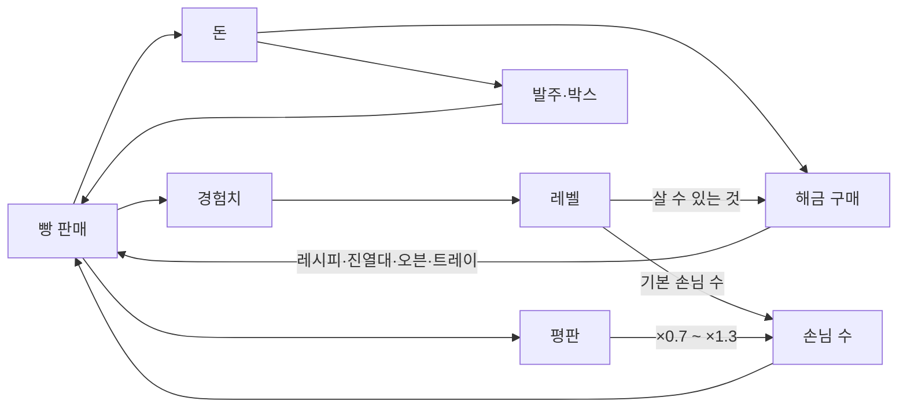

# 08. 성장과 경제

돈, 경험치, 평판 세 가지 숫자가 게임을 굴린다. **돈**은 오늘의 운영 결과이고, **경험치**는 살 수 있는 것을 열어 주며, **평판**은 손님 수를 정한다. 모든 수치는 [`content.json`](../../Assets/_Project/Data/content.json)에 있고, 이 문서의 표는 그 파일과 [밸런스 시뮬레이터](../../Tools/balance/simulate.py)의 결과를 옮긴 것이다.



## 레벨

| 레벨 | 필요 경험치(누적) | 하루 기본 손님 | 임대료 | 새 손님 | 발주에 추가 | 구매할 수 있는 해금 |
| --- | --- | --- | --- | --- | --- | --- |
| 1 | 0 | 12 | 8,000 | 학생, 직장인 | 일반 재료 7종 | - |
| 2 | 40 | 16 | 10,000 | - | 일반 미스터리 박스 (12,000) | 소금빵 레시피 (40,000), 트레이 4 (15,000), 진열대 3 (60,000) |
| 3 | 130 | 20 | 15,000 | 미식가 | - | 바게트 레시피 (70,000), 트레이 5 (25,000), 오븐 2 (150,000) |
| 4 | 280 | 24 | 20,000 | - | 초콜릿, 고급 미스터리 박스 (35,000) | 초코 소라빵 레시피 (110,000), 트레이 6 (40,000), 진열대 4 (120,000) |
| 5 | 540 | 28 | 25,000 | - | - | (MVP 최종 레벨) |

- 레벨은 경험치가 기준을 넘는 순간 오른다 (영업 중에도). 해금은 바로 살 수 있고, 기본 손님 수와 임대료는 **다음 날부터** 바뀐다.
- 해금 총액은 630,000원이다. 시뮬레이션에서는 10일차 전후에 모두 산다.
- 가구 해금은 매장에 미리 놓여 있는 "잠긴 가구"를 여는 방식이다. 가구를 자유롭게 놓는 기능은 MVP 이후로 미뤘다 ([ADR 0008](../decisions/0008-progression-and-locked-furniture.md)).

### 경험치

| 일 | 경험치 |
| --- | --- |
| 빵 1개 판매 | +1 |
| 그 빵이 완벽 품질 | 추가 +1 |
| 그 빵이 비밀 레시피 | 추가 +2 |
| 비밀 레시피 발견 | +20 |
| 하루 마감 | +5 |

## 돈

| 들어오는 돈 | 나가는 돈 |
| --- | --- |
| 빵 판매 (거의 전부) | 재료 발주 (매출의 25~30%) |
| 재료 되팔기 (쓰지 않는 핵심 재료) | 임대료 (매일 정산 때) |
| 지원금 (아침 잔액이 25,000원 미만일 때) | 미스터리 박스 |
| | 해금 구매 |
| | 계산 실수 (거스름돈 과다, 카드 금액 부족) |

- 시작 자금 50,000원, 시작 재료는 8판(이틀 정도) 구울 분량이다.
- **지원금**: 정산이 끝난 뒤 잔액이 25,000원보다 적으면 25,000원까지 채워 준다. 박스에 돈을 다 써서 재료를 살 수 없게 되는 막힘을 없애기 위한 장치다. 리포트에 "지원금"으로 표시한다.
- 금액은 모두 원 단위 정수이고, 가격은 100원 단위다.

### 가격과 결제 금액

```
표시가   = 반올림100( 플레이어가 정한 판매가 × (하루 이상 지난 빵이면 0.7) )
결제 금액 = 반올림100( 표시가 × 품질 배율 )        품질 배율: 덜 익음 0.7 / 보통 1.0 / 완벽 1.2
```

- 판매가는 시세의 50%~250% 범위에서 100원 단위로 정한다. 처음 값은 시세다.
- 반올림100은 100원 단위 반올림이고 50원은 올린다. **배율을 퍼센트 정수로 바꿔 정수로만 계산한다** (`PriceMath.Scale`). 부동소수로 곱하면 5,500 × 0.7이 3,849.9999…가 되어 3,900원이어야 할 값이 3,800원으로 내려간다. 게임과 시뮬레이터가 같은 식을 쓴다.
- 손님의 구매 판단과 예산 확인은 **표시가**로 한다. 품질 배율은 계산대에서만 적용된다.

### 구매 확률

```
구매 확률 = 가격 민감도( 표시가 ÷ 시세 ) × (덜 익은 빵이면 0.6)
조건: 지금까지 담은 표시가 합 + 이 빵 표시가 ≤ 예산
```

가격 민감도는 손님 성향마다 다른 꺾은선이다 (점 사이는 직선으로 잇는다).

| 표시가 ÷ 시세 | 0.7 이하 | 1.0 | 1.1 | 1.15 | 1.2 | 1.3 | 1.35 | 1.5 | 1.6 | 1.7 | 1.8 | 2.0 | 2.5 |
| --- | --- | --- | --- | --- | --- | --- | --- | --- | --- | --- | --- | --- | --- |
| 학생 | 1.00 | 0.95 | 0.85 | | 0.60 | | 0.25 | 0.05 | | 0 | | | |
| 직장인 | 1.00 | 0.97 | | 0.90 | | 0.70 | | 0.35 | | | 0.05 | 0 | |
| 미식가 | 1.00 | 0.98 | | | | 0.90 | | | 0.60 | | | 0.20 | 0 |

기대 매출(가격 × 구매 확률)이 가장 높은 지점은 학생 1.0~1.1배, 직장인 1.1~1.2배, 미식가 1.3배 근처다. 그래서 **빵마다 주로 사는 손님에 맞춰 가격을 다르게** 매기는 것이 이득이다.

## 평판

평판은 0~1000의 정수이고 시작값은 500이다. 화면에는 별 0~5개(200점에 별 하나, 반 개 단위)로 보여준다.

| 일 | 변화 |
| --- | --- |
| 손님 한 명 결제 완료 | +1 |
| 비밀 레시피 발견 | +20 |
| 원하는 빵이 없어서 빈손으로 떠남 | -4 |
| 비싸서 아무것도 안 사고 떠남 | -2 |
| 계산 실수로 손님이 불만 (거스름돈 부족, 카드 과다 입력) | -5 |
| 줄에서 기다리다 떠남 | -10 |

```
하루 손님 수 = 레벨의 기본 손님 수 × (0.7 + 0.6 × 평판 ÷ 1000)
```

평판 500이면 기본 손님 수 그대로, 1000이면 1.3배, 0이면 0.7배다.

## 영업 중 굽기를 만드는 두 규칙

준비 단계에 시간 제한이 없어서, 아무 제한이 없으면 "미리 전부 구워 두고 영업 중에는 계산만" 하는 것이 최선이 된다. 이를 막고 영업 중 굽기에 이유를 주는 규칙 두 가지다 ([ADR 0010](../decisions/0010-trays-aroma-dayold-discount.md)).

| 규칙 | 내용 | 효과 |
| --- | --- | --- |
| **트레이 수 제한** | 굽기를 시작할 때 빈 트레이 1개를 쓴다. 트레이의 빵을 선반에 다 옮기거나 버리면 돌아온다. 처음 3개, 최대 6개 | 미리 구워 쌓아 둘 수 있는 양에 한계가 생긴다 |
| **빵 냄새** | 영업 중 오븐에서 보통 이상 품질의 빵을 꺼내면 60초 동안 손님 생성 속도 ×1.4 | 영업 중에 굽는 것이 손님을 늘린다 |

## 시뮬레이션으로 확인한 것

시뮬레이터는 게임과 같은 `content.json`을 읽어 하루 영업을 0.5초 단위로 돌린다. 전체 결과는 [`Tools/balance/latest_report.md`](../../Tools/balance/latest_report.md)에 있다.

> **읽을 때 주의**: 플레이어가 계산·굽기에 쓰는 시간은 가정값이다 (손님 한 명 계산 약 9~12초, 오븐까지 4초). 실제 플레이 테스트로 잰 값을 넣어 다시 돌려야 한다. 절대 금액보다 전략 사이의 차이를 본다.

### 레벨별 하루 (시세 판매, 예상 수요만큼 준비)

| 레벨 | 방문 | 결제 | 판매 개수 | 매출 | 재료비 | 임대료 | 순이익 | 플레이어가 바쁜 시간 | 경험치 | 평판 |
| --- | --- | --- | --- | --- | --- | --- | --- | --- | --- | --- |
| 1 | 12.5 | 12.1 | 19.2 | 54,095 | 16,407 | 8,000 | 29,688 | 36% | 43 | +11 |
| 2 | 16.4 | 16.0 | 25.9 | 77,203 | 21,792 | 10,000 | 45,412 | 46% | 57 | +15 |
| 3 | 20.7 | 20.1 | 32.1 | 105,302 | 27,069 | 15,000 | 63,233 | 58% | 68 | +18 |
| 4 | 25.2 | 24.0 | 38.1 | 130,108 | 33,814 | 20,000 | 76,294 | 66% | 80 | +18 |
| 5 | 28.5 | 27.0 | 42.3 | 145,832 | 37,799 | 25,000 | 83,032 | 70% | 89 | +19 |

- 레벨 1은 영업 시간의 36%만 바빠서 조작을 익힐 여유가 있고, 레벨 5는 70%까지 올라간다. 가정보다 조작이 느리면 레벨 5에서 줄 이탈이 생기기 시작한다. MVP 이후 계산원 고용이 풀어 줄 압박이다.
- 해금 하나의 가격은 그 레벨 순이익의 1~2일치다 (오븐 2만 2~3일치).

### 가격 (레벨 3, 모든 빵을 같은 비율로)

| 판매가 ÷ 시세 | 판매 개수 | 순이익 | 비싸서 안 산 횟수 | 평판 |
| --- | --- | --- | --- | --- |
| 0.90 | 32.7 | 55,828 | 1.7 | +17 |
| 1.00 | 32.1 | 63,233 | 2.6 | +18 |
| 1.10 | 30.5 | 68,581 | 4.3 | +17 |
| 1.20 | 28.5 | 69,299 | 6.6 | +14 |
| 1.30 | 26.0 | 65,754 | 9.1 | +12 |
| 1.50 | 21.2 | 57,160 | 13.6 | +5 |

- 일괄 인상은 1.1~1.2배에서 순이익이 가장 높고(시세 대비 +10%), 그 이상은 손해다.
- 가격을 올릴수록 판매 개수(경험치)와 평판이 줄어든다. **비싸게 팔면 당장의 이익, 싸게 팔면 성장**이라는 선택이 된다.

### 준비량과 영업 중 굽기 (레벨 3)

| 영업 중 추가 굽기 | 준비량 (예상 수요 대비) | 방문 | 순이익 | 놓친 수요 | 플레이어가 바쁜 시간 |
| --- | --- | --- | --- | --- | --- |
| 한다 | 0.4배 | 22.8 | 62,383 | 6.2 | 70% |
| 한다 | **0.7배** | 21.8 | **66,000** | 3.3 | 64% |
| 한다 | 1.0배 | 20.7 | 63,233 | 1.1 | 58% |
| 한다 | 1.6배 | 19.9 | 52,948 | 0.3 | 54% |
| 안 한다 | 0.4배 | 19.9 | 46,940 | 9.4 | 42% |
| 안 한다 | 1.0배 | 19.9 | 59,625 | 2.0 | 51% |
| 안 한다 | 1.6배 | 19.8 | 52,829 | 0.3 | 53% |

- 조금 모자라게 준비하고 영업 중에 채우는 쪽이 가장 이익이 크다 (미리 다 굽는 최선보다 +11%). 대신 더 바쁘다.
- 너무 많이 구우면(1.6배) 최선보다 20% 손해다. 남은 빵이 다음 날 30% 할인으로 팔리기 때문이다.
- 영업 중에 굽지 않으면서 적게 준비하면(0.4배) 29% 손해다.

### 오븐이 먼저냐, 계산이 먼저냐 (레벨 4)

| 다 구워졌을 때 | 순이익 | 영업 중 구운 판의 완벽 비율 | 탄 비율 |
| --- | --- | --- | --- |
| 오븐부터 간다 | 77,804 | 56% | 0% |
| 줄 선 손님부터 계산한다 | 73,901 | 43% | 23% |

"띵!" 소리에 줄을 두고 오븐으로 가는 것이 평균적으로 이득이지만, 줄이 길면 손님이 떠난다. 재미 포인트 F3의 근거다.

### 평판 (레벨 3)

| 평판 | 방문 | 순이익 |
| --- | --- | --- |
| 200 | 17.3 | 47,648 |
| 500 | 20.7 | 63,233 |
| 800 | 24.4 | 77,185 |
| 1000 | 26.3 | 84,726 |

### 성장 속도 (자동 플레이 60회)

| 레벨 | 도달 평균 | 가장 빠름 | 가장 느림 |
| --- | --- | --- | --- |
| 2 | 1.6일차 | 1 | 2 |
| 3 | 3.3일차 | 2 | 4 |
| 4 | 5.5일차 | 4 | 7 |
| 5 | 8.6일차 | 7 | 11 |

- 첫 비밀 레시피 발견은 평균 5.6일차, 지원금이 필요했던 날은 평균 0.03일이다.
- 레벨 5 이후에는 돈이 계속 쌓인다 (20일차에 100만 원 이상). MVP 범위 밖이지만, 확장(계산원, 보안, 매장 확장)이 이 돈의 쓸 곳이 된다.

## 수치를 고칠 때

| 느낌 | 바꿀 값 (`content.json`) |
| --- | --- |
| 초반이 너무 느리다 / 빠르다 | `progression.xpThresholds`, `economy.startMoney` |
| 영업이 한가하다 / 감당이 안 된다 | `customers.baseCountByLevel`, 손님 `patienceSeconds` |
| 완벽 타이밍이 너무 어렵다 / 쉽다 | 레시피의 `perfectWindowSeconds`, `burnAfterSeconds` |
| 영업 중에 굽지 않게 된다 | `customers.aromaSeconds`, `aromaSpawnMultiplier`, `economy.startTrays` |
| 가격을 올려도 다 산다 / 조금만 올려도 안 산다 | 손님의 `priceSensitivity` |
| 박스가 너무 짜다 / 후하다 | 확률표의 `weight`, `pityThreshold` |
| 돈이 남아돈다 / 모자란다 | 해금 `cost`, `economy.rentByLevel` |

수치를 고친 뒤에는 아래를 실행해 결과를 다시 만들고, 이 문서의 표도 함께 고친다.

```bash
python3 Tools/balance/simulate.py --out Tools/balance/latest_report.md
```
