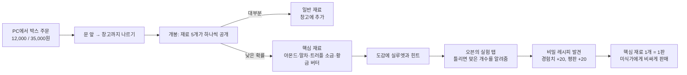

# 09. 미스터리 박스와 도감

레퍼런스의 카드 팩 개봉에 해당하는 재미다. **박스를 뜯어 핵심 재료를 얻고 → 실험으로 비밀 레시피를 찾고 → 한정 메뉴를 비싸게 판다.** 박스는 운, 실험은 추리, 판매는 운영으로 서로 다른 재미를 잇는다.



## 재료의 희귀도

| 희귀도 | 재료 | 얻는 방법 | 개봉 연출 색 |
| --- | --- | --- | --- |
| Common | 밀가루, 버터, 설탕, 우유, 달걀, 팥앙금, 소금 | 발주, 박스 | 흰색 |
| Fine | 초콜릿 | 발주(레벨 4), 박스 | 초록 |
| Fine | **아몬드** (핵심 재료) | 박스에서만 | 초록 |
| Rare | **말차**, **트러플 소금** (핵심 재료) | 박스에서만 | 파랑 |
| Legendary | **황금 버터** (핵심 재료) | 박스에서만 | 금색 |

핵심 재료 하나는 비밀 레시피 하나와 짝을 이룬다.

| 핵심 재료 | 비밀 레시피 | 재료 (한 판) | 개수 | 시세 | 한 판 매출 |
| --- | --- | --- | --- | --- | --- |
| 아몬드 | 아몬드 크루아상 | 밀가루 2, 버터 3, 아몬드 1 | 6 | 4,800 | 28,800 |
| 말차 | 말차 단팥빵 | 밀가루 2, 팥앙금 2, 말차 1 | 6 | 5,000 | 30,000 |
| 트러플 소금 | 트러플 소금빵 | 밀가루 2, 버터 2, 트러플 소금 1 | 6 | 7,000 | 42,000 |
| 황금 버터 | 황금 브리오슈 | 밀가루 2, 달걀 2, 설탕 1, 황금 버터 1 | 4 | 15,000 | 60,000 |

일반 레시피의 한 판 매출은 12,000~22,800원이다. 핵심 재료 하나가 한 판의 가치를 1.5~3배로 올린다.

## 미스터리 박스

| 박스 | 가격 | 해금 | 뽑기 수 | 뽑기 1회의 Rare 이상 확률 | 천장 |
| --- | --- | --- | --- | --- | --- |
| 농장 직송 미스터리 박스 (`loot.basic`) | 12,000 | 레벨 2 | 5 | 5% | Rare 이상 없이 5박스 → 6번째 박스에서 보장 |
| 명인의 미스터리 박스 (`loot.premium`) | 35,000 | 레벨 4 | 5 | 20% | Rare 이상 없이 2박스 → 3번째 박스에서 보장 |

### 뽑기 규칙

`LootService.Open(lootTableId)`의 동작이다. 시뮬레이터의 `open_box`와 같은 규칙이고, 분포 테스트의 기준이다.

```
천장 발동 = (이 확률표의 연속 꽝 횟수 ≥ pityThreshold)
뽑기를 rollsPerBox번 반복:
    마지막 뽑기이고, 천장 발동이고, 이 박스에서 아직 Rare 이상이 없으면
        → Rare 이상 항목만 놓고 가중치로 뽑는다
    아니면
        → 모든 항목에서 가중치로 뽑는다
    뽑힌 항목의 재료를 count개만큼 결과에 추가
이 박스에서 Rare 이상이 나왔으면 연속 꽝 횟수 = 0, 아니면 +1
```

- "꽝"은 Rare 이상이 하나도 없는 박스다. 아몬드(Fine)만 나온 박스도 꽝으로 센다.
- 연속 꽝 횟수는 확률표마다 따로 세고 세이브에 저장한다.
- 난수는 박스 전용 스트림(`lootRng`)을 쓴다. 손님 수에 따라 박스 결과가 달라지지 않게 하고, 테스트에서 시드로 결과를 재현하기 위해서다.

### 확률표

| 재료 | 일반 박스 가중치 (개수) | 고급 박스 가중치 (개수) |
| --- | --- | --- |
| 밀가루 | 14 (2) | 9 (2) |
| 버터 | 12 (1) | 12 (2) |
| 설탕 | 10 (2) | 5 (2) |
| 우유 | 12 (1) | 6 (2) |
| 달걀 | 12 (2) | 7 (2) |
| 팥앙금 | 10 (1) | 6 (2) |
| 소금 | 8 (2) | 3 (2) |
| 초콜릿 | 9 (1) | 20 (2) |
| 아몬드 | 8 (1) | 12 (1) |
| 말차 | 2.25 (1) | 8.5 (1) |
| 트러플 소금 | 2.25 (1) | 8.5 (1) |
| 황금 버터 | 0.5 (1) | 3 (1) |
| 합계 | 100 | 100 |

### 시뮬레이션 결과 (20만 박스)

| 항목 | 일반 박스 | 고급 박스 |
| --- | --- | --- |
| Rare 이상이 나오는 박스 비율 (천장 포함) | 28.7% | 69.7% |
| 같은 비율, 천장이 없다면 (이론값) | 22.6% | 67.2% |
| 천장이 발동한 박스 비율 | 8.0% | 7.5% |
| 가장 길었던 연속 꽝 | 5박스 | 2박스 |
| 함께 나오는 일반 재료의 가치 (발주가 기준) | 4,955원 (가격의 41%) | 8,073원 (가격의 23%) |
| 박스당 아몬드 | 0.40개 | 0.59개 |
| 박스당 말차 + 트러플 소금 | 0.28개 | 0.87개 |
| 박스당 황금 버터 | 0.03개 | 0.15개 |

| 목표 | 평균 | 운이 나쁜 10% |
| --- | --- | --- |
| 일반 박스에서 첫 아몬드 | 3.0박스 | 6박스 |
| 일반 박스에서 첫 Rare 이상 | 3.5박스 | 6박스 |
| 일반 박스에서 첫 황금 버터 | 32박스 | 73박스 |
| 고급 박스에서 첫 Rare 이상 | 1.4박스 | 3박스 |
| 고급 박스에서 첫 황금 버터 | 6.9박스 | 15박스 |

설계 의도:

- 꽝 박스는 가격의 절반 이하만 돌려받아서 아쉽고, 핵심 재료가 나오면 박스 값의 몇 배를 벌어서 기쁘다.
- 아몬드는 금방 나와서(평균 3박스) 실험과 도감을 일찍 경험하게 한다. 황금 버터는 고급 박스가 열린 뒤의 장기 목표다.
- 천장은 "6박스째에는 반드시"라는 약속이다. 운이 나쁜 10%도 6박스 안에 Rare 이상을 얻는다.

### 개봉 연출

1. 박스를 든 채 창고 선반을 보고 E → 박스가 선반 앞에 놓이고 뚜껑이 열린다.
2. 재료가 0.6초 간격으로 하나씩 튀어나와 희귀도 색으로 빛난다. 소리의 높이가 희귀도에 따라 올라간다.
3. 마지막 재료가 Rare 이상이면 나오기 전에 1초 뜸을 들인다.
4. E를 누르면 남은 연출을 건너뛴다.

결과는 E를 누른 순간 이미 창고에 반영되어 있다. 연출은 보여주기만 하므로, 연출 도중에 게임을 꺼도 재료가 사라지거나 두 번 들어오지 않는다. 일반 재료 묶음 박스는 연출 없이 바로 열린다.

## 실험

오븐 패널의 **실험** 탭에서 한다. 오븐이 굽는 중이어도 할 수 있고, 시간이 걸리지 않는다.

### 규칙

1. 핵심 재료 하나를 고른다. 가지고 있고, 짝이 되는 레시피를 아직 발견하지 못한 것만 고를 수 있다.
2. 도감이 알려주는 칸 수만큼 다른 재료를 고른다 (2칸 또는 3칸). 고를 수 있는 재료는 Common 7종과 초콜릿이다.
3. **실험하기**를 누르면 고른 일반 재료를 1개씩 소모하고 판정한다.

| 결과 | 조건 | 일어나는 일 |
| --- | --- | --- |
| 발견 | 고른 재료 종류가 레시피와 전부 일치 | 비밀 레시피 발견. 도감 등록, 경험치 +20, 평판 +20 |
| 실패 | 하나라도 다름 | "n개가 맞았다"를 알려주고, 시도 내용을 실험 기록에 남긴다 |

- **핵심 재료는 실험에서 소모하지 않는다.** 귀한 재료를 실패로 잃지 않게 해서 실험을 망설이지 않게 한다.
- 재료의 수량은 맞히지 않는다. 종류만 맞히면 된다.
- 실험 기록(시도한 조합과 맞은 개수)은 핵심 재료별로 저장되고 실험 탭에 계속 보인다.

### 추리가 되는 이유

다른 재료 2칸을 8종에서 고르는 경우의 수는 28가지, 3칸은 56가지다. 지금까지의 결과와 모순되지 않는 조합만 골라 가면 **평균 4~5번, 많아도 7번** 안에 찾는다 (가능한 정답 84가지를 모두 계산: 평균 4.4번). 도감의 힌트 문장을 읽고 추측하면 1~2번이면 된다. 실험 한 번의 비용은 일반 재료 2~3개(약 1,500~2,500원)다.

### 도감의 상태

| 상태 | 조건 | 도감에 보이는 것 |
| --- | --- | --- |
| 숨김 | 핵심 재료를 한 번도 얻지 못함 | "???" |
| 힌트 | 핵심 재료를 처음 얻음 | 실루엣, 힌트 문장, 재료 칸 수, 실험 기록 |
| 발견 | 실험 성공 | 이름, 재료와 수량, 시세, 지금까지 판 개수 |

일반 레시피는 라이선스를 사면 바로 "발견" 상태로 도감에 실린다.

## 핵심 재료 되팔기

PC 발주 앱의 **재료 판매** 탭에서 모든 재료를 되팔 수 있다 (핵심 재료: 아몬드 2,000 / 말차 6,000 / 트러플 소금 8,000 / 황금 버터 25,000원). 레시피를 아직 못 찾았거나 급하게 돈이 필요할 때의 선택지다. 구워서 파는 쪽이 항상 더 많이 벌지만, 손님과 오븐 시간이 필요하다.

## 구현 메모

| 대상 | 형태 | 테스트 |
| --- | --- | --- |
| `LootService` | 순수 C#. `Open(tableId)` → `IReadOnlyList<LootDrop>` | 시드 고정 결과, 10만 박스 분포가 가중치와 맞는지(오차 1%p 이내), 천장 보장, 연속 꽝 카운터 |
| `RecipeBook` | 순수 C#. `Experiment(keyIngredientId, otherIngredientIds)` → `ExperimentResult` | 발견, 맞은 개수 계산, 핵심 재료 미소모, 이미 발견한 레시피 거부, 재료 부족 거부 |
| `BoxOpenSequence` | MonoBehaviour. `BoxOpened` 이벤트를 받아 연출만 재생 | 플레이 테스트 |

작업 단위와 시그니처는 [M5 구현 계획](../plan/M5-growth-and-collection.md)에 있다.
