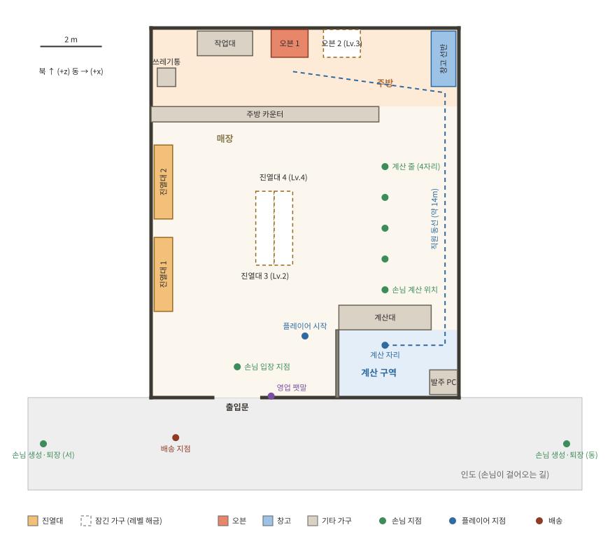

# 11. 매장 배치

매장은 **매장 구역, 계산 구역, 주방** 세 구역으로 나뉜다. 손님은 매장 구역만 다니고, 플레이어는 계산 구역과 주방을 잇는 동쪽 통로로 오간다. 이 문서의 좌표가 그레이박스 씬(`ShopSceneBuilder`)의 기준이다.



좌표 단위는 미터이고 Unity의 x(동), z(북)와 같다. 바닥은 y = 0이다. 좌표의 원본은 [`shop_layout.json`](../../Assets/_Project/Data/shop_layout.json)이고, 평면도([`Tools/docs/shop_layout.py`](../../Tools/docs/shop_layout.py))와 그레이박스 씬(`ShopSceneBuilder`)이 같은 파일을 읽는다. 배치를 바꿀 때는 JSON을 고치고 스크립트와 씬 빌더를 다시 실행한다.

## 배치의 의도

| 결정 | 이유 |
| --- | --- |
| 계산대와 오븐을 매장의 반대편 끝에 둔다 (걸어서 약 14m, 4초) | "계산 줄이냐 오븐이냐"의 선택에 이동 시간이라는 비용이 생긴다 (재미 포인트 F3) |
| 배송 지점을 문밖에, 창고를 주방 안쪽에 둔다 (약 13m) | 박스를 들고 매장을 가로지르는 동선이 생긴다 (F1) |
| 동쪽에 직원 통로를 둔다 | 계산 줄(x = 2.6)과 플레이어 동선(x = 4.55)이 겹치지 않는다 |
| 계산 줄을 매장 안쪽(북쪽)으로 뻗게 한다 | 줄이 길어져도 출입문을 막지 않는다 |
| 잠긴 가구를 처음부터 제자리에 둔다 | 해금해도 길이 바뀌지 않아 NavMesh를 다시 굽지 않아도 된다 |

## 공간

| 구역 | 범위 (x, z) | 비고 |
| --- | --- | --- |
| 매장 전체 (실내) | x −5 ~ 5, z −6 ~ 6 | 벽 높이 3, 두께 0.2 |
| 출입문 | 남쪽 벽, x −3.0 ~ −1.4 | 문짝 없이 뚫린 입구 |
| 계산 구역 | x 1.1 ~ 5, z −6 ~ −3.8 | 동쪽 끝(x 4.1 ~ 5)으로 드나든다 |
| 주방 | x −5 ~ 5, z 3.45 ~ 6 | 동쪽 끝(x 2.4 ~ 5)으로 드나든다 |
| 인도 (실외) | x −9 ~ 9, z −9 ~ −6 | 손님이 걸어오는 길, 배송 지점 |

## 가구

| ID | 이름 | 중심 (x, z) | 크기 (x × z) | 높이 |
| --- | --- | --- | --- | --- |
| `counter.01` | 계산대 | (2.6, -3.4) | 3 × 0.8 | 0.9 |
| `partition` | 칸막이 | (1.05, -4.9) | 0.1 × 2.2 | 1.2 |
| `pc.01` | 발주 PC | (4.5, -5.5) | 0.9 × 0.8 | 0.8 |
| `shelf.01` | 진열대 1 | (-4.6, -2) | 0.6 × 2.4 | 1.2 |
| `shelf.02` | 진열대 2 | (-4.6, 1) | 0.6 × 2.4 | 1.2 |
| `shelf.03` | 진열대 3 (Lv.2) | (-1.3, -0.5) | 0.6 × 2.4 | 1.2 |
| `shelf.04` | 진열대 4 (Lv.4) | (-0.7, -0.5) | 0.6 × 2.4 | 1.2 |
| `divider` | 주방 카운터 | (-1.3, 3.2) | 7.4 × 0.5 | 0.9 |
| `table.01` | 작업대 | (-2.6, 5.5) | 1.8 × 0.8 | 0.9 |
| `oven.01` | 오븐 1 | (-0.5, 5.5) | 1.2 × 0.9 | 1.4 |
| `oven.02` | 오븐 2 (Lv.3) | (1.2, 5.5) | 1.2 × 0.9 | 1.4 |
| `storage.01` | 창고 선반 | (4.5, 5) | 0.8 × 1.8 | 2 |
| `trash.01` | 쓰레기통 | (-4.5, 4.4) | 0.6 × 0.6 | 0.8 |

- 계산대, 주방 카운터, 칸막이는 손님과 플레이어의 길을 나누는 장애물이다.
- `shelf.03`, `shelf.04`, `oven.02`는 잠긴 상태로 시작한다 ([08 문서](08-progression-and-economy.md)의 해금).

## 지점

| 지점 | 위치 (x, z) |
| --- | --- |
| 플레이어 시작 | (0, -4) |
| 계산 자리 | (2.6, -4.3) |
| 손님 계산 위치 | (2.6, -2.5) |
| 줄 1 | (2.6, -1.5) |
| 줄 2 | (2.6, -0.5) |
| 줄 3 | (2.6, 0.5) |
| 줄 4 | (2.6, 1.5) |
| 손님 입장 지점 | (-2.2, -5) |
| 손님 생성·퇴장 (서) | (-8.5, -7.5) |
| 손님 생성·퇴장 (동) | (8.5, -7.5) |
| 배송 지점 | (-4.2, -7.3) |
| 영업 팻말 | (-1.1, -5.95) |

### 진열대 칸과 손님이 서는 자리

진열대마다 칸이 3개이고, 칸 사이는 0.8m다.

| 진열대 | 바라보는 방향 | 칸 0 / 1 / 2 의 z | 손님이 서는 x |
| --- | --- | --- | --- |
| `shelf.01` | 동쪽 | −2.8 / −2.0 / −1.2 | −3.7 |
| `shelf.02` | 동쪽 | 0.2 / 1.0 / 1.8 | −3.7 |
| `shelf.03` | 서쪽 | −1.3 / −0.5 / 0.3 | −2.2 |
| `shelf.04` | 동쪽 | −1.3 / −0.5 / 0.3 | 0.2 |

빵은 칸 위(높이 0.9)에 2 × 3으로 놓인다. 칸 앞 가격표는 높이 1.25에 붙는다.

### 플레이어가 서는 자리

| 대상 | 서는 위치 (x, z) |
| --- | --- |
| 오븐 1 / 오븐 2 | (−0.5, 4.6) / (1.2, 4.6) |
| 작업대 | (−2.6, 4.7) |
| 창고 선반 | (3.7, 5.0) |
| 발주 PC | (3.7, −5.3) |
| 계산대 | (2.6, −4.3) |

## 물건의 크기

| 물건 | 크기 (x × y × z) | 비고 |
| --- | --- | --- |
| 플레이어 | 캡슐 높이 1.8, 반지름 0.35, 눈높이 1.6 | M1에서 정한 값 |
| 배송 박스 | 0.5 × 0.5 × 0.5 | 미스터리 박스는 색이 다르다 |
| 빵 트레이 | 0.6 × 0.08 × 0.4 | 빵이 2 × 3으로 올라간다 |
| 빵 | 약 0.16 × 0.1 × 0.12 | 종류별 색과 모양 |
| 손님 | 캡슐 높이 1.7, 반지름 0.3 | NavMeshAgent 반지름 0.3 |

## 씬 구성

`Assets/_Project/Scenes/Shop.unity`. 고정 ID는 세이브와 해금에서 가구를 찾는 열쇠다.

```
Shop
├── [Bootstrap]        GameBootstrap, ContentDatabase 참조
├── [Environment]      바닥, 벽, 인도, 조명, NavMeshSurface
├── [Furniture]
│   ├── counter.01     CheckoutCounterView
│   ├── pc.01          PcTerminal
│   ├── shelf.01 ~ 04  ShelfView (칸 3개), LockedFurniture (03, 04)
│   ├── oven.01 ~ 02   OvenView, LockedFurniture (02)
│   ├── table.01       작업대 (트레이를 올려 두는 평평한 면)
│   ├── storage.01     StorageZone
│   ├── trash.01       TrashBin
│   └── sign.01        OpenSign
├── [Points]           ShopLayout (입장·퇴장·줄·배송 지점, 칸 앞 자리)
├── [Player]           M1의 플레이어
├── [Pools]            손님, 빵, 박스, 트레이 풀
└── [UI]               HUD, 패널들 (PanelHost)
```

## 길 찾기와 충돌

| 항목 | 설정 | 이유 |
| --- | --- | --- |
| NavMesh | 매장 구역과 인도만 걸을 수 있게 굽는다. 주방과 계산 구역은 `NavMeshModifierVolume`으로 제외 | 손님이 주방이나 계산대 안쪽으로 들어오지 않게 |
| 손님끼리 | NavMeshAgent 회피 사용, 줄에서는 자리를 하나씩 배정 | [05 문서](05-customer-and-checkout.md)의 계산 줄 규칙 |
| 플레이어와 손님 | 서로 충돌하지 않는다 (레이어 `Player` × `Customer` 충돌 끔) | 좁은 통로에서 손님에게 막혀 갇히는 문제를 처음부터 없앤다 |
| 손에 든 물건 | 충돌을 끄고 벽 앞에서 당겨온다 | [04 문서](04-player-interaction.md)의 M1 트러블슈팅 결과 |

레이어: `Player`, `Customer`, `Item`(박스·트레이), 나머지는 `Default`.
