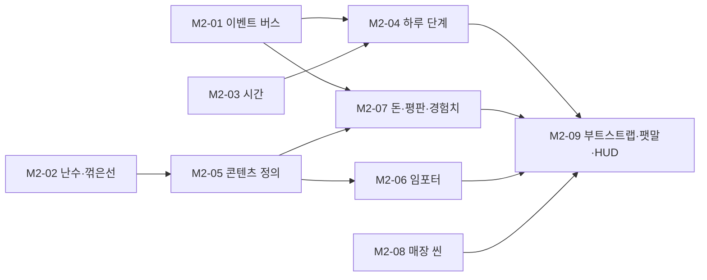

# M2. 코어와 매장 그레이박스

> 끝났을 때 되는 것: 실제 배치의 매장을 걸어 다니고, 문 옆 팻말을 돌리면 HUD의 시계가 09:00부터 흐르다가 6분 뒤 18:00에 "마감"으로 바뀐다. 눈에 보이는 것은 적지만, 이후의 모든 시스템이 이 위에 올라간다.

관련 설계: [01. 런타임 구조](../design/01-runtime-structure.md), [02. 하루 흐름과 시간](../design/02-day-cycle-and-time.md), [03. 데이터 모델](../design/03-data-model.md), [11. 매장 배치](../design/11-shop-layout.md)



## M2-01. 이벤트 버스

**목적**: 시스템과 뷰가 서로를 모른 채 "일어난 일"을 주고받는 통로를 만든다.

**파일**

- `Scripts/Core/EventBus.cs`
- `Scripts/Events/DayEvents.cs` (이 작업에서는 파일과 네임스페이스만. 이벤트는 쓰는 작업에서 추가한다)
- `Tests/EditMode/Core/EventBusTests.cs`
- 기존 테스트를 `Tests/EditMode/Player/`, `Tests/EditMode/Interaction/`으로 옮긴다

**공개 API**

```csharp
namespace BakeryShop.Core
{
    public sealed class EventBus
    {
        public void Subscribe<T>(Action<T> handler) where T : struct;
        public void Unsubscribe<T>(Action<T> handler) where T : struct;
        public void Publish<T>(in T evt) where T : struct;

        /// <summary>개발용. 발행되는 모든 이벤트를 받는다 (이벤트 로그 화면에서 사용).</summary>
        public Action<Type, object> Trace;
    }
}
```

**규칙**

- 타입마다 핸들러 목록을 따로 둔다. 구독한 순서대로 호출한다.
- 발행하는 도중에 구독·해제가 일어나도 안전하다. 발행을 시작할 때의 목록을 따라 호출하되, 도중에 해제된 핸들러는 건너뛰고 도중에 구독한 핸들러는 다음 발행부터 받는다.
- 핸들러 안에서 다른 이벤트를 발행해도 된다 (중첩 발행).
- 같은 핸들러를 두 번 구독하면 한 번만 등록한다. 등록하지 않은 핸들러의 해제는 무시한다.
- 핸들러의 예외는 삼키지 않는다. 개발 중에 바로 드러나야 한다.
- `Trace`가 null이면 박싱이 일어나지 않게 한다 (`Trace`가 있을 때만 `object`로 바꾼다).

**테스트**

- 구독한 핸들러가 발행된 값을 받는다
- 다른 타입의 이벤트는 받지 않는다
- 해제한 뒤에는 받지 않는다
- 구독한 순서대로 호출된다
- 같은 핸들러를 두 번 구독해도 한 번만 호출된다
- 핸들러 안에서 자기 자신을 해제해도 나머지 핸들러가 호출된다
- 핸들러 안에서 다른 이벤트를 발행하면 그 구독자도 호출된다
- `Trace`가 타입과 값을 받는다

**의존**: M1

## M2-02. 난수와 꺾은선

**목적**: 재현할 수 있는 난수와, `content.json`의 점 목록을 읽는 보간 함수를 만든다.

**파일**

- `Scripts/Core/Rng.cs`, `Scripts/Core/PiecewiseCurve.cs`
- `Scripts/Data/CurvePoint.cs`
- `Tests/EditMode/Core/RngTests.cs`, `PiecewiseCurveTests.cs`

**공개 API**

```csharp
namespace BakeryShop.Core
{
    /// <summary>xorshift32. 상태가 uint 하나라 세이브에 그대로 저장한다.</summary>
    public sealed class Rng
    {
        public Rng(uint seed);
        public uint State { get; }
        public void Restore(uint state);

        public uint NextUInt();
        public float NextFloat();                                // 0 이상 1 미만
        public int Range(int minInclusive, int maxInclusive);    // 양 끝 포함
        public bool Chance(float probability);                   // NextFloat() < probability
        public int PickWeighted(IReadOnlyList<float> weights);   // 뽑힌 인덱스. 합이 0 이하면 -1
    }

    public static class PiecewiseCurve
    {
        public static float Evaluate(IReadOnlyList<CurvePoint> points, float x);
        public static float Mean(IReadOnlyList<CurvePoint> points, float from, float to);
    }
}

namespace BakeryShop.Data
{
    [Serializable]
    public struct CurvePoint { public float X; public float Y; }
}
```

**규칙**

- xorshift32: `x ^= x << 13; x ^= x >> 17; x ^= x << 5;`. 시드나 복원값이 0이면 `0x9E3779B9`로 바꾼다 (0에서는 수열이 멈춘다).
- `NextFloat` = `(NextUInt() >> 8) × 2⁻²⁴`. 1.0이 나오지 않는다.
- `PickWeighted`: `x = NextFloat() × 합`, 앞에서부터 가중치를 더해 가며 `x < 누적`인 첫 항목. 시뮬레이터의 `pick_weighted`와 같은 규칙이다. 가중치가 0인 항목은 뽑히지 않는다.
- `Evaluate`: 첫 점보다 왼쪽은 첫 점의 y, 마지막 점보다 오른쪽은 마지막 점의 y, 그 사이는 직선 보간. 시뮬레이터의 `curve`와 같은 규칙이다.
- `Mean`: 구간의 사다리꼴 적분을 길이로 나눈 값.

**테스트**

- 시드 1의 첫 세 값이 270369, 67634689, 2647435461이다 (xorshift32의 알려진 값)
- 같은 시드는 같은 수열을 낸다
- `State`를 저장했다가 `Restore`하면 이어지는 수열이 같다
- 시드 0도 멈추지 않는다
- `NextFloat` 10만 번이 모두 0 이상 1 미만이다
- `Range(3, 5)` 1만 번에 3, 4, 5가 모두 나오고 다른 값은 없다
- `PickWeighted([1, 3])` 10만 번의 비율이 25% / 75%에서 1%p 이내다
- `PickWeighted([0, 1, 0])`은 항상 1이다
- `PickWeighted([])`와 `PickWeighted([0, 0])`은 -1이다
- `Evaluate`: 점 위의 값, 두 점의 중간, 범위 밖 양쪽, 점이 하나뿐일 때
- `Evaluate`: 학생 곡선에서 1.15 → 0.725, 1.25 → 0.4833 (허용 오차 0.001)
- `Mean`: y가 일정한 곡선의 평균은 그 값이다
- `Mean`: 영업 시간 곡선의 540~1080 평균이 1.0944다 (허용 오차 0.001)

**의존**: M1

## M2-03. 시간

**목적**: 모든 시간 계산이 거치는 시계 두 개를 만든다.

**파일**

- `Scripts/Core/TimeService.cs`
- `Tests/EditMode/Core/TimeServiceTests.cs`

**공개 API**

```csharp
namespace BakeryShop.Core
{
    public sealed class TimeService
    {
        public TimeService(int openMinutes, int closeMinutes, float openRealSeconds);

        public double SimTime { get; }            // 초. 일시정지가 아니면 항상 흐른다
        public float SimDelta { get; }            // 이번 프레임에 흐른 양
        public float ShopClockMinutes { get; }    // 개점 시각 ~ 폐점 시각 (540 ~ 1080)
        public bool IsPaused { get; }
        public bool IsClockRunning { get; }
        public bool HasReachedClose { get; }

        public void Advance(float realDeltaSeconds);
        public void SetPaused(bool paused);
        public void StartClock();                 // 개점: 개점 시각에서 흐르기 시작
        public void StopClock();                  // 폐점: 그 자리에서 멈춤
        public void ResetClock();                 // 다음 날: 개점 시각으로 되돌리고 멈춤
        public void RestoreSimTime(double simTime);
    }
}
```

**규칙**

- `Advance`의 입력이 음수이거나 NaN이면 0으로, 0.25초보다 크면 0.25초로 자른다 (창을 옮기거나 멈췄다 돌아왔을 때 시간이 한꺼번에 건너뛰지 않게).
- 일시정지 중에는 `SimDelta`가 0이고 두 시계 모두 멈춘다.
- 영업 시계는 `SimDelta × (폐점 − 개점) ÷ openRealSeconds`만큼 흐른다 (기본값으로 1초에 1.5분). 폐점 시각을 넘지 않는다.
- `SimTime`은 `double`이다. `float`로는 몇 시간 뒤에 프레임 단위의 정밀도를 잃는다.

**테스트**

- 처음에는 `SimTime` 0, 영업 시계는 개점 시각이고 멈춰 있다
- 시계가 멈춘 채로 `Advance`하면 `SimTime`만 늘어난다
- `StartClock` 뒤 360초를 흘리면 영업 시계가 1080이고 `HasReachedClose`가 참이다
- 폐점 시각을 넘겨 더 흘려도 1080에서 멈춘다
- 일시정지 중에는 `SimDelta`가 0이고 `SimTime`이 그대로다
- 1초를 한 번에 넘기면 0.25초만 흐른다
- 음수와 NaN은 0으로 처리한다
- `ResetClock` 뒤에는 개점 시각이고 멈춰 있다

**의존**: M1

## M2-04. 하루 단계

**목적**: 준비 → 영업 → 마감 → 정산의 전환 규칙을 한 곳에 모은다.

**파일**

- `Scripts/Core/DayCycle.cs`, `Scripts/Core/IDayEndStep.cs`
- `Scripts/Events/DayEvents.cs` (`DayPhaseChanged`, `DayAdvanced`)
- `Tests/EditMode/Core/DayCycleTests.cs`

**공개 API**

```csharp
namespace BakeryShop.Core
{
    public enum DayPhase { Preparation, Open, Closing, Settlement }

    public interface IDayEndStep
    {
        void OnDayEnd(int day);
    }

    public sealed class DayCycle
    {
        public DayCycle(TimeService time, EventBus bus);

        public int Day { get; }                              // 1부터
        public DayPhase Phase { get; }

        public void AddDayEndStep(int order, IDayEndStep step);   // order가 작은 것부터 실행된다
        public void SetShopEmptyCheck(Func<bool> isEmpty);   // 손님이 남아 있는지 (M4에서 연결)

        public void Begin();                                 // 준비 단계 시작을 알린다
        public bool TryOpenShop();                           // Preparation → Open
        public void Tick();                                  // Open에서 폐점 시각이 되면 Closing으로
        public bool CanSettle { get; }
        public bool TrySettle();                             // Closing → Settlement
        public bool StartNextDay();                          // Settlement → Preparation
        public void RestoreDay(int day);
    }
}

namespace BakeryShop.Events
{
    public readonly struct DayPhaseChanged { public readonly int Day; public readonly DayPhase Previous; public readonly DayPhase Current; }
    public readonly struct DayAdvanced { public readonly int NewDay; }
}
```

**규칙**

- 전환은 표의 명령으로만 일어난다. 조건이 맞지 않으면 `false`를 돌려주고 아무것도 바꾸지 않는다.

| 명령 | 조건 | 하는 일 |
| --- | --- | --- |
| `TryOpenShop` | `Preparation` | `Open`으로, `TimeService.StartClock()` |
| `Tick` | `Open`이고 `HasReachedClose` | `Closing`으로, `StopClock()` |
| `TrySettle` | `Closing`이고 매장이 비어 있음 | 아래 순서 |
| `StartNextDay` | `Settlement` | `Preparation`으로, `ResetClock()` |

- `TrySettle`의 순서: ① `Settlement`로 바꾸고 `DayPhaseChanged` 발행 ② 등록된 `IDayEndStep`을 `order`가 작은 것부터 실행 (같으면 등록한 순서) ③ `Day`를 1 올림 ④ `DayAdvanced` 발행. 모두 한 호출 안에서 동기적으로 끝난다. 세이브(M6)는 `DayAdvanced`를 받아 저장한다.
- 정산 단계의 `DayPhaseChanged.Day`는 끝난 날이고, 다음 날 준비 단계의 `Day`는 새 날이다.
- `SetShopEmptyCheck`를 부르지 않았으면 항상 비어 있는 것으로 본다.

**테스트**

- `Begin`이 `Preparation`의 `DayPhaseChanged`를 발행한다
- 준비 단계에서 `TryOpenShop`이 성공하고 시계가 흐르기 시작한다
- 영업 중에 `TryOpenShop`은 실패하고 이벤트가 없다
- 폐점 시각이 되면 `Tick`이 `Closing`으로 바꾼다
- 영업 중에 `TrySettle`은 실패한다
- 손님이 남아 있으면 `TrySettle`이 실패하고, 비면 성공한다
- `TrySettle`이 하루 마무리 단계를 `order` 순서로 실행하고(등록 순서를 뒤섞어도), 단계가 받은 `day`는 끝난 날이다
- `TrySettle` 뒤 `Day`가 1 늘고 `DayAdvanced`가 발행된다
- `StartNextDay` 뒤 `Preparation`이고 시계가 개점 시각이다
- 이틀을 연속으로 돌려도 순서가 유지된다

**의존**: M2-01, M2-03

## M2-05. 콘텐츠 정의와 데이터베이스

**목적**: 재료·레시피·상품·확률표·손님·해금·설정의 타입과, ID로 찾는 데이터베이스, 검증기를 만든다.

**파일**

- `Scripts/Data/`: `Enums.cs`, `IngredientAmount.cs`, `IngredientData.cs`, `RecipeData.cs`, `ProductData.cs`, `LootTable.cs`, `CustomerProfile.cs`, `UnlockData.cs`, `GameConfig.cs`, `ContentDatabase.cs`, `ContentValidator.cs`, `ContentJson.cs`
- `Tests/EditMode/TestContent.cs` (테스트용 작은 콘텐츠)
- `Tests/EditMode/Data/ContentDatabaseTests.cs`, `ContentValidatorTests.cs`

**공개 API**

```csharp
namespace BakeryShop.Data
{
    public enum Rarity { Common, Fine, Rare, Legendary }
    public enum BreadQuality { Undercooked, Normal, Perfect, Burnt }
    public enum ProductKind { IngredientPack, MysteryBox }
    public enum UnlockKind { RecipeLicense, Furniture, Tray }

    [Serializable] public struct IngredientAmount { public string IngredientId; public int Count; }
    [Serializable] public struct LootEntry { public string IngredientId; public float Weight; public int Count; }
    [Serializable] public struct RecipeWeight { public string RecipeId; public float Weight; }

    public sealed class RecipeData : ScriptableObject
    {
        public string Id { get; }
        public string DisplayName { get; }
        public IReadOnlyList<IngredientAmount> Ingredients { get; }
        public int Yield { get; }
        public int MarketPrice { get; }
        public float BakeSeconds { get; }
        public float PerfectWindowSeconds { get; }
        public float BurnAfterSeconds { get; }
        public int ShelfLifeDays { get; }
        public bool IsSecret { get; }
        public string KeyIngredientId { get; }        // 비밀 레시피가 아니면 빈 문자열
        public string Hint { get; }
        public int OtherIngredientCount { get; }      // 핵심 재료를 뺀 재료 종류 수 (실험의 칸 수)
        public Sprite Icon { get; }
        public GameObject BreadPrefab { get; }

        internal void Apply(RecipeJson json);         // 수치만 덮어쓴다. Icon, BreadPrefab은 건드리지 않는다
    }
    // IngredientData, ProductData, LootTable, CustomerProfile, UnlockData도 같은 모양이다.
    // 필드는 03 문서의 표를 따른다.

    public sealed class GameConfig : ScriptableObject
    {
        public DayConfig Day { get; }
        public EconomyConfig Economy { get; }
        public OvenConfig Oven { get; }
        public ShelfConfig Shelf { get; }
        public CustomerConfig Customers { get; }
        public ReputationConfig Reputation { get; }
        public ProgressionConfig Progression { get; }
        public DeliveryConfig Delivery { get; }
    }

    public sealed class ContentDatabase : ScriptableObject
    {
        public GameConfig Config { get; }
        public IReadOnlyList<IngredientData> Ingredients { get; }
        public IReadOnlyList<RecipeData> Recipes { get; }
        public IReadOnlyList<ProductData> Products { get; }
        public IReadOnlyList<LootTable> LootTables { get; }
        public IReadOnlyList<CustomerProfile> CustomerProfiles { get; }
        public IReadOnlyList<UnlockData> Unlocks { get; }

        public RecipeData Recipe(string id);                            // 없으면 예외
        public bool TryGetRecipe(string id, out RecipeData recipe);     // 세이브 복원처럼 없을 수 있을 때
        // Ingredient, Product, LootTable, Unlock도 같은 두 가지 모양

        public RecipeData SecretRecipeFor(string keyIngredientId);      // 없으면 null
        public IReadOnlyList<IngredientData> ExperimentChoices { get; } // 발주 상품에 들어 있는 재료 (실험에서 고를 수 있는 재료)
    }

    public static class ContentValidator
    {
        /// <summary>문제를 사람이 읽을 문장으로 돌려준다. 비어 있으면 통과.</summary>
        public static List<string> Validate(ContentDatabase database);
    }
}
```

**규칙**

- 정의의 필드는 `[SerializeField] private`이고 읽기 전용 프로퍼티로만 내보낸다. 값을 쓰는 길은 `internal Apply(…Json)` 하나다 (임포터와 테스트가 쓴다).
- `ContentJson.cs`에는 `content.json`의 모양을 그대로 옮긴 단순 클래스(`ContentJson`, `RecipeJson` …)를 둔다. 런타임 어셈블리에 두지만 게임 실행 중에는 쓰지 않는다.
- `ContentDatabase`는 처음 조회할 때 `id → 정의` 딕셔너리를 만든다.
- `ExperimentChoices`는 "`IngredientPack` 상품의 내용물에 들어 있는 재료"로 계산한다 (지금은 일반 재료 7종과 초콜릿). 목록을 코드에 적지 않는다.
- `GameConfig`의 묶음 이름과 필드는 `content.json`의 `config`와 같다.

`ContentValidator`가 확인하는 것:

| 대상 | 확인 |
| --- | --- |
| 전체 | ID가 비어 있지 않고 중복되지 않는다 |
| 레시피 | 재료 ID가 존재한다. 수량·개수·시세·굽는 시간이 0보다 크다 |
| 비밀 레시피 | 핵심 재료가 존재하고 재료 목록에 들어 있다. 핵심 재료 하나는 레시피 하나에만 쓰인다. 나머지 재료는 모두 `ExperimentChoices`에 있다 |
| 상품 | 내용물의 재료 ID, 확률표 ID가 존재한다. 종류에 맞는 필드가 채워져 있다 |
| 확률표 | 재료 ID가 존재한다. 가중치의 합이 0보다 크다. 천장이 보장할 항목(`pityMinRarity` 이상)이 하나 이상 있다 |
| 손님 | 선호 목록의 레시피 ID가 존재한다. 레벨별 비중의 길이가 레벨 수와 같다. 가격 민감도의 x가 오름차순이다. 예산의 최소 ≤ 최대 |
| 해금 | 레시피 라이선스의 대상 레시피가 존재하고 비밀 레시피가 아니다 |
| 설정 | 레벨별 배열(`xpThresholds`, `rentByLevel`, `baseCountByLevel`)의 길이가 같다. 시작 레시피와 시작 재료의 ID가 존재한다 |

**테스트**

- `ContentDatabase`: ID로 찾기, 없는 ID는 예외, `TryGet`은 false, `SecretRecipeFor`, `ExperimentChoices`, `OtherIngredientCount`
- `ContentValidator`: 올바른 `TestContent`는 문제 0개. 표의 항목마다 하나씩 깨뜨린 콘텐츠는 문제가 정확히 1개이고 문장에 해당 ID가 들어 있다

`TestContent`가 만드는 콘텐츠 (규칙 테스트 전체가 함께 쓴다):

| 종류 | 내용 |
| --- | --- |
| 재료 | `ing.a`, `ing.b`, `ing.c` (Common, 발주 가능), `ing.key` (Rare, 박스에서만) |
| 레시피 | `bread.plain` (a 2, b 1 → 4개, 시세 1,000, 굽기 10초, 완벽 구간 5초, 타기까지 20초, 보관 1일), `bread.long` (a 1, c 1 → 2개, 시세 3,000, 보관 2일), `bread.secret` (a 1, b 1, key 1 → 2개, 시세 5,000, 비밀) |
| 상품 | 재료 a·b·c 묶음 (10개, 1,000원), 박스 `product.box` (2,000원, 레벨 2) |
| 확률표 | `loot.test` (뽑기 3회, a 90 / key 10, 천장 2) |
| 손님 | `customer.test` (예산 2,000~4,000, 최대 2개, 인내심 30초, 현금 50%) |
| 해금 | `unlock.recipe.long` (레벨 2, 5,000원), `unlock.tray.3` (레벨 2, 1,000원), `unlock.shelf.02` (레벨 3, 3,000원) |
| 설정 | 레벨 3단계 (`[0, 10, 30]`), 시작 트레이 2개, 칸 3개 × 4개 |

**의존**: M2-02

## M2-06. `content.json` 임포터

**목적**: `content.json`을 읽어 ScriptableObject 에셋을 만들고, JSON과 에셋이 어긋나면 테스트가 알려주게 한다.

**파일**

- `Editor/ContentJsonReader.cs`, `Editor/ContentImporter.cs`
- `Packages/manifest.json`에 `com.unity.nuget.newtonsoft-json` 추가 (이미 다른 패키지의 의존으로 설치되어 있다. 직접 의존으로 올린다)
- `Tests/EditMode/BakeryShop.Tests.EditMode.asmdef`에 `BakeryShop.Editor` 참조 추가
- `Tests/EditMode/Data/ContentJsonReaderTests.cs`, `RealContentTests.cs`
- 생성물: `Data/Generated/` 아래의 에셋들 (사용자가 메뉴를 실행해 만들고 커밋한다)

**공개 API**

```csharp
namespace BakeryShop.Editor
{
    public static class ContentJsonReader
    {
        public static ContentJson Read(string jsonText);
    }

    public static class ContentImporter
    {
        public const string JsonPath = "Assets/_Project/Data/content.json";
        public const string OutputFolder = "Assets/_Project/Data/Generated";

        [MenuItem("BakeryShop/콘텐츠 가져오기")]
        public static void Import();

        /// <summary>에셋 파일을 만들지 않고 메모리에만 데이터베이스를 만든다 (테스트용).</summary>
        public static ContentDatabase BuildInMemory(string jsonText);

        /// <summary>두 데이터베이스의 수치가 다른 곳을 문장으로 돌려준다.</summary>
        public static List<string> Diff(ContentDatabase expected, ContentDatabase actual);
    }
}
```

**규칙**

- JSON 읽기는 Newtonsoft를 쓴다. `[[x, y], …]` 모양의 점 목록과 `{"Undercooked": 0.7, …}` 모양의 사전을 `JsonUtility`가 읽지 못하기 때문이다. 에디터 코드에서만 쓰고 런타임 어셈블리는 참조하지 않는다.
- `Import`의 동작: ① JSON 읽기 ② 정의마다 `Generated/<종류>/<id>.asset`을 찾고, 없으면 만든다 ③ `Apply`로 수치를 덮어쓴다 (외형 필드는 그대로) ④ JSON에 없는 ID의 에셋은 지우지 않고 경고만 남긴다 ⑤ `ContentDatabase.asset`의 목록을 JSON 순서대로 다시 채운다 ⑥ `ContentValidator`를 실행해 문제를 콘솔에 오류로 출력한다 ⑦ 만든 수, 바꾼 수를 로그로 남긴다.
- 에셋 파일 이름은 ID 그대로 쓴다 (`bread.croissant.asset`).
- 생성된 에셋의 인스펙터에서 수치 필드는 읽기 전용으로 보이게 한다 (커스텀 에디터에서 `GUI.enabled = false`). 외형 필드만 고칠 수 있다.

**테스트**

- `ContentJsonReader`: 점 목록이 `CurvePoint[]`가 된다
- `ContentJsonReader`: 품질 배율 사전이 읽힌다
- `ContentJsonReader`: 선택 필드(`keyIngredient`, `hint`, `lootTable`)가 없어도 읽힌다
- `RealContent`: 실제 `content.json`으로 만든 데이터베이스가 `ContentValidator`를 통과한다
- `RealContent`: `Data/Generated/ContentDatabase.asset`이 실제 `content.json`과 수치가 같다 (`Diff`가 비어 있다). JSON을 고치고 가져오기를 잊으면 이 테스트가 실패한다
- `RealContent`: 모든 레시피의 한 판 매출이 재료비보다 크다 (핵심 재료 제외)
- `RealContent`: 해금 가격의 합이 630,000원이다 (수치를 바꾸면 이 값과 08 문서를 함께 고친다)

**Unity에서 확인**

- [ ] 메뉴 **BakeryShop → 콘텐츠 가져오기**를 실행하면 `Data/Generated/`에 재료 12, 레시피 10, 상품 10, 확률표 2, 손님 3, 해금 9, 설정 1, 데이터베이스 1개의 에셋이 생긴다.
- [ ] 콘솔에 검증 오류가 없다.
- [ ] 메뉴를 한 번 더 실행해도 에셋이 새로 생기지 않는다 ("만든 수 0").
- [ ] 레시피 에셋 하나에 아이콘을 연결하고 메뉴를 다시 실행해도 아이콘이 남아 있다.
- [ ] `content.json`에서 크루아상의 시세를 3,100으로 바꾸고 테스트를 돌리면 `RealContent`의 동기화 테스트가 실패한다. 메뉴를 실행하면 통과한다. (확인 후 되돌린다)
- [ ] 생성된 에셋을 커밋한다.

**의존**: M2-05

## M2-07. 돈·평판·경험치 상태

**목적**: 게임을 굴리는 숫자 세 개의 상태와 변경 규칙을 만든다. 누가 언제 얼마를 바꾸는지는 M3 이후의 작업에서 연결한다.

**파일**

- `Scripts/Systems/Economy/Wallet.cs`, `ReputationService.cs`, `ProgressionService.cs`, `LevelMath.cs`, `MoneyFormat.cs`
- `Scripts/Events/EconomyEvents.cs` (`MoneyChanged`, `ReputationChanged`, `XpGained`, `LevelUp`)
- `Tests/EditMode/Economy/WalletTests.cs`, `ReputationServiceTests.cs`, `ProgressionServiceTests.cs`, `MoneyFormatTests.cs`

**공개 API**

```csharp
namespace BakeryShop.Economy
{
    public enum MoneyReason { Sale, Order, Unlock, Rent, Resell, Subsidy }

    public sealed class Wallet
    {
        public Wallet(EventBus bus, int startMoney);
        public int Balance { get; }
        public bool CanAfford(int amount);
        public void Add(int amount, MoneyReason reason);
        public bool TrySpend(int amount, MoneyReason reason);     // 모자라면 false
        public void ForceSpend(int amount, MoneyReason reason);   // 임대료 전용. 음수가 될 수 있다
        public void Restore(int balance);
    }

    public sealed class ReputationService
    {
        public ReputationService(EventBus bus, ReputationConfig config);
        public int Value { get; }                 // 0 ~ 1000
        public float Stars { get; }               // 0 ~ 5, 0.5 단위
        public float SpawnMultiplier { get; }     // 0.7 ~ 1.3
        public void Add(int delta);
        public void Restore(int value);
    }

    public sealed class ProgressionService
    {
        public ProgressionService(EventBus bus, ProgressionConfig config);
        public int Xp { get; }
        public int Level { get; }                 // 1 ~ 최고 레벨
        public int MaxLevel { get; }
        public int XpForCurrentLevel { get; }
        public int XpForNextLevel { get; }        // 최고 레벨이면 -1
        public void AddXp(int amount);
        public void Restore(int xp);
    }

    public static class LevelMath
    {
        public static int LevelFor(int xp, IReadOnlyList<int> thresholds);
    }

    public static class MoneyFormat
    {
        public static string Won(int amount);      // 152300 → "152,300원", -500 → "-500원"
        public static string Signed(int amount);   // 3600 → "+3,600", -500 → "-500"
    }
}
```

**규칙**

- `Wallet.Add`, `TrySpend`, `ForceSpend`의 금액이 음수면 예외. 0이면 아무 일도 하지 않고 이벤트도 없다.
- `ReputationService.Add`는 0~1000으로 자른다. 실제로 값이 바뀌었을 때만 `ReputationChanged`를 발행한다.
- `Stars` = `Value ÷ 200`을 0.5 단위로 내림. `SpawnMultiplier` = `0.7 + 0.6 × Value ÷ 1000` (설정값 `reputationSpawnMin/Max`에서 읽는다).
- `LevelFor`: 경험치가 `thresholds[i]` 이상인 가장 큰 `i`에 1을 더한 값. 기본 설정 `[0, 40, 130, 280, 540]`에서 39 → 1, 40 → 2, 540 → 5, 9999 → 5.
- `AddXp`는 `XpGained`를 발행하고, 레벨이 오르면 `LevelUp`을 발행한다. 한 번에 두 레벨이 오르면 `LevelUp`을 레벨마다 순서대로 발행한다.
- `Restore~`는 이벤트를 발행하지 않는다.
- `MoneyChanged.Reason`에 "계산 실수"는 없다. 덜 받은 금액은 판매 이벤트의 합계와 받은 금액의 차이로 리포트가 계산한다.

**테스트**

- `Wallet`: 더하기, 잔액 안의 지출, 잔액을 넘는 지출은 실패하고 잔액이 그대로, `ForceSpend`는 음수 허용, 이벤트에 잔액·변화량·사유가 담김, 음수 금액은 예외, `Restore`는 이벤트 없음
- `ReputationService`: 시작값 500, 위아래로 자르기, 변화가 없으면 이벤트 없음, 별(0 → 0, 500 → 2.5, 599 → 2.5, 600 → 3, 1000 → 5), 배율(0 → 0.7, 500 → 1.0, 1000 → 1.3)
- `LevelMath`: 경계값 (0, 39, 40, 129, 130, 540, 9999)
- `ProgressionService`: 경험치 누적, 레벨 업 이벤트, 한 번에 두 레벨, 최고 레벨에서 `XpForNextLevel`이 -1, `Restore`는 이벤트 없음
- `MoneyFormat`: 0, 999, 1000, 152300, 음수

**의존**: M2-01, M2-05 (설정 타입)

## M2-08. 매장 그레이박스 씬

**목적**: [매장 배치](../design/11-shop-layout.md)의 좌표대로 `Shop` 씬을 코드로 만든다.

**파일**

- `Editor/ShopSceneBuilder.cs`, `Editor/ShopLayoutJson.cs`, `Editor/PlayerRigBuilder.cs` (M1의 `GreyboxSceneBuilder`에서 플레이어를 만드는 부분을 빼낸다)
- `Scripts/World/FurnitureId.cs`, `Scripts/World/ShopLayout.cs`
- 원본 데이터: `Data/shop_layout.json` (이미 있다. 평면도 SVG도 이 파일에서 만든다)
- 생성물: `Scenes/Shop.unity`

**공개 API**

```csharp
namespace BakeryShop.Editor
{
    public static class ShopSceneBuilder
    {
        [MenuItem("BakeryShop/매장 씬 만들기")]
        public static void Build();
    }
}

namespace BakeryShop.World
{
    /// <summary>씬에 놓인 가구의 고정 ID. 세이브와 해금이 이 ID로 가구를 찾는다.</summary>
    public sealed class FurnitureId : MonoBehaviour
    {
        public string Id { get; }
    }

    /// <summary>매장의 지점 좌표. 손님과 배송이 쓴다.</summary>
    public sealed class ShopLayout : MonoBehaviour
    {
        public Vector3 PlayerStart { get; }
        public Vector3 DeliveryPoint { get; }
        public Vector3 EntryPoint { get; }
        public Vector3 SpawnPoint(int index);                  // 0: 서쪽, 1: 동쪽
        public Vector3 QueuePoint(int index);                  // 0: 계산 위치, 1~4: 줄
        public Vector3 SlotStandPoint(string shelfId, int slotIndex);
        public Vector3 SlotPosition(string shelfId, int slotIndex);   // 칸 위에 빵이 놓이는 자리
    }
}
```

**규칙**

- 씬의 구성은 [11 문서의 씬 구성](../design/11-shop-layout.md#씬-구성)을 따른다. 이 작업에서는 `[Bootstrap]`, `[Environment]`, `[Furniture]`, `[Points]`, `[Player]`만 만든다. 가구는 색이 다른 상자이고 `FurnitureId`만 붙인다. 기능 컴포넌트(`OvenView` 등)는 해당 작업에서 빌더에 추가한다.
- 벽은 문 자리(x −3.0 ~ −1.4)를 비우고 만든다. 인도는 실외 바닥이다.
- 잠긴 가구(`unlockId`가 있는 가구)는 반투명 재질로 만든다. 잠금 동작은 M5-01에서 붙인다.
- 레이어 `Player`, `Customer`, `Item`이 없으면 추가하고, `Player` × `Customer` 충돌을 끈다.
- `NavMeshSurface`를 `[Environment]`에 붙이고, 주방과 계산 구역에는 "걸을 수 없음" `NavMeshModifierVolume`을 놓는다. NavMesh는 에셋으로 굽지 않고 씬이 시작될 때 한 번 만든다 (M4-04). 씬을 다시 만들어도 구운 데이터가 어긋나지 않는다.
- 빌더를 다시 실행하면 씬을 처음부터 다시 만든다. 그레이박스 단계에서는 씬을 손으로 고치지 않고 빌더를 고친다.
- 색: 진열대 주황, 오븐 붉은색, 창고 파랑, 계산대·작업대 회색, 바닥 밝은 베이지, 인도 밝은 회색. 평면도의 색과 맞춘다.

**Unity에서 확인**

- [ ] 메뉴 **BakeryShop → 매장 씬 만들기**로 `Scenes/Shop.unity`가 만들어진다. Scene 뷰를 위에서 내려다보면 [평면도](../images/shop-layout.svg)와 같다.
- [ ] 플레이하면 플레이어가 (0, −4)에서 북쪽을 보고 시작한다.
- [ ] 계산 자리 → 동쪽 통로 → 주방 → 오븐 1 앞까지 걸어서 갈 수 있다. 걸리는 시간을 잰다 (시뮬레이터의 `walk_to_oven` 가정값은 4초).
- [ ] 문으로 나가 인도의 배송 지점까지 갈 수 있다. 배송 지점 → 창고 선반 앞까지 걸리는 시간을 잰다.
- [ ] 통로의 폭이 답답하지 않다 (계산 구역 입구, 주방 입구, 진열대 3·4 사이).
- [ ] 가구에 올라타거나 틈에 끼이는 곳이 없다.
- [ ] `NavMeshSurface`의 Bake를 눌러 보면(저장하지 않는다) 매장 구역과 인도만 파랗게 칠해지고, 문을 통해 이어져 있다.
- [ ] Project Settings → Physics의 충돌 표에서 `Player` × `Customer`가 꺼져 있다.

**의존**: M1

## M2-09. 부트스트랩 확장, 팻말, HUD, 패널 호스트

**목적**: 지금까지 만든 것을 씬에서 연결해, 팻말을 돌리면 하루가 시작되고 HUD가 반응하게 한다.

**파일**

- `Scripts/Core/GameComposer.cs`, `GameLoop.cs`, 수정: `GameBootstrap.cs`, `GameContext.cs`
- `Scripts/World/OpenSign.cs`
- `Scripts/UI/PanelHost.cs`, `HudView.cs`, `UiFont.cs`, `EventLogOverlay.cs`, 수정: `InteractionPromptHUD.cs` (TextMeshPro로 교체)
- `Editor/ShopUiBuilder.cs`, 수정: `ShopSceneBuilder.cs` (팻말, UI, 부트스트랩 연결)
- `Tests/EditMode/Core/GameComposerTests.cs`

**공개 API**

```csharp
namespace BakeryShop.Core
{
    public sealed class GameContext
    {
        // 순수 C# 시스템 (GameComposer가 만든다)
        public ContentDatabase Content { get; }
        public EventBus Bus { get; }
        public Rng CustomerRng { get; }
        public Rng LootRng { get; }
        public TimeService Time { get; }
        public DayCycle Day { get; }
        public Wallet Wallet { get; }
        public ReputationService Reputation { get; }
        public ProgressionService Progression { get; }
        // M3 이후: Storage, Orders, Boxes, Pricing, Ovens, Shelves, …

        // 씬 참조 (GameBootstrap이 채운다. 테스트에서는 null)
        public PlayerInputReader Input { get; }
        public PanelHost Panels { get; }
        public ShopLayout Layout { get; }
    }

    /// <summary>시스템을 만들고 연결한다. MonoBehaviour 없이 동작해서 테스트에서도 게임 전체를 만들 수 있다.</summary>
    public static class GameComposer
    {
        public static GameContext Compose(ContentDatabase content, uint customerSeed, uint lootSeed);
        public static void StartNewGame(GameContext context);    // 시작 자금 등 초기 상태를 채운다
    }

    /// <summary>한 프레임의 갱신 순서. 01 문서의 "갱신 순서"와 같다.</summary>
    public static class GameLoop
    {
        public static void Tick(GameContext context, float realDeltaSeconds);
    }
}

namespace BakeryShop.UI
{
    public interface IPanel
    {
        bool CanCloseWithEscape { get; }
        void Show();
        void Hide();
    }

    public sealed class PanelHost : MonoBehaviour, IContextConsumer
    {
        public IPanel Current { get; }
        public bool IsOpen { get; }
        public void Open(IPanel panel);     // 열려 있던 패널은 닫는다
        public void Close();
        public bool HandleEscape();         // 패널을 닫았으면 true (그러면 일시정지 메뉴를 열지 않는다)
    }
}
```

**규칙**

- `GameBootstrap.Awake`: `Compose` → `StartNewGame` → 씬 참조 채우기 → `IContextConsumer.Init` → `Day.Begin()`. `Update`는 `GameLoop.Tick(context, Time.deltaTime)` 한 줄이다.
- `GameLoop.Tick`의 M2 시점 순서: `Time.Advance` → `Day.Tick`. 이후 작업이 [01 문서](../design/01-runtime-structure.md#갱신-순서-tick)의 순서대로 줄을 추가한다.
- `OpenSign`: 준비 단계에 빈손으로 바라보면 `[E] 영업 시작`. E를 누르면 `Day.TryOpenShop()`. 영업 중에는 팻말이 "영업 중" 면으로 돌아가 있고 안내가 없다. 다음 날 준비 단계에 "준비 중" 면으로 돌아온다.
- `PanelHost.Open`: 입력 모드를 UI로, 커서를 푼다. `Close`: 입력 모드를 게임으로, 커서를 잠근다. 입력 모드를 바꾸는 코드는 여기 한 곳뿐이다.
- Esc: `PanelHost.HandleEscape()`가 `false`일 때만 M1의 임시 동작(커서 풀기)을 한다. 일시정지 메뉴는 M6-03에서 만든다.
- `HudView`의 M2 시점 항목: 날짜와 단계, 시계, 돈, 평판 별, 레벨과 경험치 막대, 조준점과 안내. 갱신 방식은 [10 문서의 HUD 표](../design/10-ui.md#hud)를 따른다. 시계는 `HH:MM`으로 10분 단위까지만 바뀌게 표시한다 (분 단위로 바뀌면 너무 빨리 깜빡인다).
- `UiFont`: UI가 쓰는 TMP 글꼴 에셋 하나를 들고 있는 ScriptableObject. `ShopUiBuilder`가 만드는 모든 텍스트가 이 글꼴을 쓴다.
- `EventLogOverlay`: 개발 빌드와 에디터에서 F3으로 켜고 끈다. `EventBus.Trace`를 받아 최근 이벤트 20개를 `시각  이벤트 이름  내용`으로 보여준다. 트러블슈팅에서 "무슨 순서로 무엇이 일어났는지"를 보는 도구다.
- 개발용 단축키 (에디터와 개발 빌드에서만): F5 = 영업 시계를 폐점 1분 전으로, F6 = 돈 +100,000, F7 = 경험치 +50. `DevCheats` 컴포넌트 하나에 모은다.

**사용자가 준비할 것** (PR을 받기 전에)

1. **Window → TextMeshPro → Import TMP Essential Resources**를 실행한다.
2. [Pretendard](https://github.com/orioncactus/pretendard) 글꼴(OFL 라이선스)의 `Pretendard-Regular.otf`, `Pretendard-Bold.otf`를 받아 `Assets/_Project/Art/Fonts/`에 넣는다.
3. 글꼴 파일을 우클릭 → **Create → TextMeshPro → Font Asset**. 만들어진 에셋의 Atlas Population Mode를 **Dynamic**으로 둔다 (한글을 쓰는 순간 필요한 글자만 채운다).
4. `Assets/_Project/Art/Fonts/OFL.txt`로 라이선스 파일을 함께 넣는다.

**테스트**

- `GameComposer.Compose`가 만든 컨텍스트에 모든 시스템이 들어 있다 (null이 없다)
- `StartNewGame` 뒤 잔액이 시작 자금, 평판이 500, 레벨이 1이다
- `GameLoop.Tick`을 영업 시간만큼 반복하면 단계가 `Closing`이 된다 (씬 없이 하루의 시간 흐름이 돈다)
- 같은 시드로 두 번 만들면 두 난수의 첫 값이 같고, 손님용과 박스용의 값은 서로 다르다

**Unity에서 확인**

- [ ] `Shop` 씬을 다시 만들고 플레이한다. 콘솔에 오류가 없다.
- [ ] HUD에 `1일차 · 준비 중`, `09:00`, `50,000원`, 별 2.5개, `Lv.1`이 보인다. 한글이 □로 나오지 않는다.
- [ ] 준비 단계에서 몇 분을 기다려도 시계가 09:00이다.
- [ ] 문 옆 팻말을 보면 `[E] 영업 시작`이 뜬다. E를 누르면 HUD가 `영업 중`으로 바뀌고 시계가 흐른다.
- [ ] 영업 중에는 팻말에 안내가 뜨지 않는다.
- [ ] 스톱워치로 재서 약 6분 뒤 18:00에 HUD가 `마감`으로 바뀌고 시계가 멈춘다. (F5로 건너뛰어도 된다)
- [ ] F3을 누르면 이벤트 로그가 뜨고, 개점할 때 `DayPhaseChanged`가 찍힌다.
- [ ] F6, F7을 누르면 HUD의 돈과 경험치 막대가 바뀌고, 경험치가 40을 넘으면 `Lv.2`가 된다.
- [ ] 1280×720과 1920×1080에서 HUD가 화면 밖으로 나가거나 겹치지 않는다.

**의존**: M2-04, M2-06, M2-07, M2-08

## 완료 기준

`Shop` 씬에서 아래를 한 번에 할 수 있다.

1. 시작하면 매장 안에 서 있고, HUD에 1일차 준비 중, 09:00, 50,000원이 보인다.
2. 매장을 한 바퀴 돈다: 진열대 → 주방 → 창고 → 계산 구역 → 문밖의 배송 지점.
3. 팻말을 돌려 영업을 시작한다. 시계가 흐른다.
4. 18:00이 되면 마감으로 바뀐다.

EditMode 테스트는 M1의 46개에 약 100개가 더해진다. 태그: `v0.2-core`
