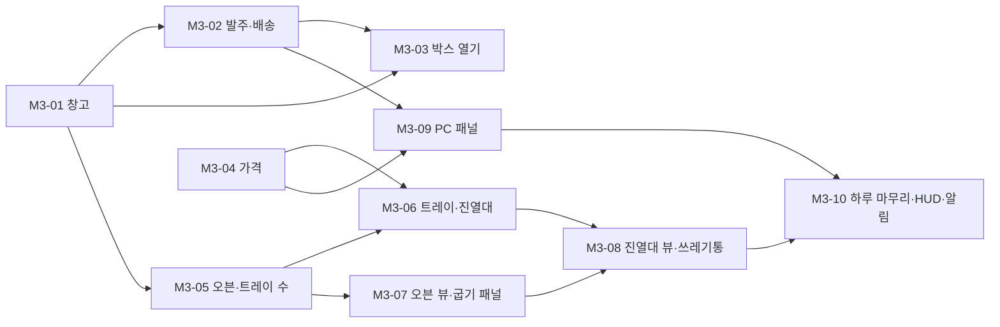

# M3. 생산 루프

> 끝났을 때 되는 것: PC에서 재료를 주문하고, 문 앞의 박스를 창고로 날라 열고, 오븐에서 빵을 굽고, 완벽한 타이밍에 꺼내 진열대에 올리고, 가격을 정한다. 손님만 없는 빵집이다.

재미 포인트: **F2** ("띵!" 소리에 달려가 완벽하게 꺼낸다), **F6** (아침에 생산량을 정한다), **F7** (빵마다 가격을 조정한다)의 절반. 나머지 절반(손님의 반응)은 M4에서 붙는다.

관련 설계: [03. 데이터 모델](../design/03-data-model.md), [04. 플레이어와 상호작용](../design/04-player-interaction.md), [08. 성장과 경제](../design/08-progression-and-economy.md), [10. 화면과 UI](../design/10-ui.md)



## M3-01. 창고

**목적**: 재료의 수량을 관리한다.

**파일**

- `Scripts/Systems/Production/StorageInventory.cs`
- `Scripts/Events/ProductionEvents.cs` (`StorageChanged`)
- `Tests/EditMode/Production/StorageInventoryTests.cs`
- 수정: `GameComposer`, `GameContext` (`Storage` 추가, `StartNewGame`에서 시작 재료 채우기)

**공개 API**

```csharp
namespace BakeryShop.Production
{
    public sealed class StorageInventory
    {
        public StorageInventory(EventBus bus);

        public int Count(string ingredientId);
        public void Add(string ingredientId, int amount);
        public bool Has(IReadOnlyList<IngredientAmount> cost);
        public bool TryConsume(IReadOnlyList<IngredientAmount> cost);   // 전부 있을 때만 전부 차감
        public bool TryRemove(string ingredientId, int amount);         // 한 종류만 (되팔기, 실험)

        public IReadOnlyList<IngredientAmount> Snapshot();              // 수량이 1 이상인 재료, ID 순
        public void Restore(IReadOnlyList<IngredientAmount> items);
    }
}

namespace BakeryShop.Events
{
    public readonly struct StorageChanged { public readonly string IngredientId; public readonly int Delta; public readonly int Count; }
}
```

**규칙**

- 가진 적 없는 재료의 `Count`는 0이다.
- `TryConsume`은 하나라도 모자라면 아무것도 차감하지 않고 `false`다. 목록에 같은 재료가 두 번 나오면 합쳐서 판단한다.
- 수량이 바뀐 재료마다 `StorageChanged`를 한 번씩 발행한다.
- 음수 수량, 0 이하의 `amount`는 예외다.

**테스트**

- 처음에는 모든 재료가 0이다
- `Add`가 수량을 늘리고 이벤트를 발행한다
- `Has`: 충분할 때, 한 종류가 모자랄 때, 빈 목록일 때 (참)
- `TryConsume`: 성공하면 모두 차감, 하나라도 모자라면 아무것도 차감하지 않음
- `TryConsume`: 같은 재료가 두 줄로 나뉘어 있어도 합쳐서 판단한다
- `TryRemove`: 성공과 실패
- `Snapshot`은 수량이 0인 재료를 빼고 ID 순으로 돌려준다
- `Restore` 뒤 수량이 같고 이벤트가 없다
- `StartNewGame` 뒤 창고에 `economy.startStorage`의 재료가 있다

**의존**: M2

## M3-02. 발주와 배송

**목적**: 상품을 주문하면 돈이 빠지고, 20초 뒤 문 앞에 박스가 놓인다.

**파일**

- `Scripts/Core/EntityIdAllocator.cs`
- `Scripts/Systems/Production/OrderService.cs`, `OrderCart.cs`, `DeliverySpotMath.cs`
- `Scripts/Events/ProductionEvents.cs` (`OrderPlaced`, `OrderDelivered`)
- `Scripts/World/DeliveryBox.cs`, `BoxSpawner.cs`
- 수정: `Interaction/IHoldable.cs` (`IHands.Release`), `Interaction/HoldableObject.cs` (상속할 수 있게), `Player/Hands.cs`, `GameLoop` (`Orders.Tick`), `ShopSceneBuilder` (`BoxSpawner`)
- `Tests/EditMode/Production/OrderServiceTests.cs`, `OrderCartTests.cs`, `DeliverySpotMathTests.cs`

**공개 API**

```csharp
namespace BakeryShop.Core
{
    public sealed class EntityIdAllocator
    {
        public int Next();                 // 1000부터 1씩
        public int PeekNext { get; }
        public void Restore(int next);
    }
}

namespace BakeryShop.Production
{
    public enum OrderResult { Ok, EmptyCart, NotEnoughMoney, ProductLocked, ShopClosed }

    /// <summary>발주 탭의 장바구니. UI 없이 테스트한다.</summary>
    public sealed class OrderCart
    {
        public OrderCart(ContentDatabase content);
        public int Quantity(string productId);
        public void SetQuantity(string productId, int quantity);   // 0 ~ 9로 자른다
        public int TotalCost { get; }
        public IReadOnlyList<IngredientAmount> Lines { get; }       // (상품 ID, 수량). 수량 1 이상만
        public void Clear();
    }

    public sealed class OrderService : IDayEndStep
    {
        public OrderService(ContentDatabase content, Wallet wallet, ProgressionService progression,
                            TimeService time, DayCycle day, EntityIdAllocator ids, EventBus bus);

        public bool IsUnlocked(string productId);        // 레벨 조건
        public OrderResult CanPlace(OrderCart cart);
        public OrderResult TryPlace(OrderCart cart);      // 성공하면 장바구니를 비운다
        public int PendingBoxCount { get; }
        public void Tick();                               // 도착 시각이 된 박스를 배송한다
        public void OnDayEnd(int day);                    // 남은 박스를 모두 배송한다
    }

    public static class DeliverySpotMath
    {
        /// <summary>배송 지점 주변에 박스를 놓을 후보 자리. 3열 × 2줄 × 3단, 가까운 자리부터.</summary>
        public static Vector3 Spot(Vector3 deliveryPoint, int index, float boxSize);
        public const int SpotCount = 18;
    }
}

namespace BakeryShop.Interaction
{
    public interface IHands
    {
        IHoldable Held { get; }
        bool TryPickUp(IHoldable item);

        /// <summary>손에서 떼어 돌려준다. 물리는 켜지 않는다. 받은 쪽이 없애거나 다른 곳에 놓는다.</summary>
        IHoldable Release();
    }
}

namespace BakeryShop.World
{
    public class DeliveryBox : HoldableObject
    {
        public int EntityId { get; }
        public string ProductId { get; }
        public void Setup(int entityId, ProductData product);
    }
}
```

**규칙**

- 박스는 상품 수량 1개당 하나다. 밀가루 ×2를 주문하면 박스 두 개가 온다.
- `TryPlace`: 조건을 확인하고 → `Wallet.TrySpend(합계, Order)` → 박스마다 `OrderPlaced` 발행 → 도착 시각을 `SimTime + delivery.seconds`로 기록한다.
- 정산 단계에는 주문할 수 없다 (`ShopClosed`). 나머지 단계에서는 된다.
- `Tick`은 도착 시각이 지난 박스마다 `OrderDelivered(주문 ID, 상품 ID, 개체 ID)`를 발행한다. 주문한 순서대로 도착한다.
- `BoxSpawner`가 `OrderDelivered`를 받아 `DeliveryBox`를 만든다. `DeliverySpotMath`의 후보 자리를 차례로 보면서 `Physics.CheckBox`로 비어 있는 첫 자리에 놓는다. 18자리가 모두 차 있으면 마지막 자리 위 1m에서 떨어뜨린다.
- 박스를 놓을 때마다 `Rigidbody.position`을 맞추고 `Physics.SyncTransforms()`를 부른다. 한 프레임에 여러 박스가 도착하는데, 방금 놓은 박스가 물리 엔진에 반영되지 않으면 다음 박스의 `CheckBox`가 같은 자리를 비었다고 본다 ([TS-002](../troubleshooting/TS-002-drop-physics-pose-sync.md)에서 배운 것).
- 박스의 이름은 상품 이름이다 (`[E] 밀가루 10개 들기`). 미스터리 박스는 색이 다르다 (일반 보라, 고급 금색).
- `HoldableObject`의 `sealed`를 떼고 `DeliveryBox`가 상속한다. 대상은 `context.Held is DeliveryBox box`로 내용물을 안다.
- `Hands.Release`는 `Held`를 비우고 `HeldChanged`를 발행한다. 물건의 부모만 떼고 충돌과 물리는 그대로 둔다.

**테스트**

- `OrderCart`: 수량 설정, 합계, 0으로 내리면 목록에서 빠짐, 9를 넘지 않음, `Clear`
- 빈 장바구니는 `EmptyCart`
- 돈이 모자라면 `NotEnoughMoney`이고 잔액과 대기 박스가 그대로다
- 레벨이 모자란 상품이 들어 있으면 `ProductLocked`
- 정산 단계에는 `ShopClosed`
- 성공하면 합계만큼 잔액이 줄고 `MoneyChanged`의 사유가 `Order`다
- 수량 3이면 `OrderPlaced`가 3번, 20초 뒤 `OrderDelivered`가 3번 발행된다
- 19.9초에는 도착하지 않고 20초에 도착한다
- 일시정지 중에는 도착하지 않는다
- `OnDayEnd`가 남은 박스를 모두 배송한다
- 개체 ID가 박스마다 다르다
- `DeliverySpotMath`: 18자리가 서로 겹치지 않는다, 0번이 배송 지점에 가장 가깝다, 2단은 1단 바로 위다

**Unity에서 확인** (PC 패널은 M3-09에서 만든다. 여기서는 개발용 단축키 F9 = "밀가루 ×2, 버터 ×1 주문"으로 확인한다)

- [ ] F9를 누르면 HUD의 돈이 27,000원 줄고, 20초 뒤 문밖 배송 지점에 박스 3개가 겹치지 않게 놓인다 (같은 프레임에 도착하는 세 박스가 한자리에 겹쳐 튀지 않는다).
- [ ] 박스를 바라보면 `[E] 밀가루 10개 들기`처럼 상품 이름이 뜬다.
- [ ] F9를 여러 번 눌러 박스가 6개를 넘으면 2단으로 쌓인다. 쌓인 박스가 무너지지 않는다.
- [ ] 돈이 모자라면 F9를 눌러도 아무 일도 없다.
- [ ] 박스를 들고 문을 지나 주방까지 걸어갈 수 있다 (문 폭, 통로 폭).

**의존**: M3-01

## M3-03. 박스 열기

**목적**: 박스를 창고 선반까지 들고 가서 열면 재료가 창고에 들어간다.

**파일**

- `Scripts/Systems/Production/BoxService.cs`, `LootDrop.cs`
- `Scripts/Events/ProductionEvents.cs` (`BoxOpened`)
- `Scripts/World/StorageZone.cs`
- 수정: `ShopSceneBuilder` (`storage.01`에 `StorageZone`)
- `Tests/EditMode/Production/BoxServiceTests.cs`

**공개 API**

```csharp
namespace BakeryShop.Production
{
    public readonly struct LootDrop { public readonly string IngredientId; public readonly int Count; }

    public sealed class BoxService
    {
        public BoxService(ContentDatabase content, StorageInventory storage, EventBus bus);

        public bool CanOpen(string productId);
        /// <summary>내용물을 창고에 넣고 BoxOpened를 발행한다. 돌려주는 목록은 나온 순서다.</summary>
        public IReadOnlyList<LootDrop> Open(string productId);
    }
}

namespace BakeryShop.Events
{
    public readonly struct BoxOpened
    {
        public readonly string ProductId;
        public readonly bool IsMystery;
        public readonly IReadOnlyList<LootDrop> Drops;
        public readonly Rarity BestRarity;
    }
}
```

**규칙**

- `IngredientPack`은 `contents`를 그대로 창고에 넣는다.
- `MysteryBox`는 M5-02에서 `LootService`를 연결하기 전까지 `CanOpen`이 `false`다. 레벨 2가 되어야 주문할 수 있어서 M3·M4의 정상 플레이에서는 만나지 않는다.
- `StorageZone`: 박스를 들고 바라보면 `[E] 밀가루 10개 열기`. E를 누르면 `hands.Release()` → `BoxService.Open` → 박스 오브젝트를 없앤다. 빈손이거나 트레이를 들었으면 안내가 없다.
- 결과는 `Open`을 부르는 순간 창고에 반영된다. 연출(M5-03)은 `BoxOpened`를 받아 보여주기만 한다.

**테스트**

- 재료 묶음을 열면 창고 수량이 내용물만큼 늘어난다
- `BoxOpened`에 상품 ID, 내용물, 가장 높은 희귀도가 담긴다
- 없는 상품 ID는 예외다
- 미스터리 박스는 `CanOpen`이 `false`다 (M5-02에서 이 테스트를 바꾼다)

**Unity에서 확인**

- [ ] 박스를 들고 창고 선반을 보면 `[E] 밀가루 10개 열기`가 뜬다. 다른 곳에서는 열 수 없다.
- [ ] E를 누르면 박스가 사라지고, F3 이벤트 로그에 `StorageChanged`와 `BoxOpened`가 찍힌다.
- [ ] 배송 지점에서 창고까지 박스 3개를 옮기는 데 걸리는 시간을 잰다. 지루하지 않은가? (F1)
- [ ] 박스를 든 채 창고 선반 앞의 좁은 곳에서 몸이 끼이지 않는다.

**의존**: M3-01, M3-02

## M3-04. 가격

**목적**: 빵마다 판매가를 정하고, 표시가와 결제 금액을 한 곳에서 계산한다.

**파일**

- `Scripts/Systems/Economy/PriceMath.cs`, `PricingService.cs`
- `Scripts/Events/EconomyEvents.cs` (`PriceChanged`)
- `Tests/EditMode/Economy/PriceMathTests.cs`, `PricingServiceTests.cs`

**공개 API**

```csharp
namespace BakeryShop.Economy
{
    public static class PriceMath
    {
        /// <summary>가격 × 배율을 100원 단위로 반올림한다 (50원은 올림).</summary>
        public static int Scale(int price, float multiplier);

        public static int TagPrice(int basePrice, int daysOld, float dayOldMultiplier);
        public static int ChargePrice(int tagPrice, BreadQuality quality, EconomyConfig economy);
        public static int MinPrice(int marketPrice, EconomyConfig economy);   // 시세 × 0.5를 100원 단위로 올림
        public static int MaxPrice(int marketPrice, EconomyConfig economy);   // 시세 × 2.5를 100원 단위로 내림
    }

    public sealed class PricingService
    {
        public PricingService(ContentDatabase content, EventBus bus);

        public int BasePrice(string recipeId);                    // 플레이어가 정한 판매가. 정한 적이 없으면 시세
        public float Ratio(string recipeId);                      // 판매가 ÷ 시세
        public int TagPrice(string recipeId, int daysOld);        // 손님이 보는 가격
        public int ChargePrice(in BreadInstance bread);           // 계산대에서 받는 금액
        public bool TryStep(string recipeId, int steps);          // +1 = 100원 인상. 범위 끝이면 false
        public IReadOnlyList<RecipePrice> Snapshot();             // 시세와 다른 가격만
        public void Restore(IReadOnlyList<RecipePrice> prices);
    }
}
```

**규칙**

- `Scale`은 **정수로만** 계산한다: `percent = round(multiplier × 100)`, 결과 = `(price × percent + 5000) / 10000 × 100` (정수 나눗셈). 부동소수로 곱하면 5,500 × 0.7이 3,849.9999…가 되어 3,900원이어야 할 값이 3,800원이 된다. 시뮬레이터의 `scale100`과 같은 규칙이다.
- 표시가 = `Scale(판매가, 하루 이상 지났으면 dayOldPriceMultiplier, 아니면 1)`.
- 결제 금액 = `Scale(표시가, 품질 배율)`. 탄 빵은 팔 수 없으므로 `Burnt`는 예외다.
- 판매가의 범위는 `MinPrice` ~ `MaxPrice`다. 시세 3,500원이면 1,800 ~ 8,700원.
- `TryStep`으로 값이 바뀌면 `PriceChanged(레시피 ID, 판매가)`를 발행한다.

**테스트**

- `Scale(5500, 0.7)`은 3,900이다 (부동소수로 계산하면 3,800이 나오는 경우)
- `Scale(3200, 0.7)`은 2,200, `Scale(3800, 0.7)`은 2,700, `Scale(3500, 0.7)`은 2,500 (2,450의 50원 올림)
- `Scale(x, 1.0)`은 100원 단위의 x 그대로다
- 모든 레시피의 시세 50%~250% 범위를 100원 단위로 돌며, `Scale(가격, 0.7)`과 `Scale(가격, 1.2)`가 정수 계산 `(가격 × 7 + 5) / 10`을 100원 단위로 반올림한 값과 같다
- `TagPrice`: 0일차는 그대로, 1일차와 2일차는 할인
- `ChargePrice`: 덜 익음 0.7, 보통 1.0, 완벽 1.2. 탄 빵은 예외
- `MinPrice`, `MaxPrice`: 시세 3,500 → 1,800 / 8,700, 시세 2,000 → 1,000 / 5,000
- `PricingService`: 처음 가격은 시세, `TryStep(+1)`이 100원 올림, 범위 끝에서 `false`이고 이벤트 없음, `Snapshot`은 바꾼 가격만, `Restore`는 이벤트 없음

**의존**: M2

## M3-05. 오븐과 트레이 수

**목적**: 굽기 시작, 진행, 품질 판정, 꺼내기와 트레이 수 제한을 만든다.

**파일**

- `Scripts/Systems/Production/BakeMath.cs`, `OvenModel.cs`, `OvenSystem.cs`, `TraySystem.cs`, `TrayModel.cs`, `BreadInstance.cs`
- `Scripts/Systems/Growth/RecipeBook.cs` (아는 레시피 목록만. 실험은 M5-04에서 추가)
- `Scripts/Events/ProductionEvents.cs` (`BakingStarted`, `OvenReady`, `OvenBurnt`, `BakingCollected`, `TraysChanged`, `TrayEmptied`, `BreadDiscarded`)
- 수정: `GameComposer`, `GameLoop` (`Ovens.Tick`)
- `Tests/EditMode/Production/BakeMathTests.cs`, `OvenSystemTests.cs`, `TraySystemTests.cs`, `Tests/EditMode/Growth/RecipeBookTests.cs`

**공개 API**

```csharp
namespace BakeryShop.Production
{
    public struct BreadInstance { public string RecipeId; public BreadQuality Quality; public int DaysOld; }

    public enum OvenStage { Empty, Baking, Underbaked, Perfect, Normal, Burnt }

    public static class BakeMath
    {
        public static OvenStage StageAt(double elapsedSeconds, RecipeData recipe, float minCollectProgress);
        public static BreadQuality QualityAt(double elapsedSeconds, RecipeData recipe);
    }

    public sealed class TrayModel
    {
        public int EntityId { get; }
        public string RecipeId { get; }
        public List<BreadInstance> Breads { get; }
    }

    /// <summary>트레이의 개수와 지금 쓰이고 있는 트레이.</summary>
    public sealed class TraySystem : IDayEndStep
    {
        public TraySystem(ContentDatabase content, EntityIdAllocator ids, EventBus bus);

        public int Total { get; }
        public int Free { get; }                                  // Total − 오븐 안 − Active
        public IReadOnlyList<TrayModel> Active { get; }           // 빵이 올라가 있는 트레이

        public bool TryReserve();                                 // 굽기 시작: 빈 트레이 하나를 오븐에 넣는다
        public void CancelReservation();                          // 탄 빵, 오븐 비우기: 빈 채로 돌아온다
        public TrayModel Fill(string recipeId, BreadQuality quality, int count);   // 꺼내기: 예약이 빵이 올라간 트레이가 된다
        public void ReleaseIfEmpty(TrayModel tray);               // 빵이 0개면 Active에서 빼고 TrayEmptied 발행
        public int Discard(TrayModel tray);                       // 쓰레기통: 빵을 모두 버리고 트레이를 돌려받는다
        public void AddTray();                                    // 해금
        public void OnDayEnd(int day);                            // 트레이 위 빵의 나이 +1, 기한 넘긴 빵 폐기
    }

    public enum StartBakeResult { Ok, OvenLocked, OvenBusy, RecipeUnknown, NotEnoughIngredients, NoFreeTray }

    public readonly struct CollectResult
    {
        public readonly bool Burnt;
        public readonly BreadQuality Quality;
        public readonly TrayModel Tray;      // 탔으면 null
    }

    public sealed class OvenSystem : IDayEndStep
    {
        public OvenSystem(ContentDatabase content, TimeService time, StorageInventory storage,
                          RecipeBook recipes, TraySystem trays, EventBus bus);

        public IReadOnlyList<OvenModel> Ovens { get; }
        public OvenModel Get(string ovenId);

        public StartBakeResult CanStart(string ovenId, string recipeId);
        public StartBakeResult TryStart(string ovenId, string recipeId);

        public OvenStage Stage(string ovenId);
        public float Progress(string ovenId);              // 경과 ÷ 굽는 시간. 비어 있으면 0
        public float SecondsUntilBurnt(string ovenId);
        public bool CanCollect(string ovenId);             // Underbaked 이후
        public CollectResult Collect(string ovenId);

        public void Tick();                                // OvenReady, OvenBurnt를 오븐마다 한 번씩
        public void Unlock(string ovenId);
        public void OnDayEnd(int day);                     // 오븐 비우기
    }
}

namespace BakeryShop.Growth
{
    public sealed class RecipeBook
    {
        public RecipeBook(ContentDatabase content, EventBus bus);
        public bool IsKnown(string recipeId);
        public IReadOnlyList<RecipeData> Known { get; }    // content.json의 순서
        public void Learn(string recipeId);                // 라이선스 구매, 실험 성공
    }
}
```

**규칙**

품질과 단계는 굽기 시작부터 흐른 시간(`SimTime` 기준)으로 정한다. `b` = 굽는 시간, `w` = 완벽 구간, `u` = 타기까지의 시간.

| 경과 시간 `t` | 단계 | 꺼내면 |
| --- | --- | --- |
| `t < b × minCollectProgress` | `Baking` | 꺼낼 수 없다 |
| `b × minCollectProgress ≤ t < b` | `Underbaked` | 덜 익음 |
| `b ≤ t ≤ b + w` | `Perfect` | 완벽 |
| `b + w < t ≤ b + u` | `Normal` | 보통 |
| `t > b + u` | `Burnt` | 폐기 |

- `TryStart`의 확인 순서: 오븐이 잠김 → 굽는 중 → 모르는 레시피 → 재료 부족 → 빈 트레이 없음. 통과하면 재료를 차감하고, 트레이를 예약하고, 시작 시각을 기록하고, `BakingStarted`를 발행한다.
- 비밀 레시피는 재료 목록에 핵심 재료가 들어 있어서 별도 처리 없이 핵심 재료가 1개 차감된다.
- `Collect`: 품질을 확정한다. 탔으면 `BreadDiscarded(탐)`을 발행하고 `CancelReservation`. 아니면 `TraySystem.Fill`로 트레이를 만들어 돌려준다. 어느 쪽이든 `BakingCollected(오븐 ID, 레시피 ID, 개수, 품질)`를 발행하고 오븐을 비운다.
- `Tick`: 경과 시간이 `b`를 넘는 순간 `OvenReady`를, `b + u`를 넘는 순간 `OvenBurnt`를 오븐마다 한 번만 발행한다.
- `OnDayEnd`: 굽고 있던 오븐마다 `BreadDiscarded(오븐 비우기)`를 발행하고 `CancelReservation`.
- 트레이 수는 항상 `Free + 오븐 안 + Active.Count == Total`이다.
- `TraySystem.OnDayEnd`: 트레이 위의 빵도 나이를 먹고, 보관 일수를 넘기면 폐기된다. 빵이 다 없어진 트레이는 돌아온다.
- 시작할 때 `Total`은 `economy.startTrays`, 아는 레시피는 `economy.startRecipes`, 오븐은 `oven.01`만 열려 있다.

**테스트**

- `BakeMath`: 다섯 구간의 대표값과 경계값 (`t = b × 0.5`, `t = b`, `t = b + w`, `t = b + u`)이 표와 같다
- 재료가 충분하면 굽기가 시작되고 재료가 줄고 빈 트레이가 하나 준다
- 실패 사유 다섯 가지가 각각 나오고, 실패하면 재료와 트레이가 그대로다
- 확인 순서: 재료도 없고 트레이도 없으면 `NotEnoughIngredients`다
- 절반이 되기 전에는 `CanCollect`가 거짓이다
- 덜 익음 / 완벽 / 보통으로 꺼내면 그 품질의 빵이 `yield`개 담긴 트레이가 나온다
- 탄 뒤에 꺼내면 트레이가 없고, `BreadDiscarded`가 발행되고, 빈 트레이 수가 돌아온다
- `OvenReady`와 `OvenBurnt`가 각각 한 번만 발행된다 (여러 번 `Tick`해도)
- 일시정지 중에는 진행하지 않는다 (`SimTime`이 멈추므로)
- 잠긴 오븐은 `OvenLocked`, `Unlock` 뒤에는 구울 수 있다
- `OnDayEnd`가 굽던 빵을 폐기하고 트레이를 돌려준다
- 트레이 3개로 세 번 굽고 꺼내지 않으면 네 번째는 `NoFreeTray`다
- 트레이의 빵을 모두 빼고 `ReleaseIfEmpty`를 부르면 빈 트레이 수가 늘고 `TrayEmptied`가 발행된다
- `Discard`가 빵 개수를 돌려주고 `BreadDiscarded(쓰레기통)`을 발행한다
- 굽기·꺼내기·비우기를 섞어 100번 반복해도 `Free + 오븐 안 + Active == Total`이 유지된다 (시드 고정 무작위)
- `TraySystem.OnDayEnd`: 보관 1일인 빵은 첫 정산에서 남고 둘째 정산에서 폐기된다
- `RecipeBook`: 시작 레시피를 안다, `Learn` 뒤에 안다, `Known`의 순서가 콘텐츠 순서다

**의존**: M3-01

## M3-06. 트레이와 진열대

**목적**: 트레이의 빵을 진열대 칸에 올리고, 칸에서 빵을 꺼내고(손님), 날이 바뀌면 나이를 먹인다.

**파일**

- `Scripts/Systems/Production/ShelfModel.cs`, `ShelfSystem.cs`, `SlotRef.cs`, `Freshness.cs`
- `Scripts/Events/ProductionEvents.cs` (`ShelfChanged`)
- `Tests/EditMode/Production/ShelfSystemTests.cs`, `FreshnessTests.cs`

**공개 API**

```csharp
namespace BakeryShop.Production
{
    public readonly struct SlotRef { public readonly string ShelfId; public readonly int Index; }

    public sealed class ShelfSlot
    {
        public string RecipeId { get; }                      // 비어 있으면 null
        public int Capacity { get; }
        public IReadOnlyList<BreadInstance> Breads { get; }  // 앞쪽(0번)이 먼저 팔린다
        public int FreeSpace { get; }
    }

    public sealed class ShelfModel
    {
        public string Id { get; }
        public bool Unlocked { get; }
        public IReadOnlyList<ShelfSlot> Slots { get; }
    }

    public static class Freshness
    {
        /// <summary>모든 빵의 나이를 1 올리고, 보관 일수를 넘긴 빵을 목록에서 뺀다. 뺀 개수를 돌려준다.</summary>
        public static int AgeAndExpire(List<BreadInstance> breads, int shelfLifeDays);
    }

    public sealed class ShelfSystem : IDayEndStep
    {
        public ShelfSystem(ContentDatabase content, TraySystem trays, PricingService pricing, EventBus bus);

        public IReadOnlyList<ShelfModel> Shelves { get; }
        public ShelfSlot Slot(SlotRef slot);

        public bool CanStock(SlotRef slot, TrayModel tray);
        public int Stock(SlotRef slot, TrayModel tray);                   // 옮긴 개수

        public bool HasStock(string recipeId);
        public IReadOnlyList<SlotRef> SlotsWith(string recipeId);         // 그 빵이 1개 이상 있는 칸
        public bool TryPeek(SlotRef slot, out BreadInstance bread);       // 맨 앞 빵
        public bool TryTake(SlotRef slot, out BreadInstance bread);       // 맨 앞 빵을 뺀다
        public bool TryReturn(BreadInstance bread);                       // 같은 빵의 칸에 자리가 있으면 맨 앞에 넣는다
        public int CountOf(string recipeId);

        public void Unlock(string shelfId);
        public void OnDayEnd(int day);
    }
}
```

**규칙**

- 진열대는 `shelf.01` ~ `shelf.04`, 칸은 진열대마다 `shelf.slotsPerShelf`개, 칸마다 `shelf.slotCapacity`개다. 처음에는 `shelf.01`, `shelf.02`만 열려 있다.
- `CanStock`: 진열대가 열려 있고, 트레이에 빵이 있고, 칸이 비어 있거나 같은 빵이고, 자리가 1개 이상 있다.
- `Stock`: 트레이의 앞에서부터 자리만큼 칸의 **뒤**에 넣는다. 남는 빵은 트레이에 남는다. 그 뒤 `TraySystem.ReleaseIfEmpty`를 부르고 `ShelfChanged`를 발행한다.
- 칸의 빵이 0개가 되면 `RecipeId`가 null로 돌아간다 (다른 빵을 놓을 수 있다).
- 손님은 맨 앞 빵부터 가져간다. 어제 남은 빵이 앞에 있으므로 먼저 팔린다.
- `TryReturn`(줄에서 떠난 손님의 빵): 같은 빵이 있는 칸 중 자리가 있는 첫 칸의 **앞**에 넣는다 (앞에서 꺼낸 빵이므로 원래 순서로 돌아간다). 없으면 `false`이고, 부른 쪽이 `BreadDiscarded(줄 이탈)`로 처리한다.
- `OnDayEnd`: 모든 칸에 `Freshness.AgeAndExpire`를 적용하고, 폐기된 빵은 레시피별로 모아 `BreadDiscarded(보관 기한, 개수, 판매가 × 개수)`를 발행한다.
- `Freshness`: `DaysOld`를 1 올린 뒤 `DaysOld > shelfLifeDays`인 빵을 뺀다. 보관 1일인 빵은 구운 날(0)과 다음 날(1)까지 팔 수 있다.

**테스트**

- 빈 칸에 올리면 칸의 `RecipeId`가 정해지고 트레이가 비워진다
- 자리가 4개인 칸에 6개짜리 트레이를 올리면 4개만 옮겨지고 2개가 트레이에 남는다
- 다른 빵이 있는 칸에는 올릴 수 없다
- 잠긴 진열대에는 올릴 수 없고, `Unlock` 뒤에는 된다
- 트레이가 비면 빈 트레이 수가 늘어난다
- `TryTake`가 맨 앞 빵을 돌려주고, 마지막 빵을 빼면 칸이 비워진다
- 어제 빵 2개가 있는 칸에 오늘 빵을 올리면 어제 빵이 먼저 나온다
- `SlotsWith`가 그 빵이 있는 칸만 돌려준다 (잠긴 진열대 제외)
- `TryReturn`: 자리가 있으면 들어가고, 없거나 그 빵의 칸이 없으면 `false`
- `Freshness`: 보관 1일 / 2일인 빵의 0·1·2·3일차
- `OnDayEnd`: 폐기 이벤트가 레시피별로 한 번, 금액이 판매가 × 개수
- 진열·판매·정산을 섞어 반복해도 어느 칸도 용량을 넘지 않고 한 칸에 두 종류가 섞이지 않는다 (시드 고정 무작위)

**의존**: M3-04, M3-05

## M3-07. 오븐 뷰와 굽기 패널

**목적**: 오븐을 바라보고 레시피를 골라 굽고, 소리를 듣고 달려가 꺼낸다 (F2).

**파일**

- `Scripts/World/OvenView.cs`, `OvenProgressBar.cs`, `TrayView.cs`, `TrayFactory.cs`, `PlaceholderSfx.cs`
- `Scripts/UI/OvenPanel.cs`, `BakeTab.cs`
- 수정: `ShopSceneBuilder` (`oven.01`, `oven.02`에 `OvenView`), `ShopUiBuilder` (오븐 패널)

**규칙**

- `OvenView`의 안내와 동작 (손이 비어 있을 때만):

| 오븐의 단계 | 안내 | E를 누르면 |
| --- | --- | --- |
| `Empty` | `오븐 열기` | 오븐 패널을 연다 |
| `Baking` | 없음 (M5-05에서 `오븐 열기 (실험)`) | - |
| `Underbaked` | `크루아상 꺼내기 (덜 익음)` | 꺼내서 트레이를 손에 든다 |
| `Perfect` | `크루아상 꺼내기 (완벽!)` | 꺼내서 트레이를 손에 든다 |
| `Normal` | `크루아상 꺼내기` | 꺼내서 트레이를 손에 든다 |
| `Burnt` | `탄 빵 버리기` | 폐기한다 |

- 굽기 탭의 구성은 [10 문서의 오븐 패널](../design/10-ui.md#오븐-패널)을 따른다. 목록은 `RecipeBook.Known`, 버튼의 활성과 사유 문구는 `OvenSystem.CanStart`의 결과로 정한다 (뷰가 재료를 직접 세지 않는다).

| `StartBakeResult` | 버튼 아래 문구 |
| --- | --- |
| `NotEnoughIngredients` | 재료가 모자랍니다 (모자란 재료를 빨간색으로) |
| `NoFreeTray` | 빈 트레이가 없습니다. 트레이의 빵을 진열하세요 |

- 굽기를 시작하면 패널이 닫힌다.
- `OvenProgressBar`: 오븐 위의 월드 UI. 굽는 중 회색 막대가 차오르고, 완벽 구간은 금색, 보통 구간은 주황, 탄 뒤는 검정이다. 남은 시간(다 익기까지 / 타기까지)을 초로 표시한다. 플레이어를 향해 돈다.
- 소리: `OvenReady`에 "띵!", 타기 5초 전부터 1초 간격의 경고음, `OvenBurnt`에 낮은 소리. `PlaceholderSfx`가 코드로 만든 사인파를 쓴다 (M6-05에서 실제 소리로 바꾼다). 소리는 오븐 위치에서 3D로 낸다.
- `TrayFactory`: `Collect`가 돌려준 `TrayModel`로 `TrayView`를 만들고 `hands.TryPickUp`으로 손에 쥐여 준다. `TrayView`는 `HoldableObject`를 상속하고, 빵을 2 × 3으로 보여준다. `TrayEmptied`를 받으면 스스로 없어진다.
- 빵의 그레이박스 외형: 레시피마다 색이 다른 둥근 상자. 덜 익은 빵은 밝게, 완벽한 빵은 위에 작은 반짝임 표시.

**Unity에서 확인**

- [ ] 빈손으로 오븐 1을 보면 `[E] 오븐 열기`. 패널에 식빵·단팥빵·크루아상이 보이고, 고르면 재료의 필요량과 보유량이 나온다.
- [ ] 크루아상을 굽기 시작하면 패널이 닫히고, HUD나 로그에서 버터 3·밀가루 2가 줄어든 것을 확인한다.
- [ ] 오븐 위에 진행 막대와 남은 시간이 보인다. 매장 반대편(계산 자리)에서도 막대가 보이는가?
- [ ] 45초 뒤 "띵!" 소리가 난다. **계산 자리에 서 있어도 들리는가?** 소리의 방향으로 오븐 쪽인 것을 알 수 있는가?
- [ ] 소리를 듣고 계산 자리에서 걸어가 8초 안에 꺼낼 수 있는가? 여유는 몇 초인가? (F2의 핵심 수치)
- [ ] 완벽 구간에 꺼내면 안내가 `(완벽!)`이고 트레이가 손에 들린다. 빵 6개가 트레이 위에 보인다.
- [ ] 22초쯤(절반)에 꺼내면 `(덜 익음)`이다. 그 전에는 안내가 뜨지 않는다.
- [ ] 다 익고 30초를 넘기면 경고음 뒤에 막대가 검게 변하고, 안내가 `탄 빵 버리기`다.
- [ ] 트레이를 든 채로는 오븐 안내가 뜨지 않는다. 트레이를 작업대에 내려놓고 다시 들 수 있다.
- [ ] 세 번 굽고 꺼내 트레이 3개를 작업대에 두면, 네 번째에는 "빈 트레이가 없습니다"가 나온다.
- [ ] 식빵을 세 번 구우면(중간에 트레이를 진열해 비운다) 우유와 달걀이 떨어진다. 네 번째에는 "재료가 모자랍니다"가 나오고 우유와 달걀이 빨간색이다.

**의존**: M3-05, M2-09 (`PanelHost`)

## M3-08. 진열대 뷰와 쓰레기통

**목적**: 트레이를 들고 진열대에 올리면 빵이 놓이고, 가격표에 이름·가격·수량이 보인다.

**파일**

- `Scripts/World/ShelfView.cs`, `ShelfSlotView.cs`, `PriceTagView.cs`, `TrashBin.cs`, `BreadVisualPool.cs`
- 수정: `ShopSceneBuilder` (진열대 4개, 칸 3개씩, 가격표, 쓰레기통)

**규칙**

- `ShelfSlotView`(칸마다 하나)가 상호작용 대상이다.

| 손 | 칸의 상태 | 안내 |
| --- | --- | --- |
| 트레이 | `CanStock`이 참 | `크루아상 진열 (6개)` (옮겨질 개수) |
| 트레이 | 다른 빵이 있음 | 없음. 가격표가 잠깐 흔들린다 |
| 트레이 | 가득 참 | 없음 |
| 빈손, 박스 | - | 없음 |

- `ShelfView`는 `ShelfChanged`를 받아 그 칸의 빵 외형을 모델대로 다시 놓는다 (2 × 3). 빵 외형은 풀에서 꺼낸다.
- `PriceTagView`: 칸 앞 높이 1.25에 `빵 이름 / 표시가 / 4/6`. 맨 앞 빵이 하루 이상 지났으면 표시가 옆에 "할인"을 붙이고 할인된 가격을 보여준다. 빈 칸은 가격표를 숨긴다. `ShelfChanged`, `PriceChanged`에 갱신한다.
- `TrashBin`: 트레이를 들고 바라보면 `빵 버리기 (6개)`. E를 누르면 `TraySystem.Discard` → 트레이가 사라진다.
- 트레이는 바닥과 작업대(평평한 윗면)에 내려놓을 수 있다 (M1의 내려놓기 그대로).
- 잠긴 진열대(3, 4)의 칸은 안내가 없다. 해금 안내는 M5-01에서 붙는다.

**Unity에서 확인**

- [ ] 트레이를 들고 진열대 1의 가운데 칸을 보면 `[E] 크루아상 진열 (6개)`. E를 누르면 빵 6개가 칸에 놓이고 트레이가 사라진다.
- [ ] 가격표에 `크루아상 / 3,000원 / 6/6`이 보인다. 계산 줄 위치(x = 2.6)에서도 읽을 수 있는가?
- [ ] 4개가 든 식빵 트레이를 올린 칸에 식빵 트레이를 하나 더 올리면 2개만 옮겨지고 2개가 트레이에 남는다.
- [ ] 크루아상이 있는 칸에 단팥빵 트레이를 대면 안내가 뜨지 않는다.
- [ ] HUD나 로그에서 트레이가 비는 순간 빈 트레이 수가 늘어나는 것을 확인한다.
- [ ] 트레이를 들고 쓰레기통을 보면 `[E] 빵 버리기 (n개)`. 누르면 트레이가 사라진다.
- [ ] 진열대 3, 4(반투명)에는 올릴 수 없다.
- [ ] 진열대 앞에 바짝 붙어도 트레이가 진열대를 뚫지 않는다 (M1의 당겨오기).
- [ ] 오븐에서 꺼내 진열대에 올리고 계산 자리로 돌아오는 시간을 잰다 (시뮬레이터의 `collect_and_stock` 가정값은 14초).

**의존**: M3-06, M3-07

## M3-09. PC 패널: 발주와 가격

**목적**: PC에서 재료를 주문하고 빵의 가격을 바꾼다.

**파일**

- `Scripts/World/PcTerminal.cs`
- `Scripts/UI/PcPanel.cs`, `OrderTab.cs`, `PriceTab.cs`
- 수정: `ShopSceneBuilder` (`pc.01`에 `PcTerminal`), `ShopUiBuilder` (PC 패널)

**규칙**

- `PcTerminal`: 빈손으로 바라보면 `PC 사용`. E를 누르면 PC 패널이 마지막에 보던 탭으로 열린다.
- PC 패널의 구성은 [10 문서의 PC 패널](../design/10-ui.md#pc-패널)을 따른다. 이 작업에서는 **발주**와 **가격** 탭만 만든다. 나머지 탭은 자리만 두고 꺼 둔다 (도감·성장 M5, 리포트 M4-08).
- 발주 탭: 상품마다 이름, 내용물, 가격, 보유량, `-` 수량 `+`. 레벨이 모자란 상품은 회색으로 `레벨 N에 열림`. 오른쪽에 장바구니와 합계, **주문하기**. `OrderService.CanPlace`의 결과로 버튼을 켜고 끈다. 돈이 모자라면 합계가 빨간색이다.
- 보유량은 그 상품의 첫 내용물 재료의 창고 수량이다. 미스터리 박스는 보유량이 없다.
- 주문하면 장바구니가 비고 "20초 뒤 문 앞에 도착합니다"가 2초 동안 보인다. 패널은 닫히지 않는다.
- 가격 탭: 아는 레시피마다 이름, 시세, 현재 판매가, `-` `+`, 시세 대비 비율(`110%`). 비율이 100%보다 높으면 주황, 낮으면 파랑. "어제 비싸서 안 산 횟수" 열은 M4-08에서 채운다.
- 패널이 열려 있어도 시간은 흐른다.

**Unity에서 확인**

- [ ] 빈손으로 PC를 보면 `[E] PC 사용`. 패널이 열리고 커서가 풀린다. Esc로 닫히고 커서가 잠긴다.
- [ ] 발주 탭에 재료 7종이 보이고, 미스터리 박스 2종과 초콜릿은 회색에 `레벨 2에 열림` 또는 `레벨 4에 열림`이 붙어 있다.
- [ ] 밀가루 ×2, 버터 ×1을 담으면 합계가 27,000원이다. 주문하면 돈이 줄고 20초 뒤 박스 3개가 온다.
- [ ] 잔액보다 많이 담으면 합계가 빨갛고 주문 버튼이 꺼진다.
- [ ] 가격 탭에서 크루아상을 `+` 세 번 누르면 3,300원 (110%)이 되고, 진열대의 가격표가 바로 바뀐다.
- [ ] `-`를 계속 누르면 1,500원(50%)에서 멈춘다.
- [ ] 패널을 연 채로 오븐의 "띵!" 소리가 들린다 (시간이 멈추지 않는다).
- [ ] 1280×720에서 패널이 잘리지 않는다.

**의존**: M3-02, M3-04, M2-09

## M3-10. 하루 마무리 단계 (생산), HUD, 알림

**목적**: 정산에 들어갈 때 생산 쪽 상태를 정리하고, HUD에 트레이 수와 알림을 붙인다.

**파일**

- `Scripts/Core/DayEndOrder.cs`
- `Scripts/World/HandsDayEndStep.cs`
- `Scripts/UI/ToastView.cs`, 수정: `HudView.cs`
- 수정: `GameComposer`, `GameBootstrap` (하루 마무리 단계 등록), `DevCheats` (F8)
- `Tests/EditMode/Core/DayEndFlowTests.cs`

**공개 API**

```csharp
namespace BakeryShop.Core
{
    /// <summary>하루 마무리 단계의 실행 순서. 02 문서의 표와 같다.</summary>
    public static class DayEndOrder
    {
        public const int DropHeldItem = 10;
        public const int ClearOvens = 20;
        public const int AgeBread = 30;         // 진열대 30, 트레이 31
        public const int DeliverOrders = 40;
        public const int Rent = 50;             // M4-08
        public const int Subsidy = 60;          // M4-08
        public const int DayXp = 70;            // M4-07
        public const int Report = 80;           // M4-08
    }
}
```

**규칙**

- `GameComposer`가 `OvenSystem`(20), `ShelfSystem`(30), `TraySystem`(31), `OrderService`(40)를 등록하고, `GameBootstrap`이 `HandsDayEndStep`(10)을 등록한다.
- `HandsDayEndStep`: 손에 든 것이 있으면 발밑(플레이어 앞 0.6m 바닥)에 내려놓는다. 자리가 막혀 있으면 플레이어 위치 위 0.5m에서 떨어뜨린다.
- 오븐을 먼저 비우고(20) 나이를 먹이는(30) 순서라서, 오븐 안의 빵은 다음 날로 넘어가지 않는다.
- HUD에 `빈 트레이 n/전체`를 추가한다 (`TraysChanged`).
- `ToastView`: 화면 왼쪽 아래에 한 줄씩 2.5초 동안 보여준다. 여러 개가 겹치면 차례로 보여준다 (최대 4개 대기, 넘치면 오래된 것부터 버린다). 이 작업에서 연결하는 알림: 배송 도착(`OrderDelivered`, 같은 프레임의 여러 박스는 한 번만), 빵이 탐(`OvenBurnt`).
- 개발용 F8: `TrySettle()`에 성공하면 바로 `StartNextDay()`. 정산 화면은 M4-08에서 만든다.

**테스트** (`GameComposer`로 만든 전체 시스템을 씬 없이 돌린다)

- 굽는 중에 정산하면 오븐이 비고 빈 트레이 수가 전체와 같아진다 (진열대·트레이에 빵이 없을 때)
- 보관 1일인 빵을 진열하고 정산을 두 번 하면 첫 번째에는 남고(`DaysOld` 1) 두 번째에 폐기된다
- 보관 2일인 빵은 세 번째 정산에 폐기된다
- 주문 직후 정산하면 박스가 그날 배송된다 (`OrderDelivered`가 정산 중에 발행된다)
- 하루 마무리 단계가 `DayEndOrder`의 순서로 실행된다 (등록 순서를 뒤섞어도)
- 하루 지난 빵의 표시가가 30% 할인이다 (정산 뒤 `PricingService.TagPrice`)

**Unity에서 확인**

- [ ] HUD 오른쪽 아래에 `빈 트레이 3/3`이 보이고, 굽기 시작하면 `2/3`, 진열을 마치면 `3/3`이 된다.
- [ ] 박스가 도착하면 "주문한 박스가 도착했습니다"가 한 번 뜬다 (박스 3개여도 한 번).
- [ ] 빵을 태우면 "오븐 1의 빵이 타 버렸습니다"가 뜬다.
- [ ] 크루아상을 진열하고, 팻말로 개점하고, F5로 폐점 시각까지 건너뛴 뒤 F8을 누르면 2일차 준비 중이 된다. 진열대의 크루아상 가격표에 "할인"과 2,100원이 보인다 (판매가가 시세 3,000원일 때).
- [ ] F8을 한 번 더(개점 → F5 → F8) 하면 크루아상이 진열대에서 사라진다. 식빵(보관 2일)은 하루 더 남는다.
- [ ] 트레이를 든 채 F8을 누르면 트레이가 발밑에 놓여 있다.
- [ ] 굽는 중에 F8을 누르면 오븐이 비어 있고 빈 트레이 수가 돌아와 있다.

**의존**: M3-08, M3-09

## 완료 기준

손님 없이 아래를 한 번에 할 수 있다.

1. PC에서 밀가루와 버터를 주문한다.
2. 문 앞에 온 박스를 창고로 날라 연다.
3. 오븐에서 크루아상을 굽고, "띵!" 소리에 맞춰 완벽하게 꺼낸다.
4. 트레이를 진열대에 올린다. 가격표가 보인다.
5. 굽는 동안 PC에서 크루아상 가격을 3,300원으로 올린다.
6. 트레이 3개를 모두 쓰면 더 구울 수 없고, 진열하면 다시 구울 수 있다.
7. 개점 → 마감 → (F8) 다음 날. 남은 빵에 할인 표시가 붙는다.

이 시점에 [플레이 테스트에서 잴 값](README.md#플레이-테스트에서-잴-값) 중 `walk_to_oven`, `start_bake`, `collect_and_stock`, `restock_from_tray`를 재서 시뮬레이터에 넣는다. EditMode 테스트는 약 110개가 더해진다. 태그: `v0.3-production`
