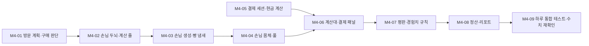

# M4. 영업 루프

> 끝났을 때 되는 것: 손님이 들어와 빵을 고르고, 줄을 서고, 계산하고 나간다. 마감 뒤 정산 리포트가 나오고 다음 날로 넘어간다. **하루가 처음부터 끝까지 도는 첫 빌드다.**

재미 포인트: **F3** (계산 줄과 오븐 사이의 선택), **F4** (거스름돈을 빠르고 정확하게), **F5** (빵 냄새로 손님이 몰린다), **F8** (리포트를 보고 내일을 고친다), 그리고 M3에서 절반만 된 F6·F7의 나머지.

관련 설계: [05. 손님과 계산](../design/05-customer-and-checkout.md), [08. 성장과 경제](../design/08-progression-and-economy.md), [10. 화면과 UI](../design/10-ui.md)



M4-01 ~ M4-03과 M4-05는 순수 C#이라 Unity 확인 없이 연달아 진행할 수 있다. 화면에 손님이 처음 보이는 것은 M4-04다.

## M4-01. 방문 계획과 구매 판단

**목적**: 손님이 "무엇을 사러 왔고, 이 가격이면 사는가"를 순수 함수로 만든다.

**파일**

- `Scripts/Systems/Customers/VisitPlan.cs`, `CustomerPlanner.cs`, `PurchaseDecision.cs`
- `Tests/EditMode/Customers/CustomerPlannerTests.cs`, `PurchaseDecisionTests.cs`

**공개 API**

```csharp
namespace BakeryShop.Customers
{
    public sealed class VisitPlan
    {
        public CustomerProfile Profile { get; }
        public IReadOnlyList<string> Wanted { get; }     // 레시피 ID. 겹치지 않는다
        public int Budget { get; }
        public bool PaysCash { get; }
    }

    public static class CustomerPlanner
    {
        /// <summary>손님이 찾을 수 있는 빵: 아는 일반 레시피 전부 + 지금 진열된 비밀 레시피.</summary>
        public static List<string> BuildMenu(RecipeBook recipes, ShelfSystem shelves);

        public static CustomerProfile PickProfile(IReadOnlyList<CustomerProfile> profiles, int level, Rng rng);
        public static VisitPlan Create(CustomerProfile profile, IReadOnlyList<string> menu, Rng rng);
    }

    public enum PurchaseOutcome { Bought, NoStock, OverBudget, TooExpensive }

    public static class PurchaseDecision
    {
        public static float BuyProbability(CustomerProfile profile, int tagPrice, int marketPrice,
                                           BreadQuality quality, float undercookedMultiplier);

        public static PurchaseOutcome Evaluate(CustomerProfile profile, bool inStock, int tagPrice, int marketPrice,
                                               BreadQuality quality, int spentSoFar, int budget,
                                               float undercookedMultiplier, Rng rng);
    }
}
```

**규칙**

- `Create`가 난수를 쓰는 순서는 고정이다: ① 원하는 개수 `Range(1, maxItems)` ② 빵을 개수만큼 가중치로 뽑기 (뽑은 빵은 후보에서 뺀다) ③ 예산 `Range(budgetMin ÷ 100, budgetMax ÷ 100) × 100` ④ 현금 여부 `Chance(cashRatio)`. 시뮬레이터의 `make_plan`과 같은 순서다.
- 빵의 가중치는 성향의 `preferences`에 있으면 그 값, 없으면 `defaultPreference`다.
- 메뉴의 빵이 원하는 개수보다 적으면 있는 만큼만 원한다.
- 구매 확률 = `PiecewiseCurve.Evaluate(priceSensitivity, 표시가 ÷ 시세) × (덜 익었으면 undercookedMultiplier)`.
- `Evaluate`의 판단 순서: 재고 없음 → `NoStock` / `담은 금액 + 표시가 > 예산` → `OverBudget` / `NextFloat() ≥ 구매 확률` → `TooExpensive` / 그 외 `Bought`. 난수는 세 번째 판단에서만 쓴다 (앞에서 걸리면 난수를 소비하지 않는다).
- `OverBudget`과 `TooExpensive`는 둘 다 `PriceRejected` 이벤트가 되고 말풍선도 같다. 테스트와 로그에서 구분하려고 나눠 둔다.

**테스트**

- `BuildMenu`: 아는 일반 레시피는 진열하지 않아도 들어간다
- `BuildMenu`: 아는 비밀 레시피는 진열했을 때만 들어간다
- `BuildMenu`: 모르는 레시피는 들어가지 않는다
- `Create`: 원하는 빵이 겹치지 않고 `maxItems`를 넘지 않는다 (1,000번)
- `Create`: 예산이 범위 안이고 100원 단위다 (1,000번)
- `Create`: 메뉴가 1종이면 1개만 원한다
- `Create`: 가중치가 5 : 1인 두 빵 중 첫 번째를 원하는 비율이 가중치를 따른다 (1만 번, 허용 오차 2%p)
- `Create`: 현금 비율이 `cashRatio`를 따른다 (1만 번, 허용 오차 2%p)
- `Create`: 같은 시드는 같은 계획을 낸다
- `PickProfile`: 그 레벨의 비중이 0인 성향은 나오지 않는다
- `BuyProbability`: 시세에서의 값, 덜 익은 빵은 그 값 × 배율
- `Evaluate`: 네 가지 결과가 각각 나온다
- `Evaluate`: 예산을 정확히 채우는 가격은 살 수 있다 (`>`이지 `≥`가 아니다)
- `Evaluate`: `NoStock`과 `OverBudget`은 난수를 소비하지 않는다 (호출 전후 `Rng.State`가 같다)

**의존**: M3

## M4-02. 손님 두뇌(FSM)와 계산 줄

**목적**: 손님의 상태 기계를 엔진 없이 돌린다. "선반이 비었으면 빈손으로 떠나는가" 같은 시나리오를 EditMode 테스트로 확인한다.

**파일**

- `Scripts/Core/IState.cs`
- `Scripts/Systems/Customers/ICustomerBody.cs`, `IShopLayout.cs`, `CustomerContext.cs`, `CustomerBrain.cs`, `LeaveReason.cs`
- `Scripts/Systems/Customers/States/EnteringState.cs`, `BrowsingState.cs`, `QueuingState.cs`, `AtCounterState.cs`, `LeavingState.cs`
- `Scripts/Systems/Checkout/CheckoutQueue.cs`
- `Scripts/Events/CustomerEvents.cs` (`CustomerEntered`, `CustomerLeft`, `CustomerAtCounter`, `DemandMissed`, `PriceRejected`)
- 수정: `World/ShopLayout.cs` (`IShopLayout` 구현)
- `Tests/EditMode/Customers/FakeCustomerBody.cs`, `FakeShopLayout.cs`, `CustomerBrainTests.cs`, `Tests/EditMode/Checkout/CheckoutQueueTests.cs`

**공개 API**

```csharp
namespace BakeryShop.Customers
{
    public enum LeaveReason { Paid, NoStock, TooExpensive, QueueTimeout }
    public enum CustomerBubble { None, NoStock, TooExpensive, Impatient }
    public enum CustomerStateId { Entering, Browsing, Queuing, AtCounter, Leaving, Done }

    public interface ICustomerBody
    {
        Vector3 Position { get; }
        void MoveTo(Vector3 destination);
        bool HasArrived { get; }
        void Stop();
        void ShowBubble(CustomerBubble bubble, string recipeId = null);
    }

    public interface IShopLayout
    {
        Vector3 SpawnPoint(int index);
        Vector3 EntryPoint { get; }
        Vector3 SlotStandPoint(SlotRef slot);
        Vector3 QueuePoint(int index);          // 0 = 계산 위치, 1~4 = 줄
    }

    /// <summary>손님 한 명의 상태. 상태 클래스들은 필드 없이 이 객체만 읽고 쓴다.</summary>
    public sealed class CustomerContext
    {
        public int Id;
        public VisitPlan Plan;
        public ICustomerBody Body;
        public List<BreadInstance> Basket;
        public int Spent;                 // 표시가의 합 (예산 비교용)
        public float PatienceLeft;
        public int WantedIndex;
        public float Timer;
        public bool AnyMissed;
        public bool ScanStarted;          // 첫 빵이 스캔되면 인내심이 멈춘다
        public bool Paid;
        public LeaveReason LeaveReason;
        public int ExitIndex;
        // 함께 쓰는 서비스: Layout, Shelves, Pricing, Queue, Bus, Rng, Config
    }

    public sealed class CustomerBrain
    {
        public CustomerBrain(CustomerContext context);
        public CustomerContext Context { get; }
        public CustomerStateId State { get; }
        public void Tick(float simDelta);
        public void NotifyScanStarted();
        public void NotifyPaid();
    }
}

namespace BakeryShop.Checkout
{
    public sealed class CheckoutQueue
    {
        public CheckoutQueue(int slots);
        public int Count { get; }
        public bool IsFull { get; }
        public bool TryJoin(int customerId);
        public int IndexOf(int customerId);       // 0 = 계산 위치. 없으면 -1
        public void Leave(int customerId);        // 뒤의 손님이 한 칸씩 당겨진다
        public int FrontCustomerId { get; }       // 없으면 -1
    }
}
```

**규칙** (상태별)

| 상태 | 들어올 때 | 매 틱 | 다음 상태 |
| --- | --- | --- | --- |
| `Entering` | 입장 지점으로 이동, `CustomerEntered` | - | 도착하면 `Browsing` |
| `Browsing` | - | 아래 "둘러보기" | 원하는 빵을 다 봤을 때 바구니가 있으면 `Queuing`, 없으면 `Leaving` |
| `Queuing` | - | 아래 "줄 서기" | 0번 자리에 도착하면 `AtCounter`, 인내심이 0이면 `Leaving` |
| `AtCounter` | `CustomerAtCounter` | 스캔이 시작되기 전까지 인내심 감소 | 결제되면 `Leaving(Paid)`, 인내심이 0이면 `Leaving(QueueTimeout)` |
| `Leaving` | 퇴장 지점으로 이동, `CustomerLeft(이유)` | - | 도착하면 `Done` |

둘러보기 (원하는 빵 하나마다):

1. `ShelfSystem.SlotsWith(빵)`이 비어 있으면: `DemandMissed`, 말풍선 "없네…", `AnyMissed = true`, 1.5초 뒤 다음 빵.
2. 있으면: 가장 가까운 칸의 서는 자리로 이동 → 도착 후 `browseSecondsPerItem`초 대기.
3. 대기가 끝나면 그 칸의 맨 앞 빵으로 `PurchaseDecision.Evaluate`. 그 사이 칸이 비었으면 다른 칸을 찾고, 없으면 1번.
4. `Bought`: `ShelfSystem.TryTake` → 바구니에 담고 `Spent += 표시가`. 그 외: `PriceRejected`, 말풍선 "비싸다".

- 빈손으로 떠날 때의 이유: `AnyMissed`면 `NoStock`, 아니면 `TooExpensive`.

줄 서기:

- 줄에 자리가 없으면 그 자리에서 3초마다 `TryJoin`을 다시 시도한다.
- 줄에 들어가면 자기 번호의 자리로 이동하고, 번호가 당겨지면 새 자리로 이동한다.
- 줄에 들어가기를 기다리는 동안과 줄에 서 있는 동안 인내심이 `simDelta`만큼 준다. 30% 이하가 되면 말풍선 "!".
- 인내심이 0이 되면: 줄에서 빠지고, 바구니의 빵을 `ShelfSystem.TryReturn`으로 돌려놓고, 실패한 빵은 `BreadDiscarded(줄 이탈)`.

- 상태 객체는 상태마다 하나만 만들어 모든 손님이 함께 쓴다.
- 영업이 끝나도(마감 단계) 매장 안의 손님은 하던 일을 끝까지 한다.

**테스트** (`FakeCustomerBody`는 `MoveTo`한 다음 틱에 도착한다)

- 원하는 빵이 진열되어 있고 시세면 → 바구니에 담고 줄을 서고 계산 위치에서 `CustomerAtCounter`를 발행한다
- 진열대가 비어 있으면 → `DemandMissed`를 원하는 빵 수만큼 발행하고 `NoStock`으로 떠난다
- 가격이 상한이면 → `PriceRejected`를 발행하고 `TooExpensive`로 떠난다
- 예산이 모자라면 → `PriceRejected`
- 두 개를 원하는데 하나만 있으면 → 하나를 사고 줄을 선다 (놓친 수요 1)
- 둘러보는 4초 사이에 다른 손님이 마지막 빵을 가져가면 → 놓친 수요가 된다
- 산 빵은 진열대에서 빠져 있다
- 줄에서 인내심이 다하면 → `QueueTimeout`으로 떠나고 빵이 진열대로 돌아온다
- 돌려놓을 자리가 없으면 → `BreadDiscarded(줄 이탈)`
- 계산 위치에서 스캔이 시작되면 인내심이 줄지 않는다
- `NotifyPaid` 뒤 `Paid`로 떠나고, 퇴장 지점에 도착하면 `Done`이다
- 줄이 가득 차면 기다리다가, 자리가 나면 들어간다
- 앞사람이 빠지면 한 칸 당겨진 자리로 이동한다
- `CheckoutQueue`: 들어온 순서, 가득 참, 중간 손님이 빠지면 뒤가 당겨짐, 없는 손님의 `Leave`는 무시

**의존**: M4-01

## M4-03. 손님 생성과 빵 냄새

**목적**: 평판·레벨·시간대·빵 냄새에 따라 손님이 오는 속도를 정한다 (F5).

**파일**

- `Scripts/Systems/Customers/SpawnMath.cs`, `CustomerSpawner.cs`, `ICustomerBodyFactory.cs`, `CustomerSystem.cs`
- `Scripts/Events/CustomerEvents.cs` (`AromaStarted`)
- 수정: `GameComposer`, `GameLoop` (`Customers.Tick`), `DayCycle.SetShopEmptyCheck` 연결
- `Tests/EditMode/Customers/SpawnMathTests.cs`, `CustomerSpawnerTests.cs`, `CustomerSystemTests.cs`

**공개 API**

```csharp
namespace BakeryShop.Customers
{
    public static class SpawnMath
    {
        public static float TargetCount(int baseCount, float reputationMultiplier);
        public static float Rate(float targetCount, float openSeconds, float curveValue, float curveMean, float aromaMultiplier);
        public static float NextThreshold(Rng rng);      // −ln(1 − 난수)
    }

    public sealed class CustomerSpawner
    {
        public CustomerSpawner(ContentDatabase content, TimeService time, DayCycle day,
                               ReputationService reputation, ProgressionService progression, Rng rng, EventBus bus);

        public float TargetCountToday { get; }           // 개점할 때 정해진다
        public bool AromaActive { get; }
        public float AromaSecondsLeft { get; }
        public float CurrentRate { get; }                // 명/초
        public bool Tick(int customersInShop);           // 이번 틱에 한 명을 만들어야 하면 true
    }

    public interface ICustomerBodyFactory
    {
        ICustomerBody Rent(Vector3 position, CustomerProfile profile);
        void Return(ICustomerBody body);
    }

    public sealed class CustomerSystem
    {
        public CustomerSystem(/* 컨텍스트의 서비스들 */);
        public void Attach(ICustomerBodyFactory bodies, IShopLayout layout);    // 씬에서 (테스트에서는 가짜로)

        public IReadOnlyList<CustomerBrain> Active { get; }
        public int CountInShop { get; }
        public bool IsEmpty { get; }
        public CustomerBrain Find(int customerId);
        public void Tick();                              // 생성 → 모든 두뇌 갱신 → 끝난 손님 반환
    }
}
```

**규칙**

- 개점하는 순간(`DayPhaseChanged`가 `Open`): `TargetCountToday = baseCountByLevel[레벨 − 1] × Reputation.SpawnMultiplier`. 그날 중에 평판이나 레벨이 바뀌어도 다시 계산하지 않는다.
- 속도 = `목표 ÷ openRealSeconds × 시간대 곡선(영업 시계) ÷ 곡선 평균 × (빵 냄새 중이면 aromaSpawnMultiplier)`.
- 매 틱 `누적 += 속도 × simDelta`. 누적이 문턱 이상이면 문턱만큼 빼고 한 명을 만들고, 새 문턱을 `NextThreshold`로 뽑는다. 한 틱에 한 명까지만 만든다.
- 영업 단계가 아니면 만들지 않고 누적도 쌓지 않는다. 매장 안 손님이 `maxConcurrent` 이상이면 만들지 않고 누적은 유지한다.
- 빵 냄새: 영업 단계에 `BakingCollected`의 품질이 보통이나 완벽이면 남은 시간을 `aromaSeconds`로 맞추고 `AromaStarted`를 발행한다. 이미 켜져 있으면 시간만 다시 채운다 (겹쳐서 더 세지지 않는다). 덜 익은 빵과 탄 빵은 냄새가 나지 않는다.
- `CustomerSystem.Tick`: ① `Spawner.Tick`이 참이면 성향을 뽑고(`PickProfile`), 메뉴를 만들고(`BuildMenu`), 계획을 만들어(`Create`) 손님을 추가한다. 생성 지점은 두 곳 중 무작위, 퇴장 지점도 무작위. ② 모든 두뇌를 갱신한다. ③ `Done`인 손님의 몸체를 돌려준다.
- 메뉴가 비어 있으면(아는 일반 레시피가 없을 수는 없지만) 손님을 만들지 않는다.
- `DayCycle.SetShopEmptyCheck(() => Customers.IsEmpty)`로 연결한다.

**테스트**

- `SpawnMath.Rate`: 곡선이 평균과 같으면 `목표 ÷ 영업 시간`이다
- `SpawnMath.NextThreshold`: 10만 번의 평균이 1.0에서 0.02 이내다
- 준비 단계에는 만들지 않는다
- 개점하면 `TargetCountToday`가 레벨과 평판으로 정해진다 (레벨 1, 평판 500 → 12)
- 하루 동안 만든 수의 평균이 목표의 ±5% 이내다 (시드 200개, 60fps 틱)
- 프레임 속도를 30fps와 120fps로 바꿔도 평균이 같은 범위 안이다
- 매장이 가득 차 있으면 만들지 않고, 자리가 나면 바로 만든다
- 영업 중 완벽한 빵을 꺼내면 빵 냄새가 60초 동안 켜지고 속도가 1.4배다
- 준비 단계에 꺼낸 빵, 덜 익은 빵은 냄새를 켜지 않는다
- 냄새 중에 또 꺼내면 남은 시간이 60초로 돌아가고 배율은 1.4 그대로다
- `CustomerSystem`: 가짜 몸체로 하루를 돌리면 모든 손님이 `Done`이 되어 반환되고, 마감 뒤 `IsEmpty`가 참이 된다

**의존**: M4-02

## M4-04. 손님 몸체, 풀, 매장 지점

**목적**: 손님이 화면에 보이고 NavMesh 위를 걷는다.

**파일**

- `Scripts/World/CustomerController.cs`, `CustomerPool.cs`, `CustomerBubbleView.cs`, `ShopNavMesh.cs`
- 수정: `ShopSceneBuilder` (`[Customers]`, 풀, `ShopNavMesh`), `GameBootstrap` (`Customers.Attach`)

**규칙**

- `CustomerController`가 `ICustomerBody`를 `NavMeshAgent`로 구현한다. `HasArrived`: 경로 계산이 끝났고 남은 거리가 정지 거리 이하다.
- 에이전트 설정: 반지름 0.3, 높이 1.7, 속도 1.6m/s, 가속 8, 정지 거리 0.15, 회전 속도 360. 레이어는 `Customer`.
- 손님끼리의 회피는 켜 두되 품질을 낮음으로 한다. 줄의 자리는 `CheckoutQueue`가 배정하므로 회피에 기대지 않는다.
- `CustomerPool`이 `ICustomerBodyFactory`를 구현한다. 처음에 12개를 만들어 두고, 모자라면 늘린다. `Return`할 때 `Reset()` 한 곳에서 말풍선, 색, 경로, 위치를 되돌리고 비활성화한다.
- 외형(그레이박스): 캡슐과 머리 위 구. 성향마다 색이 다르다 (학생 파랑, 직장인 회색, 미식가 보라). 바구니에 빵이 있으면 손 위치에 작은 상자를 보여준다.
- `CustomerBubbleView`: 머리 위 월드 UI. "없네…"는 그 빵의 색 점과 함께, "비싸다", 빨간 "!". 2초 뒤 사라진다 ("!"는 계속).
- `ShopNavMesh`: 씬이 시작될 때 `NavMeshSurface.BuildNavMesh()`를 한 번 부른다. 가구는 장애물로 들어간다. 잠긴 가구도 장애물이다 (해금해도 길이 바뀌지 않는다).
- 문의 폭은 1.6m다. 두 명이 엇갈릴 수 있어야 한다.

**Unity에서 확인**

- [ ] 개점하면 인도의 양 끝에서 손님이 걸어와 문으로 들어온다.
- [ ] 진열대에 빵을 올려 두면 손님이 그 칸 앞에 서서 4초쯤 본 뒤, 빵이 칸에서 하나 줄고 손님 손에 상자가 보인다.
- [ ] 빵을 든 손님이 계산대 앞에 서고, 다음 손님들이 뒤로 한 줄로 선다 (서로 밀거나 겹치지 않는다).
- [ ] 진열대가 비어 있으면 손님 머리 위에 "없네…"가 뜨고 나간다.
- [ ] 가격을 상한까지 올리면 "비싸다"가 뜨고 나간다.
- [ ] 계산을 하지 않고 두면 70초쯤(학생) 뒤 줄의 손님에게 "!"가 뜨고, 떠나며 빵이 진열대로 돌아온다.
- [ ] 손님이 주방과 계산 구역 안으로 들어오지 않는다.
- [ ] 손님이 가구, 문틀, 다른 손님에게 끼여 멈추는 일이 없다. **3일치(F5로 건너뛰지 않고 하루는 온전히) 지켜본다.** 끼이면 위치를 캡처해 이슈로 남긴다.
- [ ] 플레이어가 통로를 막고 서 있어도 손님이 돌아가거나 기다렸다 지나간다 (플레이어와 손님은 서로 통과한다).
- [ ] 마감 뒤 매장 안의 손님이 모두 나간다.
- [ ] F3 로그에서 `CustomerEntered` → `CustomerLeft`의 수가 같다 (풀에서 새는 손님이 없다).

**의존**: M4-03, M2-08

## M4-05. 결제 세션과 현금 계산

**목적**: 스캔, 카드 금액 입력, 거스름돈 계산의 규칙을 만든다 (F4).

**파일**

- `Scripts/Systems/Checkout/CashMath.cs`, `CheckoutSession.cs`, `CheckoutItem.cs`
- `Tests/EditMode/Checkout/CashMathTests.cs`, `CheckoutSessionTests.cs`

**공개 API**

```csharp
namespace BakeryShop.Checkout
{
    public readonly struct CheckoutItem
    {
        public readonly string RecipeId;
        public readonly BreadQuality Quality;
        public readonly int DaysOld;
        public readonly int Price;           // 결제 금액 (표시가 × 품질 배율)
    }

    public static class CashMath
    {
        public static readonly int[] Denominations = { 50000, 10000, 5000, 1000, 500, 100 };

        public static int Tender(int total, Rng rng);                 // 손님이 내는 돈
        public static int RoundUp(int amount, int unit);
        public static List<int> MakeChange(int change);               // 큰 단위부터 채운 정답 예시
    }

    public enum CheckoutState { Scanning, EnteringAmount, MakingChange, Completed }
    public enum PaymentResult { Accepted, Rejected, Invalid }

    public sealed class CheckoutSession
    {
        public CheckoutSession(int customerId, IReadOnlyList<CheckoutItem> items, bool paysCash, int tendered);

        public int CustomerId { get; }
        public CheckoutState State { get; }
        public IReadOnlyList<CheckoutItem> Items { get; }
        public bool IsScanned(int index);
        public int ScannedTotal { get; }      // 지금까지 스캔한 합계
        public int Total { get; }             // 전체 합계
        public bool PaysCash { get; }
        public int Tendered { get; }          // 손님이 낸 현금 (카드면 0)
        public int ChangeDue { get; }
        public int Received { get; }          // 실제로 받은 금액 (Completed에서)
        public int MistakeDelta { get; }      // Received − Total (0 이하)
        public bool WasRejected { get; }

        public bool Scan(int index);
        public PaymentResult SubmitCardAmount(int amount);
        public PaymentResult SubmitChange(int changeGiven);
    }
}
```

**규칙**

- `Scan`: `Scanning` 상태에서 아직 스캔하지 않은 품목이면 참. 모두 스캔하면 카드는 `EnteringAmount`, 현금은 `MakingChange`로 넘어간다.
- 카드: `amount ≤ 0` → `Invalid` (아무 일 없음) / `amount > Total` → `Rejected` / 그 외 `Accepted`, `Received = amount`.
- 현금: `changeGiven < 0` 또는 `> Tendered` → `Invalid` / `changeGiven < ChangeDue` → `Rejected` / 그 외 `Accepted`, `Received = Tendered − changeGiven`.
- `Rejected`는 상태를 바꾸지 않고 `WasRejected`만 참으로 만든다. 다시 입력할 수 있다.
- `Tender`의 후보와 가중치는 [05 문서의 표](../design/05-customer-and-checkout.md#손님이-내는-현금)를 따른다. 값이 같은 후보는 가중치를 합친다. 결과는 항상 합계 이상이다.
- `MakeChange`는 UI의 "거스름돈 도움말"과 테스트에 쓴다. 플레이어가 꼭 그 조합으로 줄 필요는 없다 (합계만 맞으면 된다).

**테스트**

- `RoundUp(7500, 1000)`은 8,000, `RoundUp(8000, 1000)`은 8,000
- `Tender`: 합계 7,500원에서 나올 수 있는 값은 7,500 / 8,000 / 10,000 / 50,000뿐이다 (1만 번)
- `Tender`: 항상 합계 이상이다 (합계 100 ~ 60,000을 100원 단위로)
- `Tender`: 합계 7,500원에서 10,000원이 가장 자주 나온다 (가중치 3 + 3)
- `Tender`: 합계가 20,000원 미만이면 50,000원의 비율이 5% 이하다
- `MakeChange(2500)`은 `[1000, 1000, 500]`, `MakeChange(0)`은 빈 목록, 합이 항상 입력과 같다
- 세션: 품목을 모두 스캔하면 카드 손님은 `EnteringAmount`, 현금 손님은 `MakingChange`
- 세션: 같은 품목을 두 번 스캔하면 두 번째는 거짓이다
- 세션: 스캔이 끝나기 전에는 결제할 수 없다 (`Invalid`)
- 카드: 정확한 금액 → `Accepted`, 실수 0
- 카드: 적게 입력 → `Accepted`, `MistakeDelta`가 음수
- 카드: 많이 입력 → `Rejected`, 상태 그대로, 다시 입력하면 통과
- 현금: 정확한 거스름돈 → `Accepted`, `Received == Total`
- 현금: 덜 줌 → `Rejected` / 더 줌 → `Accepted`, `MistakeDelta`가 음수
- 현금: 손님이 정확한 금액을 냈으면 `ChangeDue`가 0이고 0원을 건네면 통과

**의존**: M3-04 (가격)

## M4-06. 계산대와 결제 패널

**목적**: 계산대에서 빵을 스캔하고 결제한다. 돈이 처음으로 들어온다.

**파일**

- `Scripts/Systems/Checkout/CheckoutService.cs`
- `Scripts/Events/CustomerEvents.cs` (`CheckoutStarted`, `PaymentRejected`, `SaleCompleted`)
- `Scripts/World/CheckoutCounterView.cs`, `CounterItemView.cs`
- `Scripts/UI/CardPaymentPanel.cs`, `CashPaymentPanel.cs`
- 수정: `ShopSceneBuilder`, `ShopUiBuilder`, `GameComposer`
- `Tests/EditMode/Checkout/CheckoutServiceTests.cs`

**공개 API**

```csharp
namespace BakeryShop.Checkout
{
    public sealed class CheckoutService
    {
        public CheckoutService(CustomerSystem customers, PricingService pricing, Wallet wallet, Rng rng, EventBus bus);

        public CheckoutSession Current { get; }            // 계산 중이 아니면 null
        public bool Scan(int itemIndex);
        public PaymentResult SubmitCardAmount(int amount);
        public PaymentResult SubmitChange(int changeGiven);
    }
}

namespace BakeryShop.Events
{
    public readonly struct SaleCompleted
    {
        public readonly int CustomerId;
        public readonly IReadOnlyList<CheckoutItem> Items;
        public readonly int Total;
        public readonly int Received;
        public readonly bool PaidCash;
    }
}
```

**규칙**

- `CustomerAtCounter`를 받으면 그 손님의 바구니로 세션을 만든다. 품목의 가격은 `PricingService.ChargePrice`, 현금 손님이 내는 돈은 `CashMath.Tender(합계, 손님용 Rng)`. `CheckoutStarted`를 발행한다.
- 첫 스캔에서 `CustomerBrain.NotifyScanStarted()`를 부른다.
- 결제가 `Accepted`면: `Wallet.Add(Received, Sale)` → `SaleCompleted` 발행 → `CustomerBrain.NotifyPaid()` → `Current = null`. 이 순서를 지킨다 (구독자가 잔액을 읽을 때 이미 반영되어 있다).
- `Rejected`면 그 손님에 대해 처음일 때만 `PaymentRejected`를 발행한다.
- 계산 중인 손님이 인내심이 다해 떠나면(`CustomerLeft`) 세션을 버린다.
- `CheckoutCounterView`: `CheckoutStarted`를 받아 계산대 위에 빵을 한 줄로 놓는다 (`CounterItemView`, 최대 3개). 빵을 바라보면 `[E] 스캔`. 스캔한 빵은 옆의 봉투 자리로 옮겨지고 "삑" 소리가 난다. 계산대 위 화면에 스캔한 합계를 보여준다.
- 모두 스캔하면 카드나 현금 패널이 자동으로 열린다. 구성은 [10 문서의 계산 패널](../design/10-ui.md#계산-패널)을 따른다.
- 결제 패널은 Esc로 닫히지 않는다 (`CanCloseWithEscape = false`).
- 카드 패널: 숫자 키와 화면 키패드로 입력, Enter나 **결제**로 확정. 거부되면 패널이 흔들리고 입력이 지워진다.
- 현금 패널: 받은 돈과 합계를 보여주고, 지폐·동전 버튼을 누를 때마다 "건넬 돈"이 늘어난다. **다시**는 0으로. **건네기**로 확정. 거스름돈 금액 표시는 기본으로 켜져 있다 (설정에서 끄는 것은 M6-03).
- 스캔은 계산 자리(계산대 남쪽)에서만 손이 닿는다. 손에 물건을 들고 있으면 스캔할 수 없다.

**테스트**

- 손님이 계산 위치에 오면 세션이 생기고 합계가 바구니의 결제 금액 합과 같다
- 완벽한 빵은 1.2배, 하루 지난 빵은 할인된 표시가 기준으로 계산된다
- 결제가 끝나면 잔액이 받은 금액만큼 늘고 `SaleCompleted`가 발행되고 세션이 없어진다
- `SaleCompleted`를 받은 구독자가 읽은 잔액이 이미 늘어 있다
- 거부가 두 번 일어나도 `PaymentRejected`는 한 번이다
- 계산 중인 손님이 떠나면 세션이 없어지고 돈이 들어오지 않는다
- 첫 스캔 뒤 손님의 인내심이 줄지 않는다

**Unity에서 확인**

- [ ] 손님이 계산대 앞에 서면 계산대 위에 빵이 놓인다. 계산 자리에서 빵을 보면 `[E] 스캔`.
- [ ] 스캔할 때마다 "삑" 소리와 함께 합계가 올라간다.
- [ ] 카드 손님: 패널에 합계가 보이고, 숫자 키로 입력해 Enter를 누르면 HUD의 돈이 오른다. 손님이 나가고 다음 손님이 온다.
- [ ] 합계보다 많이 입력하면 패널이 흔들리고 입력이 지워진다.
- [ ] 현금 손님: 받은 돈 10,000원, 합계 7,500원이면 `[1,000] [1,000] [500]`을 눌러 건넨다. 덜 건네면 거부된다.
- [ ] 결제 패널이 열린 동안 Esc를 눌러도 닫히지 않는다.
- [ ] 계산 중에 오븐의 "띵!"이 들린다. 계산을 끝내고 달려가면 완벽 구간 안에 꺼낼 수 있는가? (F3)
- [ ] 손님 한 명의 계산에 걸리는 시간을 카드와 현금으로 각각 5번씩 잰다 (시뮬레이터 가정값: 스캔 1.2초/개, 카드 4초, 현금 7초, 그 외 3초).
- [ ] 현금 계산이 재미있는가, 귀찮은가? 10번 해 본 뒤의 느낌을 적는다 (F4).
- [ ] 계산대 바깥(손님 쪽)에서는 스캔 안내가 뜨지 않는다.

**의존**: M4-04, M4-05

## M4-07. 평판·경험치 규칙 연결

**목적**: 일어난 일에 따라 평판과 경험치가 바뀐다.

**파일**

- `Scripts/Systems/Economy/ReputationRules.cs`, `XpRules.cs`
- 수정: `GameComposer`, `HudView` (평판 별과 경험치 막대가 움직인다), `ToastView` (레벨 업 알림)
- `Tests/EditMode/Economy/ReputationRulesTests.cs`, `XpRulesTests.cs`

**공개 API**

```csharp
namespace BakeryShop.Economy
{
    /// <summary>이벤트를 구독해 ReputationService.Add를 부른다.</summary>
    public sealed class ReputationRules
    {
        public ReputationRules(ReputationService reputation, ReputationConfig config, EventBus bus);
    }

    /// <summary>이벤트를 구독해 ProgressionService.AddXp를 부른다. 하루를 마친 경험치는 하루 마무리 단계로 준다.</summary>
    public sealed class XpRules : IDayEndStep
    {
        public XpRules(ProgressionService progression, ContentDatabase content, EventBus bus);
        public void OnDayEnd(int day);
    }
}
```

**규칙**

| 일어난 일 | 평판 | 경험치 |
| --- | --- | --- |
| `SaleCompleted` | `saleCompleted` (+1) | 빵 1개당 `xpPerBread` (1), 완벽하면 `+xpPerfectBonus` (1), 비밀 레시피면 `+xpSecretBonus` (2) |
| `CustomerLeft(NoStock)` | `leftNoStock` (−4) | - |
| `CustomerLeft(TooExpensive)` | `leftTooExpensive` (−2) | - |
| `CustomerLeft(QueueTimeout)` | `leftQueueTimeout` (−10) | - |
| `PaymentRejected` | `paymentComplaint` (−5) | - |
| `RecipeDiscovered` (M5-04부터 발행) | `recipeDiscovered` (+20) | `xpDiscovery` (20) |
| 하루 마무리 (`DayEndOrder.DayXp`) | - | `xpDayComplete` (5) |

- 수치는 모두 `GameConfig`에서 읽는다.
- 레벨이 오르면 알림 "레벨 2가 되었습니다. PC의 성장 탭을 확인하세요"를 띄운다.

**테스트**

- 표의 줄마다 하나씩: 이벤트를 발행하면 평판과 경험치가 표의 값만큼 바뀐다
- 완벽한 비밀 레시피 빵 2개를 팔면 경험치가 `2 × (1 + 1 + 2)` 오른다
- 평판 0에서 손님이 떠나도 0 아래로 내려가지 않는다
- 하루를 마치면 경험치 5가 오르고, 그 5로 레벨이 오를 수 있다

**Unity에서 확인**

- [ ] 빵을 팔 때마다 HUD의 경험치 막대가 조금씩 찬다.
- [ ] 진열대를 비워 두고 손님을 몇 명 보내면 평판 별이 줄어드는 것이 보인다 (별 반 개 = 100).
- [ ] 첫날 장사를 잘하면 2일차 초반에 "레벨 2가 되었습니다" 알림이 뜬다 (경험치 40).

**의존**: M4-06

## M4-08. 정산과 리포트

**목적**: 하루의 결과를 모아 보여주고, 임대료를 내고, 다음 날로 넘어간다 (F8).

**파일**

- `Scripts/Systems/Economy/DailyReport.cs`, `EconomyLedger.cs`, `RentStep.cs`, `SubsidyStep.cs`, `ReportAdvice.cs`
- `Scripts/Events/EconomyEvents.cs` (`DaySettled`)
- `Scripts/UI/SettlementPanel.cs`, `ReportTab.cs`, 수정: `PcPanel.cs` (마감 정산 버튼), `PriceTab.cs` (어제 비싸서 안 산 횟수)
- 수정: `GameComposer`, `DevCheats` (F8 제거)
- `Tests/EditMode/Economy/EconomyLedgerTests.cs`, `ReportAdviceTests.cs`, `RentAndSubsidyTests.cs`

**공개 API**

```csharp
namespace BakeryShop.Economy
{
    public sealed class RecipeReport
    {
        public string RecipeId;
        public int Sold;
        public int Missed;            // 찾았지만 없던 횟수
        public int PriceRejected;     // 비싸서 안 산 횟수
        public int Discarded;
        public int CarriedOver;       // 내일 할인으로 팔 빵
    }

    public sealed class DailyReport
    {
        public int Day;
        public int Revenue;           // 실제로 받은 금액
        public int OrderCost;
        public int UnlockCost;
        public int ResellIncome;
        public int Rent;
        public int Subsidy;
        public int MistakeDelta;      // 덜 받은 금액의 합 (0 이하). Revenue에 이미 반영되어 있다
        public int Net;               // Revenue + ResellIncome − OrderCost − UnlockCost − Rent
        public int BalanceAfter;
        public int Visitors, Paid, LeftEmptyHanded, LeftQueue;
        public int ReputationDelta, ReputationAfter;
        public int XpGained;
        public int PerfectBatches, NormalBatches, UnderbakedBatches, BurntBatches;
        public List<RecipeReport> Recipes;      // 판매·수요·폐기가 하나라도 있는 빵
    }

    public sealed class EconomyLedger : IDayEndStep
    {
        public EconomyLedger(ContentDatabase content, ShelfSystem shelves, TraySystem trays, Wallet wallet,
                             ReputationService reputation, EventBus bus);
        public DailyReport Today { get; }                        // 집계 중
        public IReadOnlyList<DailyReport> History { get; }       // 최근 7일, 오래된 날부터
        public int PriceRejectedYesterday(string recipeId);
        public void OnDayEnd(int day);                           // 마감하고 DaySettled 발행
    }

    public enum AdviceKind { QueueLeft, MissedDemand, TooExpensive, TooMuchWaste, Praise }
    public readonly struct Advice { public readonly AdviceKind Kind; public readonly string RecipeId; public readonly int Count; }

    public static class ReportAdvice
    {
        public static Advice Pick(DailyReport report);
    }
}
```

**규칙**

- `EconomyLedger`는 이벤트만 구독해 집계한다: `MoneyChanged`(사유별), `SaleCompleted`, `CustomerEntered`, `CustomerLeft`, `DemandMissed`, `PriceRejected`, `BreadDiscarded`, `BakingCollected`, `ReputationChanged`, `XpGained`.
- 하루 마무리 순서: `RentStep`(50) → `SubsidyStep`(60) → `XpRules`(70) → `EconomyLedger`(80).
- `RentStep`: `Wallet.ForceSpend(rentByLevel[개점할 때의 레벨 − 1], Rent)`. 개점하는 순간(`DayPhaseChanged`가 `Open`)의 레벨을 기억해 둔다. 그날 중에 레벨이 올라도 임대료는 다음 날부터 오른다. 개점하지 않고 정산한 날은 현재 레벨을 쓴다. 잔액이 음수가 될 수 있다.
- `SubsidyStep`: 잔액이 `moneyFloor`보다 적으면 모자란 만큼 `Wallet.Add(…, Subsidy)`. 임대료를 낸 뒤에 판단한다.
- `EconomyLedger.OnDayEnd`: `CarriedOver`를 진열대와 트레이에 남은 빵 수로 채우고, 잔액과 평판을 기록하고, 기록을 `History`에 넣고(7일을 넘으면 오래된 것을 버린다), `DaySettled(report)`를 발행하고, `Today`를 새로 만든다.
- 정산 단계에 일어나는 폐기(보관 기한, 오븐 비우기)도 그날의 리포트에 들어간다 (단계 순서가 30 → 80이므로).
- `ReportAdvice.Pick`의 우선순위: ① 줄에서 떠난 손님이 3명 이상 ② 놓친 수요가 가장 많은 빵 (1 이상) ③ 비싸서 안 산 횟수가 판매보다 많은 빵 ④ 폐기가 5개 이상 ⑤ 칭찬. 문장은 UI가 `AdviceKind`로 만든다.

| `AdviceKind` | 문장 |
| --- | --- |
| `QueueLeft` | 계산을 기다리다 떠난 손님이 {n}명 있습니다. 계산을 먼저 챙겨 보세요. |
| `MissedDemand` | {빵}을 찾는 손님 {n}명이 그냥 돌아갔습니다. |
| `TooExpensive` | {빵}이 비싸다는 손님이 {n}명 있었습니다. |
| `TooMuchWaste` | 빵 {n}개를 버렸습니다. 내일은 조금 덜 구워 보세요. |
| `Praise` | 손님 {n}명이 모두 만족하고 돌아갔습니다. |

- PC 패널: 마감 단계이고 `Day.CanSettle`이면 **마감 정산** 버튼이 켜진다. 손님이 남아 있으면 "손님이 나갈 때까지 기다리세요"로 꺼져 있다. 누르면 `TrySettle()` → 정산 패널이 열린다.
- 정산 패널의 구성은 [10 문서의 정산 리포트](../design/10-ui.md#정산-리포트)를 따른다. 0인 줄(해금 지출, 재료 판매, 지원금)은 숨긴다. **다음 날**을 누르면 `StartNextDay()`. Esc로 닫히지 않는다.
- 리포트 탭: `History`의 7일을 매출·순이익 막대로 보여주고, 날짜를 누르면 그날의 빵별 표가 나온다.
- 가격 탭의 "어제 비싸서 안 산 횟수" 열을 채운다.
- HUD: 마감 단계에 "PC에서 마감 정산을 하세요"를 표시한다.

**테스트**

- 판매 두 번의 받은 금액 합이 `Revenue`다
- 발주, 해금, 재료 판매가 각자의 줄에 집계된다
- 적게 받은 결제의 차액이 `MistakeDelta`에 음수로 쌓인다
- `Net`이 규칙의 식과 같고, 지원금은 들어가지 않는다
- 방문·결제·빈손·줄 이탈 수가 이벤트 수와 같다
- 빵별 판매·놓친 수요·비싸서 안 삼·폐기가 맞다
- 정산 중 보관 기한으로 폐기된 빵이 그날 리포트의 폐기에 들어간다
- `CarriedOver`가 정산 뒤 진열대에 남은 빵 수와 같다
- `DaySettled` 뒤 `Today`가 비어 있고 `History`에 하루가 추가된다. 8일째에 첫날이 빠진다
- `RentStep`: 레벨 1은 8,000원, 레벨 3은 15,000원. 잔액이 모자라도 낸다
- `RentStep`: 영업 중에 레벨이 올라도 그날의 임대료는 개점할 때의 레벨 기준이다
- `SubsidyStep`: 임대료를 낸 뒤 잔액이 10,000원이면 15,000원을 받는다. 25,000원 이상이면 받지 않는다
- `ReportAdvice`: 다섯 가지 경우와, 둘 이상이 해당할 때의 우선순위

**Unity에서 확인**

- [ ] 18:00에 HUD에 "PC에서 마감 정산을 하세요"가 뜬다. 손님이 남아 있으면 PC의 버튼이 꺼져 있다.
- [ ] 마감 정산을 누르면 리포트가 뜬다. 매출이 그날 HUD에서 본 돈의 증가와 맞는다.
- [ ] 진열하지 않은 빵을 찾은 손님이 있었다면 "놓친 수요"에 그 빵이 나오고, 한 줄 조언이 그것을 말한다.
- [ ] **다음 날**을 누르면 2일차 준비 중이 되고 시계가 09:00이다. 진열대에 남은 빵에 할인 표시가 있다.
- [ ] PC의 리포트 탭에 1일차가 보인다.
- [ ] 리포트를 보고 "내일은 무엇을 바꿔야겠다"는 생각이 드는가? 무엇이 부족한가? (F8)
- [ ] 돈을 다 쓰고 장사를 망친 뒤 정산하면 지원금 줄이 보이고, 다음 날 잔액이 25,000원이다.

**의존**: M4-07

## M4-09. 하루 통합 테스트와 수치 재확인

**목적**: 게임 전체를 씬 없이 하루 돌리는 테스트를 만들고, 직접 플레이해서 잰 값으로 밸런스를 다시 확인한다.

**파일**

- `Tests/EditMode/Integration/HeadlessGame.cs` (가짜 몸체·가짜 배치로 `GameComposer`를 조립하고, 간단한 자동 플레이어를 붙인다)
- `Tests/EditMode/Integration/FullDayTests.cs`
- 수정: `Tools/balance/simulate.py`의 `ASSUME`, `content.json`, 08 문서의 표

**규칙**

- `HeadlessGame`의 자동 플레이어: 준비 단계에 아는 레시피를 재료가 되는 대로 구워 진열하고(오븐은 완벽 구간에 꺼낸다), 개점하고, 손님이 계산 위치에 오면 정해진 시간 뒤 정확한 금액으로 결제하고, 마감 뒤 정산한다. 영업 중에는 굽지 않는다.
- 이 테스트는 **규칙이 서로 맞물려 도는지**를 본다. 밸런스 수치의 정확한 값은 보지 않는다 (그것은 시뮬레이터의 일이다).

**테스트**

- 1일차를 끝까지 돌리면 예외 없이 `Settlement`에 도달하고 `DaySettled`가 한 번 발행된다
- 같은 시드로 두 번 돌리면 리포트의 모든 숫자가 같다
- 시드를 바꾸면 방문 수가 달라진다
- 하루 동안: `방문 = 결제 + 빈손 이탈 + 줄 이탈`
- 하루 동안: 잔액의 변화 = 매출 − 발주 − 임대료 + 지원금
- 하루 동안: 구운 빵 = 판 빵 + 버린 빵 + 남은 빵 (빵이 새거나 복제되지 않는다)
- 하루가 끝나면 `Free + 오븐 안 + Active == Total` (트레이가 새지 않는다)
- 5일을 연속으로 돌려도 위의 식이 매일 성립한다
- 시드 30개의 1일차 방문 수 평균이 목표(12명)의 ±15% 이내다
- 진열대를 비운 채 개점하면 모든 손님이 `NoStock`으로 떠나고 평판이 `방문 수 × 4`만큼 내려간다

**직접 플레이해서 할 일**

1. 1일차부터 3일차까지 건너뛰지 않고 플레이한다. 화면을 녹화한다.
2. 녹화에서 [플레이 테스트에서 잴 값](README.md#플레이-테스트에서-잴-값)의 여덟 가지를 잰다.
3. `simulate.py`의 `ASSUME`을 잰 값으로 바꾸고 다시 돌린다: `python3 Tools/balance/simulate.py --out Tools/balance/latest_report.md`
4. 결과가 아래 범위를 벗어나면 `content.json`을 조정한다.

| 확인할 것 | 기대 범위 | 벗어나면 고칠 값 |
| --- | --- | --- |
| 레벨 1의 플레이어가 바쁜 시간 | 30 ~ 45% | `baseCountByLevel[0]` |
| 레벨 5의 플레이어가 바쁜 시간 | 60 ~ 80% | `baseCountByLevel[4]`, `maxConcurrent` |
| 레벨 3의 줄 이탈 | 하루 1명 이하 | `patienceSeconds`, `queueSlots` |
| 조금 모자라게 굽고 영업 중에 채우는 쪽이 미리 다 굽는 쪽보다 이익 | +5% 이상 | `aromaSpawnMultiplier`, `startTrays` |
| 오븐을 먼저 챙기는 쪽이 계산을 먼저 하는 쪽보다 이익 | 양수 | `perfectWindowSeconds`, `burnAfterSeconds` |
| 레벨 2 도달 | 1.5 ~ 2.5일차 | `xpThresholds` |

5. 재미 포인트 F2 ~ F8의 [플레이 테스트 질문](../GDD.md)에 답을 적는다. "아니오"인 항목은 이슈로 남긴다.

**Unity에서 확인**

- [ ] 1일차를 처음부터 끝까지 한 번에 플레이할 수 있다: 주문 → 굽기 → 진열 → 개점 → 계산 → 마감 → 정산 → 2일차.
- [ ] 3일차까지 플레이하는 동안 콘솔에 오류가 없다.
- [ ] 영업 중 한가해서 지루한 구간이 있는가? 반대로 감당이 안 되는 구간이 있는가? 몇 시쯤인가?
- [ ] 영업 중에 빵을 구우면 손님이 느는 것을 느낄 수 있는가? (F5. 빵 냄새가 켜졌다는 표시가 필요한가?)

**의존**: M4-08

## 완료 기준

1. 1일차: 시작 재료로 세 종류를 굽고 진열한다. 개점한다.
2. 손님이 들어와 빵을 고르고 줄을 선다. 카드와 현금으로 계산한다.
3. 영업 중에 한 번 더 굽는다. 꺼내는 순간부터 손님이 는다.
4. 18:00에 마감. 손님이 다 나가면 PC에서 정산한다. 리포트가 나온다.
5. 다음 날을 누른다. 2일차에 남은 빵이 할인으로 팔린다.
6. 3일차까지 이어서 플레이할 수 있고, 그 사이 레벨 2가 된다.

EditMode 테스트는 약 110개가 더해진다. 시뮬레이터의 가정값이 실제로 잰 값으로 바뀌어 있다. 태그: `v0.4-day-loop`

**이 빌드가 포트폴리오의 첫 번째 시연 가능한 버전이다.** 여기까지 오면 30초짜리 플레이 영상을 한 번 찍어 둔다.
