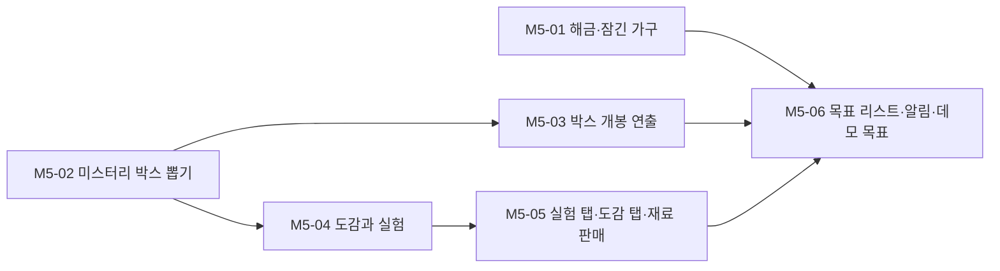

# M5. 성장과 수집

> 끝났을 때 되는 것: 레벨이 오르면 PC에서 새 빵과 가구를 사고, 미스터리 박스를 뜯어 희귀 재료를 얻고, 실험으로 비밀 레시피를 찾아 도감을 채운다. 처음 하는 사람은 HUD의 목표를 따라가면 된다.

재미 포인트: **F9** (박스를 뜯는 순간), **F10** (추리해서 레시피를 찾는다), **F11** (레벨이 오를 때마다 살 것이 생긴다), **F12** (도감을 채운다).

관련 설계: [08. 성장과 경제](../design/08-progression-and-economy.md), [09. 미스터리 박스와 도감](../design/09-mystery-box-and-recipe-book.md), [10. 화면과 UI](../design/10-ui.md)



M5-01과 M5-02는 서로 의존하지 않는다. 어느 쪽을 먼저 해도 된다.

## M5-01. 해금과 잠긴 가구

**목적**: 레벨이 열어 준 것을 돈으로 산다 (F11).

**파일**

- `Scripts/Systems/Growth/UnlockService.cs`
- `Scripts/Events/GrowthEvents.cs` (`UnlockPurchased`)
- `Scripts/World/LockedFurnitureView.cs`
- `Scripts/UI/GrowthTab.cs`
- 수정: `GameComposer`, `ShopSceneBuilder` (잠긴 가구에 `LockedFurnitureView`), `PcPanel`
- `Tests/EditMode/Growth/UnlockServiceTests.cs`

**공개 API**

```csharp
namespace BakeryShop.Growth
{
    public enum UnlockResult { Ok, AlreadyOwned, LevelTooLow, NotEnoughMoney }

    public sealed class UnlockService
    {
        public UnlockService(ContentDatabase content, Wallet wallet, ProgressionService progression,
                             RecipeBook recipes, OvenSystem ovens, ShelfSystem shelves, TraySystem trays, EventBus bus);

        public bool IsOwned(string unlockId);
        public UnlockResult CanBuy(string unlockId);
        public UnlockResult TryBuy(string unlockId);
        public IReadOnlyList<UnlockData> Available { get; }     // 아직 사지 않은 것. 레벨 순, 같으면 가격 순
        public IReadOnlyList<string> Owned { get; }
        public void Restore(IReadOnlyList<string> owned);       // 효과를 다시 적용한다. 돈과 이벤트는 건드리지 않는다
    }
}
```

**규칙**

- 확인 순서: 이미 삼 → 레벨 부족 → 돈 부족. 통과하면 `Wallet.TrySpend(가격, Unlock)` → 효과 적용 → `UnlockPurchased(해금 ID)`.

| 종류 | 효과 |
| --- | --- |
| `RecipeLicense` | `RecipeBook.Learn(대상 레시피)` |
| `Furniture` (대상이 `oven.`으로 시작) | `OvenSystem.Unlock(대상)` |
| `Furniture` (대상이 `shelf.`로 시작) | `ShelfSystem.Unlock(대상)` |
| `Tray` | `TraySystem.AddTray()` |

- 해금은 사는 즉시 적용된다. 영업 중에도 살 수 있다.
- `LockedFurnitureView`: 잠겨 있는 동안 반투명 재질과 자물쇠 표시. 바라보면 안내 자리에 `진열대 3 · 레벨 2 · 60,000원 (PC의 성장 탭에서 구매)`가 뜬다 (E는 동작하지 않는다). `UnlockPurchased`를 받으면 원래 재질로 바뀌고 짧은 효과와 소리가 난다. 불러오기에서는 효과 없이 바로 열린 상태가 된다.
- 성장 탭: 위에 레벨, 경험치 막대, 다음 레벨까지 남은 양. 아래에 `Available` 목록 (이름, 설명, 필요 레벨, 가격, **구매**). 레벨이 모자라면 회색에 `레벨 3에 열림`, 돈이 모자라면 가격이 빨간색이다. 산 것은 목록 아래 "보유"로 내려간다.
- PC의 성장 탭 이름 옆에, 지금 살 수 있는 것이 있으면 점 표시를 붙인다.

**테스트**

- 레벨과 돈이 충분하면 사지고, 돈이 가격만큼 줄고, `UnlockPurchased`가 발행된다
- 실패 사유 세 가지가 각각 나오고, 실패하면 돈과 상태가 그대로다
- 레벨도 돈도 모자라면 `LevelTooLow`다 (확인 순서)
- 레시피 라이선스를 사면 `RecipeBook.IsKnown`이 참이 되고 굽기 목록에 나온다
- 오븐을 사면 그 오븐에서 구울 수 있다
- 진열대를 사면 그 진열대에 올릴 수 있다
- 트레이를 사면 전체와 빈 트레이가 1씩 는다
- 같은 것을 두 번 살 수 없다
- `Available`이 레벨 순으로 정렬되고 산 것은 빠진다
- `Restore`가 효과를 다시 적용하고 돈을 쓰지 않고 이벤트를 발행하지 않는다

**Unity에서 확인**

- [ ] 진열대 3을 보면 반투명이고 `진열대 3 · 레벨 2 · 60,000원 (PC의 성장 탭에서 구매)`가 뜬다.
- [ ] 레벨 1에서 성장 탭을 열면 모든 항목이 회색이다. F7로 레벨 2가 되면 소금빵, 트레이 4, 진열대 3이 켜지고 탭에 점이 붙는다.
- [ ] 트레이 4를 사면 HUD가 `빈 트레이 4/4`가 된다.
- [ ] 소금빵 라이선스를 사면 오븐 패널의 목록에 소금빵이 생긴다.
- [ ] 진열대 3을 사면 그 자리에서 불투명해지고, 트레이를 올릴 수 있고, 손님이 그 앞에 선다.
- [ ] 오븐 2를 사서 두 대를 동시에 돌릴 수 있다. 두 대의 "띵!"이 구분되는가?
- [ ] 레벨 업 알림을 보고 성장 탭까지 가는 길이 자연스러운가? 무엇을 먼저 살지 고민이 되는가? (F11)

**의존**: M4

## M5-02. 미스터리 박스 뽑기

**목적**: 확률표에서 재료를 뽑고, 천장을 보장한다. 결과가 시뮬레이터의 통계와 맞는지 테스트로 확인한다.

**파일**

- `Scripts/Systems/Growth/LootService.cs`
- 수정: `Production/BoxService.cs` (미스터리 박스 지원), `GameComposer`
- `Tests/EditMode/Growth/LootServiceTests.cs`, `LootDistributionTests.cs`

**공개 API**

```csharp
namespace BakeryShop.Growth
{
    public sealed class LootService
    {
        public LootService(ContentDatabase content, Rng lootRng);

        /// <summary>뽑은 순서대로 돌려준다. 연속 꽝 횟수를 갱신한다.</summary>
        public IReadOnlyList<LootDrop> Open(string lootTableId);

        public int DryStreak(string lootTableId);
        public IReadOnlyList<PityState> Snapshot();
        public void Restore(IReadOnlyList<PityState> states);
    }

    [Serializable] public struct PityState { public string LootTableId; public int DryStreak; }
}
```

**규칙**

- 뽑기 규칙은 [09 문서의 뽑기 규칙](../design/09-mystery-box-and-recipe-book.md#뽑기-규칙)을 그대로 옮긴다. 시뮬레이터의 `open_box`와 한 줄씩 대응하게 쓴다.
- "Rare 이상"의 기준은 확률표의 `pityMinRarity`다.
- `BoxService.Open`(미스터리 박스): `LootService.Open` → 나온 재료를 창고에 넣음 → `BoxOpened(IsMystery = true, Drops, BestRarity)`. `CanOpen`이 참이 된다 (M3-03의 테스트를 고친다).
- 같은 재료가 여러 번 뽑혀도 `Drops`에서는 합치지 않는다 (연출이 하나씩 보여준다).

**테스트**

- 같은 시드로 같은 박스를 열면 결과가 같다
- 결과의 개수가 `rollsPerBox`다
- 가중치가 0인 항목은 나오지 않는다
- Rare 이상이 나온 박스 뒤에는 연속 꽝 횟수가 0이다
- 꽝이 `pityThreshold`번 이어지면 다음 박스에는 반드시 Rare 이상이 있다 (시드 1,000개로 확인)
- 천장으로 보장된 뽑기는 그 박스의 마지막 뽑기다
- 연속 꽝 횟수는 확률표마다 따로 센다
- `Snapshot` → `Restore` 뒤 이어지는 결과가 같다 (난수 상태도 함께 복원했을 때)
- 분포: 천장이 발동하지 않게 만든 확률표에서 10만 박스를 열면 항목별 비율이 가중치와 1%p 이내다
- 실제 `loot.basic` 20만 박스: Rare 이상이 나온 박스의 비율이 [시뮬레이터 리포트](../../Tools/balance/latest_report.md)의 28.7%와 1%p 이내다
- 실제 `loot.basic`: 첫 아몬드까지 여는 박스 수의 평균이 3.0에서 0.2 이내다
- 실제 `loot.basic`: Rare 이상 없이 6박스를 넘기는 경우가 없다 (20만 박스)

**Unity에서 확인**

- [ ] F7로 레벨 2를 만들고 미스터리 박스를 주문한다. 보라색 박스가 온다.
- [ ] 창고 선반에서 열면 F3 로그의 `BoxOpened`에 재료 5개가 찍히고 창고에 들어간다.

**의존**: M3-03

## M5-03. 박스 개봉 연출

**목적**: 박스를 여는 순간을 기대하게 만든다 (F9).

**파일**

- `Scripts/World/BoxOpenSequence.cs`, `LootItemView.cs`
- `Scripts/UI/LootSummaryView.cs`
- 수정: `StorageZone.cs`, `PlaceholderSfx.cs`, `ShopSceneBuilder`

**규칙**

- `BoxOpened(IsMystery = true)`를 받아 재생한다. 결과는 이미 창고에 들어가 있다. 연출은 보여주기만 한다.
- 순서는 [09 문서의 개봉 연출](../design/09-mystery-box-and-recipe-book.md#개봉-연출)을 따른다.

| 순간 | 화면 | 소리 |
| --- | --- | --- |
| 시작 | 박스가 창고 선반 앞 바닥에 놓이고 뚜껑이 열린다 (0.4초) | 뚜껑 소리 |
| 재료 하나 (0.6초 간격) | 재료가 튀어나와 박스 위에 떠서 돈다. 희귀도 색의 빛: 일반 흰색, 고급 초록, 희귀 파랑, 전설 금색 | 희귀도가 높을수록 높은 음 |
| 마지막이 Rare 이상 | 나오기 전에 1초 멈추고 박스가 떨린다 | 낮게 깔리는 소리 → 높은 음 |
| 끝 | 화면 아래에 요약 줄: `밀가루 ×2  설탕 ×2  아몬드 ×1`. 3초 뒤 사라진다 | - |

- 연출 중에도 플레이어는 움직일 수 있다. E를 다시 누르면 남은 재료를 한꺼번에 보여주고 요약으로 넘어간다.
- 핵심 재료를 처음 얻었으면 요약 줄 아래에 "도감에 새 힌트가 생겼습니다"를 붙인다 (M5-04의 `KeyIngredientFound`).
- 연출 중에 다른 박스를 열면 앞의 연출을 바로 끝내고 새 연출을 시작한다.
- 재료 묶음 박스는 연출이 없다.

**Unity에서 확인**

- [ ] 미스터리 박스를 열면 재료가 하나씩 나온다. 다섯 개가 다 나오는 데 3~4초다.
- [ ] 희귀도마다 색과 소리가 달라서, 화면을 보지 않아도 좋은 것이 나왔는지 알 수 있다.
- [ ] 마지막에 희귀 재료가 나올 때 뜸을 들이는 것이 느껴진다 (시드를 바꿔 가며 나올 때까지 연다. 개발용 F10 = 다음 박스에 천장 발동).
- [ ] 연출 중에 E를 누르면 건너뛴다. 걸어 다녀도 문제가 없다.
- [ ] 연출 도중에 게임을 끄고 다시 켜도(M6 이후) 재료가 두 번 들어오거나 사라지지 않는다.
- [ ] 다섯 박스를 연달아 열어 본다. 세 번째에도 기대가 되는가, 건너뛰고 싶어지는가? (F9)
- [ ] 꽝 박스의 아쉬움과 희귀 재료의 기쁨이 구분되는가?

**의존**: M5-02

## M5-04. 도감과 실험

**목적**: 핵심 재료를 얻으면 도감에 힌트가 생기고, 재료를 골라 실험하면 맞은 개수를 알려준다 (F10).

**파일**

- `Scripts/Systems/Growth/ExperimentMath.cs`, `ExperimentRecord.cs`, 수정: `RecipeBook.cs`
- `Scripts/Events/GrowthEvents.cs` (`KeyIngredientFound`, `ExperimentTried`, `RecipeDiscovered`)
- `Tests/EditMode/Growth/ExperimentMathTests.cs`, `RecipeBookExperimentTests.cs`, `ExperimentSolverTests.cs`

**공개 API**

```csharp
namespace BakeryShop.Growth
{
    public enum RecipeEntryState { Hidden, Hinted, Discovered }

    public enum ExperimentOutcome
    {
        Discovered, Failed,
        KeyIngredientMissing, AlreadyDiscovered, WrongChoiceCount, InvalidChoice, NotEnoughIngredients
    }

    public readonly struct ExperimentResult
    {
        public readonly ExperimentOutcome Outcome;
        public readonly int Matches;         // 맞은 재료 수
        public readonly int Slots;           // 칸 수
        public readonly string RecipeId;     // 발견했을 때
    }

    [Serializable]
    public sealed class ExperimentRecord
    {
        public List<string> Choices;         // 고른 재료 ID (ID 순으로 정렬해 저장)
        public int Matches;
    }

    public static class ExperimentMath
    {
        public static int CountMatches(IReadOnlyCollection<string> answer, IReadOnlyList<string> guess);
    }

    public sealed class RecipeBook    // M3-05의 클래스에 추가
    {
        public RecipeEntryState StateOf(string recipeId);
        public bool HasFoundKey(string keyIngredientId);
        public IReadOnlyList<string> ExperimentableKeys { get; }    // 창고에 있고, 짝 레시피를 아직 못 찾은 핵심 재료
        public int SlotCount(string keyIngredientId);
        public IReadOnlyList<ExperimentRecord> History(string keyIngredientId);
        public bool WasTried(string keyIngredientId, IReadOnlyList<string> choices);

        public bool CanExperiment(string keyIngredientId, IReadOnlyList<string> otherIngredientIds, out ExperimentOutcome reason);
        public ExperimentResult Experiment(string keyIngredientId, IReadOnlyList<string> otherIngredientIds);

        public int DiscoveredSecretCount { get; }
        public int SoldCount(string recipeId);                       // 도감의 "지금까지 판 개수"
    }
}
```

**규칙**

- `RecipeBook`이 `StorageChanged`를 구독한다. 늘어난 재료가 핵심 재료이고 처음 얻은 것이면 기록하고 `KeyIngredientFound(재료 ID, 짝 레시피 ID)`를 발행한다. 박스에서 나왔든 다른 경로든 같은 규칙이다.
- `StateOf`: 아는 레시피는 `Discovered`. 비밀 레시피는 핵심 재료를 얻은 적이 있으면 `Hinted`, 없으면 `Hidden`. 라이선스를 사지 않은 일반 레시피는 `Hidden`.
- `CanExperiment`의 확인 순서: 창고에 핵심 재료가 없음 → 이미 발견함 → 고른 개수가 칸 수와 다르거나 같은 재료를 두 번 고름 → 고를 수 없는 재료(`ExperimentChoices`에 없음) → 고른 재료 중 창고에 없는 것이 있음. 걸리면 `false`와 함께 사유를 돌려준다.
- `Experiment`: 검증 → 고른 재료를 1개씩 차감 (**핵심 재료는 차감하지 않는다**) → 판정.
  - 맞은 개수 = 고른 재료 중 정답(핵심 재료를 뺀 레시피 재료의 종류)에 들어 있는 수.
  - 맞은 개수가 칸 수와 같으면: `Learn(레시피)` → `ExperimentTried(…, 발견 = true)` → `RecipeDiscovered(레시피 ID)`.
  - 아니면: 기록에 추가 → `ExperimentTried(핵심 재료, 맞은 개수, 칸 수, 발견 = false)`.
- 재료의 수량은 맞히지 않는다. 종류만 본다.
- 같은 조합을 다시 시도할 수는 있다 (재료만 낭비). UI가 `WasTried`로 "이미 해 본 조합입니다"를 미리 알려준다.
- `SoldCount`는 `SaleCompleted`를 구독해 센다.

**테스트**

- `CountMatches`: 전부 맞음, 일부 맞음, 하나도 안 맞음, 순서가 달라도 같음
- 핵심 재료가 창고에 처음 들어오면 `KeyIngredientFound`가 한 번 발행되고, 두 번째에는 발행되지 않는다
- 일반 재료가 들어올 때는 발행되지 않는다
- `StateOf`: 숨김 → (핵심 재료 획득) 힌트 → (실험 성공) 발견
- 정답을 고르면 `Discovered`이고 레시피를 알게 되고 `RecipeDiscovered`가 발행된다
- 하나만 맞으면 `Failed`, `Matches`가 1이고 기록에 남는다
- **성공해도 실패해도 핵심 재료의 수량이 그대로다**
- 고른 일반 재료는 성공·실패 모두 1개씩 준다
- 거부 사유 다섯 가지가 각각 나오고, 거부되면 재료가 줄지 않는다
- 발견한 뒤에는 그 핵심 재료가 `ExperimentableKeys`에서 빠진다
- 발견한 비밀 레시피는 핵심 재료를 포함한 재료로 구울 수 있고, 구우면 핵심 재료가 1개 준다
- `WasTried`가 순서와 상관없이 같은 조합을 알아본다
- `ExperimentSolver`: 실제 콘텐츠의 `ExperimentChoices`(8종)로 만들 수 있는 모든 정답(2칸 28가지, 3칸 56가지)에 대해, "지금까지의 결과와 모순되지 않는 후보 중 첫 번째를 고르는" 풀이가 7번 안에 정답을 찾는다
- `ExperimentSolver`: 같은 조건에서 평균 시도 횟수가 5 이하다. 재료 종류를 늘려 실험이 너무 어려워지면 이 두 테스트가 알려준다

**의존**: M5-02 (핵심 재료를 얻는 경로), M3-05

## M5-05. 실험 탭, 도감 탭, 재료 판매

**목적**: 실험과 도감을 화면에서 쓸 수 있게 한다 (F10, F12).

**파일**

- `Scripts/UI/ExperimentTab.cs`, `RecipeBookTab.cs`, `ResellView.cs`
- `Scripts/Systems/Economy/ResellService.cs`
- 수정: `OvenPanel.cs`, `OvenView.cs` (굽는 중에도 `오븐 열기 (실험)`), `PcPanel.cs`, `OrderTab.cs`
- `Tests/EditMode/Economy/ResellServiceTests.cs`

**공개 API**

```csharp
namespace BakeryShop.Economy
{
    public sealed class ResellService
    {
        public ResellService(ContentDatabase content, StorageInventory storage, Wallet wallet);
        public int PriceOf(string ingredientId);
        public bool TrySell(string ingredientId, int count);    // 창고에서 빼고 Wallet.Add(…, Resell)
    }
}
```

**규칙**

- 실험 탭의 구성은 [10 문서의 오븐 패널](../design/10-ui.md#오븐-패널)을 따른다.
  - 왼쪽: `ExperimentableKeys` 목록. 없으면 "미스터리 박스에서 희귀한 재료를 찾아보세요".
  - 가운데: 도감의 힌트 문장, 칸 (2개 또는 3개), `ExperimentChoices` 버튼들 (보유량 표시, 0개면 꺼짐). 버튼을 누르면 빈 칸에 들어가고, 칸을 누르면 빠진다.
  - 오른쪽: 실험 기록. `밀가루 · 설탕 → 1개 맞음`.
  - **실험하기**: `CanExperiment`가 참일 때만 켜진다. 이미 해 본 조합이면 버튼 위에 "이미 해 본 조합입니다".
- 실패하면 칸이 흔들리고 "2개 중 1개가 맞았습니다"가 뜬다. 칸은 비워지지 않는다 (하나만 바꿔 다시 시도하기 쉽게).
- 발견하면 칸이 빛나고 빵 이름과 그림이 뜬다. 2초 뒤 굽기 탭으로 넘어가고 새 레시피가 선택되어 있다.
- 오븐이 굽는 중(`Baking`)에도 `[E] 오븐 열기 (실험)`으로 패널을 열 수 있다. 이때 굽기 탭의 굽기 버튼은 꺼져 있다.
- 도감 탭: 레시피 10칸을 2줄로. 상태별 표시는 [09 문서의 도감의 상태](../design/09-mystery-box-and-recipe-book.md#도감의-상태)를 따른다. 위에 `발견 4 / 10`. 칸을 누르면 오른쪽에 상세(재료, 시세, 판 개수 또는 힌트와 실험 기록).
- 재료 판매: 발주 탭 아래의 **재료 판매**를 누르면 창고의 재료 목록 (이름, 보유량, 판매가, `-` 수량 `+`, **판매**). 핵심 재료는 희귀도 색으로 표시하고, 짝 레시피를 아직 못 찾은 핵심 재료를 팔려 하면 "이 재료로 찾을 수 있는 레시피가 있습니다"를 한 번 확인한다.

**테스트**

- `ResellService`: 팔면 창고가 줄고 돈이 `판매가 × 개수`만큼 늘고 사유가 `Resell`이다
- `ResellService`: 가진 것보다 많이 팔 수 없다

**Unity에서 확인**

- [ ] 아몬드를 얻은 뒤 오븐 패널의 실험 탭에 아몬드가 보이고, 힌트 문장과 칸 2개가 나온다.
- [ ] 재료 두 개를 골라 실험하면 "2개 중 n개가 맞았습니다"가 뜨고 기록에 남는다. 아몬드 수량은 그대로다.
- [ ] 힌트를 읽지 않고 결과만 보고 추리해서 찾아본다. 몇 번 걸렸는가? (설계 기준: 평균 4~5번, 많아도 7번)
- [ ] 힌트를 읽으면 더 빨리 찾는가? 힌트가 너무 쉽거나 어렵지 않은가? (F10)
- [ ] 발견하면 굽기 탭에 아몬드 크루아상이 생기고, 구워서 진열하면 손님이 사 간다. 경험치와 평판이 오른다.
- [ ] 굽는 중인 오븐에서도 실험 탭을 열 수 있다.
- [ ] 도감 탭에서 숨김 `???`, 힌트(실루엣), 발견 세 상태가 구분된다. 빈 칸을 채우고 싶어지는가? (F12)
- [ ] 재료 판매에서 아몬드를 팔려 하면 확인 문구가 뜬다. 팔면 2,000원이 들어온다.

**의존**: M5-04

## M5-06. 목표 리스트, 알림, 데모 목표

**목적**: 처음 하는 사람이 설명 없이 첫날을 마치고, 데모의 끝을 안다.

**파일**

- `Scripts/Systems/Growth/ObjectiveTracker.cs`, `ObjectiveList.cs`
- `Scripts/Events/GrowthEvents.cs` (`ObjectiveCompleted`, `DemoGoalReached`)
- `Scripts/UI/ObjectiveView.cs`, `DemoGoalCard.cs`, 수정: `ToastView.cs`
- `Tests/EditMode/Growth/ObjectiveTrackerTests.cs`

**공개 API**

```csharp
namespace BakeryShop.Growth
{
    public sealed class Objective
    {
        public string Id { get; }
        public string Text { get; }           // "{0}/{1}"이 들어 있으면 진행도를 넣는다
        public int Target { get; }            // 대부분 1
    }

    public static class ObjectiveList
    {
        public static IReadOnlyList<Objective> All { get; }     // 10 문서의 표 순서
    }

    public sealed class ObjectiveTracker
    {
        public ObjectiveTracker(EventBus bus, ProgressionService progression, RecipeBook recipes, ContentDatabase content);

        public Objective Current { get; }                       // 모두 끝났으면 null
        public int Progress { get; }
        public bool DemoGoalReached { get; }
        public IReadOnlyList<string> Completed { get; }
        public void Restore(IReadOnlyList<string> completed, bool demoGoalShown);
    }
}
```

**규칙**

- 목표와 완료 조건은 [10 문서의 목표 리스트](../design/10-ui.md#목표-리스트-온보딩)의 표와 같다.
- `ObjectiveTracker`는 게임을 시작할 때부터 목표에 쓰이는 이벤트의 횟수를 모두 세어 둔다. 목표가 열렸을 때 조건이 이미 채워져 있으면 바로 완료하고 다음으로 넘어간다 (**이미 한 일을 다시 시키지 않는다**).
- 목표가 완료되면 `ObjectiveCompleted`를 발행하고, HUD에서 그 줄에 줄을 긋고 1초 뒤 다음 목표를 보여준다.
- 마지막 목표(레벨 5와 비밀 레시피 2종)를 달성하면 `DemoGoalReached`를 한 번 발행한다. `DemoGoalCard`가 "동네 맛집 인증" 카드를 띄운다 (플레이한 날 수, 판 빵의 수, 발견한 레시피). **계속하기**를 누르면 닫히고 게임은 이어진다. 이후 HUD의 목표 영역은 숨긴다.
- 데모 목표의 숫자(레벨 5, 2종)는 `content.json`의 `progression`에 `demoGoalLevel`, `demoGoalSecretRecipes`로 둔다.
- 남은 알림을 `ToastView`에 연결한다: 비밀 레시피 발견, 핵심 재료 첫 획득, 줄에서 손님이 떠남, 영업 종료, 지원금. 문구는 [10 문서의 알림](../design/10-ui.md#알림)과 같다.

**테스트**

- 처음의 목표는 "오븐에서 빵을 구워 보세요"다
- `BakingStarted`가 발행되면 첫 목표가 완료되고 다음 목표가 된다
- 손님 3명 목표: `SaleCompleted` 두 번이면 진행도 2/3, 세 번이면 완료
- 목표가 열리기 전에 한 일은 열리는 순간 바로 완료 처리된다 (재료 주문을 1일차 아침에 미리 한 경우)
- 한 이벤트로 연달아 두 목표가 완료될 수 있다
- 레벨 5이고 비밀 레시피가 1종이면 데모 목표가 아니다. 2종이 되는 순간 `DemoGoalReached`가 한 번 발행된다
- `Restore` 뒤에는 완료하지 않은 첫 목표가 보이고, 이미 본 데모 카드는 다시 뜨지 않는다
- 모든 목표의 ID가 서로 다르다

**Unity에서 확인**

- [ ] 새 게임을 시작하면 HUD 오른쪽에 "오븐에서 빵을 구워 보세요"가 보인다.
- [ ] **게임을 처음 보는 사람에게 아무 설명 없이 시켜 본다.** 첫날 정산까지 막히지 않고 가는가? 막힌 곳과 걸린 시간을 적는다. (가능하면 2명)
- [ ] 목표가 완료될 때 줄이 그어지고 다음 목표가 나온다. 눈에 띄지만 방해되지 않는다.
- [ ] 개발용 단축키로 레벨 5와 비밀 레시피 2종을 만들면 "동네 맛집 인증" 카드가 뜬다. 계속하기를 누르면 게임이 이어진다.
- [ ] 알림이 한꺼번에 여러 개 생겨도 겹치지 않고 차례로 나온다.

**의존**: M5-01, M5-03, M5-05

## 완료 기준

새 게임에서 시작해 아래를 플레이로 확인한다 (개발용 단축키 없이 한 번, 시간이 없으면 단축키로 한 번).

1. 목표를 따라 첫날을 마친다.
2. 레벨 2가 되어 미스터리 박스를 주문하고 연다. 재료가 하나씩 나온다.
3. 아몬드를 얻어 실험한다. 몇 번의 시도 끝에 아몬드 크루아상을 찾는다.
4. 아몬드 크루아상을 구워 판다. 도감에 판 개수가 올라간다.
5. 번 돈으로 소금빵 라이선스, 트레이, 진열대 3을 산다.
6. 레벨 5와 비밀 레시피 2종을 달성하면 인증 카드가 뜬다.

시뮬레이터 기준으로 레벨 5는 8.6일차, 첫 비밀 레시피는 5.6일차다. 실제 플레이에서 크게 다르면 `xpThresholds`와 박스 확률을 다시 본다. EditMode 테스트는 약 70개가 더해진다. 태그: `v0.5-growth`
