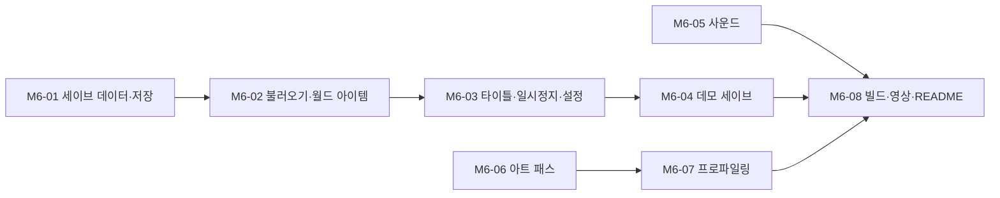

# M6. 저장과 마감

> 끝났을 때 되는 것: 게임을 껐다 켜도 이어서 할 수 있고, 타이틀 화면에서 데모 세이브로 중반부터 볼 수 있다. 소리와 외형이 갖춰지고, 빌드와 영상과 README가 포트폴리오로 제출할 수 있는 상태가 된다.

관련 설계: [06. 세이브](../design/06-save.md), [10. 화면과 UI](../design/10-ui.md), [기획서의 MVP 범위](../GDD.md)



세이브(01 ~ 04)와 사운드·아트(05, 06)는 서로 의존하지 않는다. 세이브를 먼저 끝내는 것을 권한다. 세이브는 다른 모든 시스템의 상태를 건드리므로 버그가 가장 많이 나올 곳이고, 그만큼 트러블슈팅 기록이 나올 곳이다.

## M6-01. 세이브 데이터와 저장

**목적**: 하루가 끝날 때 게임 상태를 파일로 쓴다.

**파일**

- `Scripts/Systems/Save/SaveData.cs`, `SaveService.cs`, `ISaveStorage.cs`, `FileSaveStorage.cs`, `MemorySaveStorage.cs`, `WorldItemData.cs`
- 수정: `GameComposer`, `GameBootstrap` (`DayAdvanced`에서 저장)
- `Tests/EditMode/Save/SaveCaptureTests.cs`, `FileSaveStorageTests.cs`

**공개 API**

```csharp
namespace BakeryShop.Save
{
    /// <summary>세이브 파일의 모양. 06 문서의 JSON과 필드 이름이 같다 (JsonUtility가 필드 이름을 그대로 쓰므로 camelCase).</summary>
    [Serializable]
    public sealed class SaveData
    {
        public int version;
        public int day;
        public int money;
        public int reputation;
        public int xp;
        public uint customerRngState;
        public uint lootRngState;
        public int nextEntityId;
        public List<string> unlocks;
        public List<PriceEntry> prices;
        public List<StorageEntry> storage;
        public List<string> knownRecipes;
        public List<string> foundKeyIngredients;
        public List<ExperimentEntry> experiments;
        public List<PityEntry> pity;
        public List<SoldEntry> soldCounts;
        public List<ShelfEntry> shelves;
        public List<WorldItemData> worldItems;
        public int objectivesDone;
        public bool demoGoalShown;
        public SettingsEntry settings;
        public List<DailyReport> history;
    }

    public interface ISaveStorage
    {
        bool Exists(string slot);
        string Read(string slot);                // 없으면 null
        void Write(string slot, string json);
        void Delete(string slot);
    }

    public interface IWorldItemSource
    {
        List<WorldItemData> Capture();
        void Restore(IReadOnlyList<WorldItemData> items);
    }

    public sealed class SaveService
    {
        public const int CurrentVersion = 1;

        public SaveService(GameContext context, ISaveStorage storage);
        public void AttachWorld(IWorldItemSource world);      // 씬에서. 테스트에서는 가짜

        public string Slot { get; set; }                       // "save_1" 또는 "demo"
        public SaveData Capture();
        public void Save();                                    // Capture → JSON → storage.Write
    }
}
```

**규칙**

- 저장하는 항목과 뜻은 [06 문서의 표](../design/06-save.md#저장하는-것)를 따른다. 모델마다 이미 있는 `Snapshot()`과 프로퍼티를 읽어 채운다. `SaveService`가 모델의 private 상태를 들여다보지 않는다.
- 저장 시점은 `DayAdvanced` 하나뿐이다. 하루 마무리 단계가 끝난 뒤라서 오븐·손님·배송 대기가 비어 있다. 저장되는 `day`는 새 날이다.
- `FileSaveStorage.Write`: `save_1.json.tmp`에 다 쓴 뒤 → 기존 `save_1.json`을 `save_1.json.bak`으로 옮기고 → 임시 파일을 `save_1.json`으로 바꾼다. 쓰는 도중 꺼져도 이전 세이브가 남는다.
- `FileSaveStorage.Read`: 본 파일이 없고 `.bak`만 있으면 `.bak`을 읽는다.
- 경로는 `Application.persistentDataPath`. 생성자에서 폴더를 받아 테스트에서는 임시 폴더를 쓴다.
- JSON은 `JsonUtility.ToJson(data, prettyPrint: true)`. 사람이 열어 볼 수 있어야 트러블슈팅이 쉽다.
- 저장에 실패하면(디스크 오류) 예외를 잡아 로그를 남기고 알림 "저장하지 못했습니다"를 띄운다. 게임은 계속된다.

**테스트**

- 새 게임 직후 `Capture`: 버전, 1일차, 시작 자금, 평판 500, 경험치 0, 시작 재료, 시작 레시피가 들어 있다
- 가격을 바꾸고, 해금을 사고, 빵을 진열한 뒤 `Capture`하면 각 항목이 들어 있다
- 시세와 같은 가격은 `prices`에 들어가지 않는다
- 빈 칸은 `recipeId`가 빈 문자열이고 `breads`가 비어 있다
- `DayAdvanced`가 발행되면 저장소에 한 번 쓰인다
- 저장된 `day`가 정산한 날 + 1이다
- `FileSaveStorage`: 쓰고 읽으면 같은 문자열이다
- `FileSaveStorage`: 두 번 쓰면 `.bak`에 첫 번째 내용이 있다
- `FileSaveStorage`: 본 파일을 지워도 `.bak`에서 읽는다
- `FileSaveStorage`: `.tmp`만 남아 있는 상태(쓰다가 꺼짐)에서 읽으면 이전 본 파일을 읽는다

**Unity에서 확인**

- [ ] 하루를 정산하면 `persistentDataPath`에 `save_1.json`이 생긴다 (경로는 콘솔 로그에 찍힌다). 열어 보면 읽을 수 있는 JSON이다.
- [ ] 정산을 두 번 하면 `.bak`이 생긴다.

**의존**: M5

## M6-02. 불러오기와 월드 아이템

**목적**: 저장한 파일로 게임을 같은 상태로 되돌린다.

**파일**

- `Scripts/Systems/Save/SaveLoader.cs`, `ISaveMigration.cs`, `SaveMigrations.cs`
- `Scripts/World/WorldItemRegistry.cs` (`IWorldItemSource` 구현)
- 수정: `GameBootstrap`, `BoxSpawner`, `TrayFactory`, 각 모델의 `Restore`
- `Tests/EditMode/Save/SaveRoundTripTests.cs`, `SaveCorruptionTests.cs`, `SaveMigrationTests.cs`

**공개 API**

```csharp
namespace BakeryShop.Save
{
    public enum LoadResult { Ok, NotFound, Corrupted, NewerVersion }

    public interface ISaveMigration
    {
        int FromVersion { get; }
        void Apply(SaveData data);          // FromVersion → FromVersion + 1
    }

    public sealed class SaveLoader
    {
        public SaveLoader(ISaveStorage storage, IReadOnlyList<ISaveMigration> migrations);
        public LoadResult TryRead(string slot, out SaveData data);      // 읽기, 파싱, 버전 변환까지
        public LoadResult TryParse(string json, out SaveData data);
        public List<string> Apply(SaveData data, GameContext context, IWorldItemSource world);   // 경고 목록을 돌려준다
    }
}
```

**규칙**

- 복원 순서 ([06 문서의 불러오기 순서](../design/06-save.md#불러오기-순서)):

| 순서 | 대상 | 이유 |
| --- | --- | --- |
| 1 | 난수 상태, 개체 ID 발급기, 날짜 | 이후의 복원이 ID를 새로 받지 않게 |
| 2 | 지갑, 평판, 경험치 | 서로 의존하지 않는다 |
| 3 | 아는 레시피, 핵심 재료, 실험 기록, 판 개수 | 해금보다 먼저 (해금이 `Learn`을 다시 불러도 같다) |
| 4 | 해금 (`UnlockService.Restore`) | **진열대보다 먼저.** 잠긴 진열대에 빵을 채우지 않게 |
| 5 | 창고, 가격, 천장 | |
| 6 | 진열대의 빵 | |
| 7 | 트레이 (`TraySystem.Restore`) → 월드 아이템 (`IWorldItemSource.Restore`) | 트레이 모델을 먼저 만들고 뷰를 붙인다 |
| 8 | 목표, 설정, 리포트 기록 | |

- 모든 `Restore`는 이벤트를 발행하지 않는다. 복원이 끝난 뒤 `GameBootstrap`이 뷰를 초기화하고, 뷰는 모델을 읽어 스스로 맞춘다 (`ShelfView.Refresh()` 등).
- 콘텐츠에 없는 ID(지운 레시피, 이름을 바꾼 재료)와 씬에 없는 진열대 ID는 **건너뛰고 경고 목록에 넣는다.** 세이브 전체를 버리지 않는다.
- `TryParse`: JSON이 깨졌으면 `Corrupted`. `version`이 현재보다 크면 `NewerVersion`. 작으면 변환기를 순서대로 적용한다.
- `WorldItemRegistry`: 살아 있는 `DeliveryBox`와 `TrayView`를 등록해 두고, `Capture`에서 종류·위치·회전·내용물을 돌려준다. `Restore`에서는 `BoxSpawner`와 `TrayFactory`로 다시 만든다.
- 복원한 물건은 `Rigidbody.position`을 맞추고, 모두 놓은 뒤 `Physics.SyncTransforms()`를 한 번 부른다. 물리가 안정될 때까지 한 프레임 동안 kinematic으로 두었다가 푼다 (쌓여 있던 박스가 불러오자마자 튀지 않게. [TS-002](../troubleshooting/TS-002-drop-physics-pose-sync.md)).
- `GameBootstrap.Awake`: `LaunchRequest`가 "이어하기"면 `StartNewGame` 대신 `TryRead` → `Apply`. 실패하면 타이틀로 돌아가 사유를 보여준다.

**테스트**

- **왕복**: `HeadlessGame`으로 3일을 플레이 → `Capture` → 새 컨텍스트에 `Apply` → 다시 `Capture`한 결과가 처음과 같다 (JSON 문자열 비교)
- 왕복 뒤 같은 입력으로 하루를 더 돌리면 두 게임의 리포트가 같다 (난수 상태까지 복원되었다는 뜻)
- 해금한 진열대에 있던 빵이 복원된다 (해금이 진열대보다 먼저 적용된다)
- 트레이 2개가 작업대에 있던 상태를 복원하면 빈 트레이 수가 `전체 − 2`다
- 하루 지난 빵의 `daysOld`와 품질이 유지된다
- 연속 꽝 횟수가 유지되어, 복원 뒤 연 박스에서 천장이 발동한다
- 실험 기록과 도감 상태가 유지된다
- 없는 레시피 ID가 가격·진열대·아는 레시피에 섞여 있어도 나머지가 복원되고 경고가 그 수만큼 나온다
- 없는 진열대 ID는 건너뛴다
- 깨진 JSON은 `Corrupted`, 빈 문자열은 `Corrupted`, 없는 슬롯은 `NotFound`
- 버전이 더 높은 세이브는 `NewerVersion`이고 게임 상태를 건드리지 않는다
- 변환기: 가짜 변환기(0 → 1)를 등록하고 버전 0의 JSON을 넣으면 적용되고 버전이 1이 된다
- `Apply` 도중 어떤 이벤트도 발행되지 않는다 (`EventBus.Trace`로 확인)

**Unity에서 확인**

- [ ] 박스 2개를 문 앞에 쌓아 두고, 트레이 1개를 작업대에 두고, 진열대에 빵을 둔 채 정산한다. 게임을 끄고 이어하기로 들어오면 모두 같은 자리에 있다.
- [ ] 쌓여 있던 박스가 불러오자마자 무너지거나 튀지 않는다.
- [ ] 돈, 평판, 레벨, 가격표, 도감, 목표가 그대로다.
- [ ] 해금한 진열대 3이 열려 있고 그 위의 빵도 있다.
- [ ] 불러온 직후 "레벨 업", "새 레시피 발견" 같은 알림이나 효과음이 나오지 않는다.
- [ ] `save_1.json`의 중간을 지워 깨뜨리고 이어하기를 누르면 `.bak`으로 불러오거나, 둘 다 깨졌으면 타이틀에 "세이브 파일을 읽을 수 없습니다"가 뜬다. 게임이 멈추지 않는다.
- [ ] 영업 중에 게임을 끄고 이어하면 그날 아침으로 돌아간다 (의도한 동작).

**의존**: M6-01

## M6-03. 타이틀, 일시정지, 설정

**목적**: 게임의 시작과 끝을 만든다.

**파일**

- `Scripts/Core/LaunchRequest.cs`
- `Scripts/UI/TitleScreen.cs`, `PauseMenu.cs`, `SettingsView.cs`, `GameSettings.cs`
- `Editor/TitleSceneBuilder.cs`, 생성물: `Scenes/Title.unity`
- 수정: `GameBootstrap`, `PanelHost`, `PlayerMotor` (감도), `CashPaymentPanel` (거스름돈 표시)
- `Tests/EditMode/Core/LaunchRequestTests.cs`

**공개 API**

```csharp
namespace BakeryShop.Core
{
    public enum LaunchMode { NewGame, Continue, DemoSave }

    /// <summary>타이틀에서 고른 것을 Shop 씬으로 넘긴다. 씬을 넘어 전달할 값이 이것 하나라서 static을 쓴다
    /// (게임 규칙의 상태가 아니고, 한 번 읽으면 지워진다).</summary>
    public static class LaunchRequest
    {
        public static void Set(LaunchMode mode);
        public static LaunchMode Consume();       // 없으면 NewGame (Shop 씬을 에디터에서 바로 실행한 경우)
    }
}

namespace BakeryShop.UI
{
    /// <summary>기기 설정. 세이브가 아니라 PlayerPrefs에 둔다.</summary>
    public sealed class GameSettings
    {
        public float MouseSensitivity { get; set; }     // 0.2 ~ 3.0
        public float MasterVolume { get; set; }         // 0 ~ 1
        public bool ShowChangeAmount { get; set; }      // 현금 결제에서 거스름돈 금액 표시
        public void Load();
        public void Save();
        public event Action Changed;
    }
}
```

**규칙**

- 타이틀: **새 게임** / **이어하기** (세이브가 있을 때만 켜짐. 옆에 `7일차 · Lv.3 · 152,300원`) / **데모 세이브로 시작** (M6-04) / **설정** / **종료**. 새 게임을 눌렀는데 세이브가 있으면 "기존 세이브를 덮어씁니다"를 확인한다.
- `LaunchMode.NewGame`은 슬롯 `save_1`에, `DemoSave`는 슬롯 `demo`에 저장한다. 데모로 시작해도 자기 세이브가 지워지지 않는다.
- 일시정지 메뉴: 패널이 열려 있지 않을 때 Esc. `TimeService.SetPaused(true)`, 입력 모드 UI. **계속하기** / **설정** / **타이틀로** ("오늘 진행한 내용은 저장되지 않습니다" 확인).
- 일시정지 중에는 오븐, 손님, 배송, 영업 시계가 모두 멈춘다. 결제 패널이 열린 채로는 일시정지할 수 없다 (Esc가 동작하지 않는 패널).
- 설정은 바꾸는 즉시 적용되고 `PlayerPrefs`에 저장된다.
- M2-09의 임시 Esc 동작(커서 풀기)을 지운다.
- `Shop` 씬을 에디터에서 바로 실행하면 새 게임으로 시작한다 (개발 편의).

**테스트**

- `LaunchRequest`: `Set` 뒤 `Consume`은 그 값을, 한 번 더 `Consume`하면 `NewGame`을 돌려준다
- `GameSettings`: 범위를 벗어난 값은 잘린다. 값이 바뀌면 `Changed`가 한 번 불린다

**Unity에서 확인**

- [ ] `Title` 씬에서 시작한다. 세이브가 없으면 이어하기가 꺼져 있다.
- [ ] 새 게임 → 하루 정산 → Esc → 타이틀로 → 이어하기에 `2일차 · Lv.1 · …원`이 보인다. 누르면 2일차 준비 중이다.
- [ ] 영업 중 Esc: 손님과 오븐 막대와 시계가 멈춘다. 계속하기를 누르면 이어진다. 멈춘 동안 오븐이 타지 않는다.
- [ ] PC 패널이 열려 있을 때 Esc는 패널만 닫는다. 한 번 더 누르면 일시정지다.
- [ ] 설정에서 마우스 감도를 바꾸면 바로 느껴지고, 게임을 껐다 켜도 유지된다.
- [ ] 거스름돈 표시를 끄면 현금 패널에 거스름돈 금액이 보이지 않는다 (직접 계산해야 한다).
- [ ] 빌드 설정의 씬 목록에 `Title`(0번)과 `Shop`(1번)이 들어 있다.

**의존**: M6-02

## M6-04. 데모 세이브

**목적**: 포트폴리오를 보는 사람이 5분 안에 중반 플레이(박스 개봉, 실험, 바쁜 영업)를 볼 수 있게 한다.

**파일**

- `Data/demo_save.json` (TextAsset)
- `Editor/DemoSaveTools.cs`
- 수정: `TitleScreen`, `GameBootstrap`
- `Tests/EditMode/Save/DemoSaveTests.cs`

**규칙**

- 데모 세이브의 상태: **6일차, 레벨 3, 미스터리 박스 2개가 문 앞에 놓여 있다.** 소금빵 라이선스, 트레이 4개, 진열대 3을 갖고 있고, 아몬드를 1개 갖고 있지만 아몬드 크루아상은 아직 찾지 못했다. 돈은 80,000원 안팎이라 바게트 라이선스(70,000원)는 살 수 있고 오븐 2(150,000원)는 아직 모자란다. 진열대에 어제 빵이 몇 개 남아 있다.
- 이 상태에서 시작하면 5분 안에 볼 수 있는 것: 박스 2개 개봉(F9), 아몬드로 실험(F10), 손님이 많은 영업(F3), 무엇을 먼저 살지의 고민(F11).
- 만드는 방법: 직접 6일차까지 플레이해서 만들거나, 개발용 단축키로 상태를 만든 뒤 정산한다. 메뉴 **BakeryShop → 현재 세이브를 데모 세이브로 복사**가 `save_1.json`을 `Data/demo_save.json`으로 복사한다.
- 데모 세이브는 저장소에 커밋한다. 세이브 형식을 바꾸면 테스트가 실패하므로, 변환기를 추가하거나 데모 세이브를 다시 만든다.
- 목표 리스트는 9번(박스를 창고로 가져가 열어 보세요)부터 보인다.

**테스트**

- `demo_save.json`이 현재 버전으로 읽히고 `Apply`의 경고가 0개다
- 불러온 상태가 6일차, 레벨 3이고 문 앞에 미스터리 박스가 2개다
- 불러온 뒤 `HeadlessGame`으로 하루를 돌려도 예외가 없다
- 아몬드가 창고에 있고 아몬드 크루아상은 `Hinted` 상태다

**Unity에서 확인**

- [ ] 타이틀의 **데모 세이브로 시작**을 누르면 6일차 준비 중이고 문 앞에 보라색 박스 2개가 있다.
- [ ] 처음 보는 사람이 설명 없이 5분 안에 박스를 열고 실험 탭을 찾아가는가? HUD의 목표가 안내하는가?
- [ ] 데모로 하루를 정산한 뒤 타이틀로 나가면, 이어하기는 여전히 자기 세이브를 가리킨다.

**의존**: M6-03

## M6-05. 사운드

**목적**: 코드로 만든 임시 소리를 실제 소리로 바꾸고, 빠진 소리를 채운다.

**파일**

- `Scripts/World/AudioService.cs`, `SoundLibrary.cs` (ScriptableObject)
- `Art/Audio/` (소리 파일), `docs/CREDITS.md`
- 수정: `PlaceholderSfx`를 쓰던 곳, `ShopSceneBuilder`

**규칙**

- `AudioService`가 이벤트를 구독해 소리를 낸다. 다른 코드는 소리를 직접 재생하지 않는다 (이벤트를 발행하면 소리는 따라온다).

| 이벤트 | 소리 | 위치 |
| --- | --- | --- |
| `OvenReady` | 맑은 "띵!" | 오븐 (3D) |
| 타기 5초 전 ~ | 1초 간격 경고음 | 오븐 (3D) |
| `OvenBurnt` | 낮은 실패음 | 오븐 (3D) |
| `BakingStarted` | 오븐 문 닫는 소리 | 오븐 (3D) |
| 스캔 | "삑" | 2D |
| `SaleCompleted` | 금전 등록기 | 2D |
| `PaymentRejected` | 짧은 거부음 | 2D |
| `CustomerEntered` | 문 종소리 (0.5초 안에 겹치면 생략) | 문 (3D) |
| `OrderDelivered` | 박스 내려놓는 소리 | 배송 지점 (3D) |
| 박스 개봉의 재료 | 희귀도별 4단계 음 | 2D |
| `LevelUp`, `RecipeDiscovered` | 짧은 축하음 | 2D |
| `DayPhaseChanged` → 영업 / 마감 | 팻말 소리 / 종소리 | 2D |
| 들기, 내려놓기 | 짧은 효과음 | 2D |
| `AromaStarted` | 없음 (화면 표시로 충분하면) | - |

- 3D 소리의 감쇠 거리는 매장 대각선(약 15m)에서도 "띵!"이 들리게 맞춘다. F2와 F3이 이 소리에 달려 있다.
- 배경음: 영업 중에는 잔잔한 매장 음악, 준비 단계에는 더 조용한 음악. 없어도 된다 (효과음이 우선).
- 소리는 CC0 라이선스만 쓴다 ([Kenney](https://kenney.nl/assets), [freesound](https://freesound.org)의 CC0 등). 파일마다 출처와 라이선스를 `docs/CREDITS.md`에 적는다.
- 전체 음량은 `GameSettings.MasterVolume`을 따른다.
- 같은 소리가 한 프레임에 여러 번 요청되면 한 번만 낸다.

**Unity에서 확인**

- [ ] 표의 소리가 모두 난다. 빠진 것이 없다.
- [ ] 계산 자리에서 눈을 감고 "띵!"을 들으면 어느 쪽 오븐인지 알 수 있다 (오븐 2대일 때).
- [ ] 손님 10명이 몰려도 소리가 시끄럽게 겹치지 않는다.
- [ ] 설정의 소리 크기가 모든 소리에 적용된다.
- [ ] `docs/CREDITS.md`에 쓴 파일이 모두 적혀 있다.

**의존**: M5 (세이브와는 무관)

## M6-06. 아트 패스

**목적**: 회색 상자를 빵집으로 보이게 한다. 프로그래머 포트폴리오이므로 "깔끔하고 읽기 쉬운" 수준이 목표다.

**파일**

- `Prefabs/Furniture/`, `Prefabs/Bread/`, `Prefabs/Customer/`, `Art/Models/`, `Art/Materials/`
- 수정: `ShopSceneBuilder` (프리팹이 있으면 프리팹을, 없으면 상자를 놓는다), `docs/CREDITS.md`

**규칙**

- **씬을 손으로 고치지 않는 원칙을 유지한다.** 빌더가 가구 ID와 같은 이름의 프리팹(`Prefabs/Furniture/oven.01.prefab`)을 찾아 놓고, 없으면 그레이박스 상자를 놓는다. 외형 작업은 프리팹 안에서 하고, 씬은 언제든 메뉴로 다시 만든다.
- 프리팹의 콜라이더 크기는 [11 문서](../design/11-shop-layout.md)의 가구 크기를 유지한다. 외형이 달라져도 길과 상호작용 거리가 바뀌지 않는다.
- 에셋은 CC0 로우폴리를 쓴다 ([Kenney](https://kenney.nl/assets), [Quaternius](https://quaternius.com) 등). 한 묶음에서 가져와 스타일을 맞춘다. 출처를 `docs/CREDITS.md`에 적는다.
- 3D 모델은 Git LFS로 올라간다 (`.gitattributes`에 설정되어 있다).

우선순위 (위에서부터, 시간이 되는 데까지):

| 순서 | 대상 | 이유 |
| --- | --- | --- |
| 1 | 빵 10종의 외형 (또는 모양 3가지 × 색) | 화면에서 가장 많이 보이고, 종류를 구분해야 한다 |
| 2 | 조명과 색 (따뜻한 실내 조명, 바닥·벽 재질) | 적은 노력으로 분위기가 가장 많이 바뀐다 |
| 3 | 오븐, 진열대, 계산대 | 상호작용의 중심 |
| 4 | 손님 (로우폴리 사람 3색) | 캡슐도 읽히지만 영상에서 차이가 크다 |
| 5 | 박스, 트레이, 재료 아이콘 | |
| 6 | 창고, PC, 쓰레기통, 문, 간판 | |
| 7 | UI 정리 (여백, 색, 아이콘) | |

- 품질 표시: 덜 익은 빵은 밝은 색, 완벽한 빵은 은은한 윤기. 하루 지난 빵은 채도가 조금 낮다.
- 걷기 애니메이션은 선택이다. 없으면 손님이 미끄러지듯 움직인다.

**Unity에서 확인**

- [ ] 진열대의 빵을 3m 거리에서 종류별로 구분할 수 있다.
- [ ] 완벽한 빵과 보통 빵, 오늘 빵과 어제 빵이 눈으로 구분된다.
- [ ] 메뉴로 씬을 다시 만들어도 외형이 그대로다 (프리팹에 들어 있다).
- [ ] 외형을 바꾼 뒤에도 M2-08, M3-08, M4-04의 확인 항목(통로 폭, 끼임, 안내 거리)이 통과한다.
- [ ] 1280×720 캡처 한 장이 "빵집 게임"으로 보인다.

**의존**: M5

## M6-07. 프로파일링과 스트레스 테스트

**목적**: 가장 바쁜 상황에서 성능을 재고, 문제를 찾아 고치고, 그 과정을 기록한다.

**파일**

- 수정: `DevCheats` (F11 = 스트레스 상태 만들기)
- `docs/troubleshooting/`에 최적화 기록

**규칙**

- 스트레스 상태 (F11): 레벨 5, 모든 해금, 진열대 12칸을 6개씩 채움(빵 72개), 트레이 6개, 손님 생성 속도 3배, `maxConcurrent` 30.
- 재는 것 (Unity Profiler와 Stats 창, **빌드에서** 잰다. 에디터의 수치는 참고만):

| 항목 | 목표 | 보는 곳 |
| --- | --- | --- |
| 프레임 시간 | 평상시(손님 10명) 60fps, 스트레스(30명) 45fps 이상 | Profiler → CPU |
| 프레임당 GC 할당 | 평상시 0B (손님 생성·퇴장 순간 제외) | Profiler → GC Alloc |
| 드로 콜 (SetPass) | 평상시 150 이하 | Stats, Frame Debugger |
| 10분 플레이 뒤 메모리 | 늘지 않는다 | Memory Profiler |

- 미리 의심해 둘 곳 (실제로 문제인지는 재 봐야 안다):

| 의심 | 확인 방법 | 대응 후보 |
| --- | --- | --- |
| 빵 72개 + 트레이 + 계산대의 빵이 각각 드로 콜 | Frame Debugger | SRP Batcher가 묶는지 확인, 같은 재질 공유, GPU 인스턴싱 |
| 가격표·말풍선·진행 막대의 월드 캔버스가 매 프레임 다시 그려짐 | Profiler의 `Canvas.BuildBatch` | 바뀔 때만 갱신, 캔버스 분리 |
| HUD 시계·돈 문자열을 매 프레임 만듦 | GC Alloc | 값이 바뀔 때만 문자열 생성 |
| 손님 생성 때마다 `Instantiate` | GC Alloc 스파이크 | 풀이 실제로 재사용되는지 확인 |
| `EventBus.Trace`의 박싱 | GC Alloc | 릴리스 빌드에서 꺼져 있는지 확인 |
| NavMeshAgent 30개의 회피 | Profiler → AI | 회피 품질 낮춤, 우선순위 분산 |
| `ShelfChanged`마다 칸의 빵 외형을 전부 다시 놓음 | CPU 스파이크 | 바뀐 개수만 조정 |

- **고치기 전에 반드시 수치를 재고 캡처한다.** 고친 뒤 같은 조건으로 다시 잰다. 전후 수치와 Profiler 캡처가 트러블슈팅 기록의 핵심이다.
- 문제가 없는 항목은 고치지 않는다. "재 보니 문제가 아니었다"도 기록할 가치가 있다.

**Unity에서 확인**

- [ ] 평상시와 스트레스 상태의 네 항목을 표로 기록했다 (고치기 전).
- [ ] 가장 큰 문제 1~2개를 골라 원인을 찾고 고쳤다.
- [ ] 같은 조건의 고친 뒤 수치를 기록했다.
- [ ] 트러블슈팅 기록 1건 이상을 [`docs/troubleshooting/`](../troubleshooting/README.md)에 정리했다 (전후 수치, Profiler 캡처 포함).
- [ ] 30분 연속 플레이(5일) 동안 프레임이 눈에 띄게 떨어지는 구간이 없다.

**의존**: M6-06 (외형이 바뀌면 드로 콜이 달라진다)

## M6-08. 빌드, 영상, README

**목적**: 포트폴리오로 제출할 수 있는 형태로 묶는다.

**파일**

- 빌드: Windows (필수), WebGL (선택)
- `README.md`, `docs/troubleshooting/README.md`, `docs/images/` (GIF, 캡처)
- GitHub Release `v1.0-mvp`

**규칙**

- **Windows 빌드**: IL2CPP가 아니어도 된다 (Mono로 충분). 압축 파일을 GitHub Release에 올린다. 개발용 단축키와 이벤트 로그는 릴리스 빌드에서 빠져 있어야 한다 (`DEVELOPMENT_BUILD` 조건).
- **WebGL 빌드** (선택): 링크 하나로 바로 해 볼 수 있어서 지원 서류에 유리하다. 확인할 것: 세이브가 브라우저에 남는지, 첫 클릭 전에는 소리가 나지 않는 제약, 마우스 커서 잠금 동작, 한글 글꼴이 포함되었는지. itch.io나 GitHub Pages에 올린다.
- **플레이 영상** (1분 30초 ~ 2분):

| 시간 | 장면 | 보여주는 것 |
| --- | --- | --- |
| 0:00 ~ 0:15 | 아침: 굽고, 꺼내고, 진열한다 | 조작감, F2 |
| 0:15 ~ 0:45 | 영업: 손님, 계산, 오븐 소리에 달려감 | F3, F4, F5 |
| 0:45 ~ 1:00 | 정산 리포트 | F8 |
| 1:00 ~ 1:25 | 미스터리 박스 개봉, 실험, 발견 | F9, F10 |
| 1:25 ~ 1:40 | 해금, 도감, 바빠진 매장 | F11, F12 |
| 1:40 ~ 2:00 | (선택) Scene 뷰의 디버그 표시, 이벤트 로그, 테스트 실행 화면 | 구현 방식 |

- **README** (채용 담당자가 2분 안에 읽는다고 생각하고 쓴다):
  1. 한 줄 소개와 대표 GIF
  2. 플레이 링크(WebGL) 또는 다운로드, 영상 링크
  3. 주요 기능 5줄
  4. **트러블슈팅 3~4건** (현상 → 원인 → 해결을 각 3줄로, 상세 문서 링크). 가장 위에 가깝게 둔다
  5. 구조 한 장 (부트스트랩, 모델과 뷰의 분리, 이벤트 버스) 과 설계 문서 링크
  6. 테스트 (개수, 무엇을 테스트하는지), 밸런스 시뮬레이터
  7. 사용 기술, 개발 기간, 에셋 출처
- 트러블슈팅 정리본은 분류가 겹치지 않게 고른다 (물리·충돌 / AI·길 찾기 / 세이브 / 최적화 / 밸런스 중에서).

**Unity에서 확인**

- [ ] Windows 빌드를 **다른 PC**(또는 다른 계정)에서 압축을 풀어 실행한다. 새 게임 → 하루 → 종료 → 이어하기가 된다.
- [ ] 릴리스 빌드에서 F3, F5 ~ F11이 동작하지 않는다.
- [ ] (WebGL) 브라우저에서 새 게임 → 하루 → 새로고침 → 이어하기가 된다.
- [ ] 데모 세이브로 시작해 5분 플레이가 막힘 없이 된다.
- [ ] README의 링크가 모두 열린다. 저장소를 처음 보는 사람이 README만 읽고 무슨 게임이고 무엇을 해결했는지 말할 수 있다.
- [ ] `v1.0-mvp` 태그와 Release가 올라가 있다.

**의존**: M6-04, M6-05, M6-07

## 완료 기준

1. 타이틀에서 새 게임을 시작해 3일을 플레이하고, 끄고, 이어서 한다.
2. 타이틀에서 데모 세이브로 시작해 박스 개봉과 실험을 본다.
3. 소리와 외형이 갖춰져 있다.
4. Windows 빌드가 다른 PC에서 실행된다.
5. README에 영상, 트러블슈팅 3~4건, 구조 설명이 있다.

EditMode 테스트는 약 40개가 더해져 전체 470개 안팎이 된다. 태그: `v1.0-mvp`
