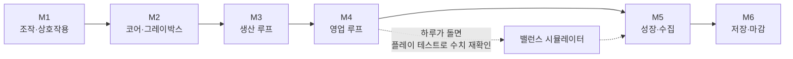

# 구현 계획

[기획서](../GDD.md)와 [설계 문서](../design/README.md)를 **PR 하나 크기의 작업**으로 나눈 계획이다. 작업마다 만들 파일, 공개 API, 규칙, 테스트, Unity에서 확인할 것이 적혀 있어서, 문서를 다시 읽지 않고 작업 명세만 보고 시작할 수 있다. 코드를 쓰는 규칙은 [코드 작성 규칙](../CONVENTIONS.md)에 있다.

## 마일스톤

하루 1~2시간 기준이다. 각 마일스톤이 끝나면 그 상태로 보여줄 수 있는 빌드가 되고, 태그를 남긴다.

| 마일스톤 | 끝났을 때 되는 것 | 재미 포인트 | 작업 수 | 예상 기간 | 태그 |
| --- | --- | --- | --- | --- | --- |
| [M1. 조작과 상호작용](M1-player-interaction.md) | 걸어 다니며 박스를 들고, 쌓고, 내려놓는다 | F1 | 3 | 0.5주 (코드 완료, 확인만 남음) | `v0.1-movement` |
| [M2. 코어와 매장 그레이박스](M2-core-and-greybox.md) | 실제 배치의 매장에서 팻말을 돌리면 시계가 흐르고 18시에 마감된다 | - | 9 | 2주 | `v0.2-core` |
| [M3. 생산 루프](M3-production-loop.md) | 발주 → 배송 → 창고 → 굽기 → 진열 → 가격 설정이 손님 없이 돈다 | F2, F6, F7 | 10 | 2.5주 | `v0.3-production` |
| [M4. 영업 루프](M4-shop-loop.md) | 손님이 와서 사고, 계산하고, 정산 리포트가 나온다. **하루가 처음부터 끝까지 돈다** | F3, F4, F5, F8 | 9 | 3주 | `v0.4-day-loop` |
| [M5. 성장과 수집](M5-growth-and-collection.md) | 레벨 해금, 미스터리 박스, 실험, 도감, 목표 리스트 | F9, F10, F11, F12 | 6 | 2주 | `v0.5-growth` |
| [M6. 저장과 마감](M6-save-and-polish.md) | 세이브, 타이틀, 사운드, 아트, 최적화, 빌드와 영상 | - | 8 | 2.5주 | `v1.0-mvp` |

합계 45개 작업, 약 12.5주다. v1 계획의 8주보다 길어졌다. 성장 구조(레벨·해금), 트레이·빵 냄새, 실험 피드백, 목표 리스트가 추가되었기 때문이다. 일정이 밀릴 때 줄이는 순서는 [아래](#일정이-밀릴-때-줄이는-순서)에 정해 두었다.

M4가 끝나는 시점이 가장 중요하다. 하루가 처음부터 끝까지 도는 첫 빌드이고, 시뮬레이터의 가정값을 실제로 잰 값으로 바꿔 밸런스를 다시 확인하는 시점이다.

## 작업 명세를 읽는 법

마일스톤 문서의 작업은 모두 같은 형식이다.

| 항목 | 내용 |
| --- | --- |
| **목적** | 이 작업이 끝나면 무엇이 되는지 한 문장 |
| **파일** | 새로 만들거나 고치는 파일. 경로는 `Assets/_Project/` 기준 |
| **공개 API** | 다른 코드가 쓰는 클래스와 메서드의 모양. 구현하면서 바뀌면 이 문서도 고친다 |
| **규칙** | 구현이 지켜야 하는 동작. 설계 문서의 규칙을 코드 수준으로 옮긴 것 |
| **테스트** | EditMode 테스트로 확인할 것. 한 줄이 테스트 하나다 |
| **Unity에서 확인** | 사람이 플레이하며 직접 볼 것. PR 본문의 체크리스트가 된다 |
| **의존** | 먼저 끝나 있어야 하는 작업 |

작업 ID는 `M3-06`처럼 마일스톤과 순번이다. 브랜치 이름(`feature/M3-06-oven-system`), PR 제목, 커밋에 같은 ID를 쓴다.

## 작업 하나가 진행되는 순서

| 단계 | 누가 | 하는 일 |
| --- | --- | --- |
| 1 | Claude | 작업 명세대로 코드와 EditMode 테스트를 작성하고 PR을 연다 |
| 2 | 사용자 | 브랜치를 받아 Unity에서 EditMode 테스트를 전부 실행한다 |
| 3 | 사용자 | "Unity에서 확인" 항목을 직접 플레이하며 확인한다 |
| 4 | 사용자 | 어색하거나 틀린 것이 있으면 트러블슈팅 템플릿으로 이슈를 남긴다 (현상, 재현 절차, GIF) |
| 5 | 함께 | 가설을 세우고, 검증하고, 고친다. 과정은 이슈에 계속 덧붙인다 |
| 6 | 사용자 | 항목이 모두 통과하면 PR을 병합한다 |

Claude는 Unity 에디터를 실행할 수 없다. 그래서 순수 C# 규칙은 테스트로 미리 확인하고, 조작감·충돌·화면처럼 실행해야 보이는 것은 사용자가 확인한다. **4번과 5번이 포트폴리오의 트러블슈팅 기록이 된다.**

## 완료의 정의

작업 하나가 끝났다고 말하려면 아래가 모두 참이어야 한다.

- [ ] EditMode 테스트가 전부 통과한다 (이 작업의 테스트와 기존 테스트 모두).
- [ ] "Unity에서 확인" 항목을 사용자가 직접 확인했다.
- [ ] 콘솔에 오류와 경고가 없다.
- [ ] 설계와 달라진 점이 있으면 설계 문서가 같은 PR에서 고쳐져 있다.
- [ ] 확인 중에 발견한 문제는 이슈로 남아 있다 (고쳤든 미뤘든).

마일스톤이 끝났다고 말하려면 추가로:

- [ ] 마일스톤 문서의 "완료 기준" 시나리오를 처음부터 끝까지 한 번에 플레이할 수 있다.
- [ ] 태그를 남겼다.
- [ ] [로드맵](../ROADMAP.md)의 체크 표시와 README의 "현재 상태"를 고쳤다.

## 플레이 테스트에서 잴 값

밸런스 시뮬레이터는 플레이어가 조작에 쓰는 시간을 가정값으로 넣고 있다. 기능이 생기는 대로 실제 값을 재서 [`simulate.py`](../../Tools/balance/simulate.py)의 `ASSUME`에 넣고 다시 돌린다. 결과가 달라지면 `content.json`의 수치를 조정한다.

| 가정값 (`ASSUME`) | 지금 값 | 재는 방법 | 잴 수 있는 시점 |
| --- | --- | --- | --- |
| `walk_to_oven` | 4초 | 계산 자리에서 오븐 앞까지 걷는 시간 | M2 |
| `start_bake` | 9초 | 계산 자리 → 오븐 → 패널에서 굽기 시작 → 계산 자리 | M3 |
| `collect_and_stock` | 14초 | 오븐에서 꺼내 진열대에 올리고 계산 자리로 | M3 |
| `restock_from_tray` | 7초 | 작업대의 트레이를 들어 진열대에 올리고 복귀 | M3 |
| `checkout_per_item` | 1.2초 | 빵 하나 스캔 | M4 |
| `pay_card` | 4초 | 키패드 입력부터 결제까지 | M4 |
| `pay_cash` | 7초 | 거스름돈을 골라 건네기까지 | M4 |
| `checkout_base` | 3초 | 손님 한 명의 계산에서 위 시간을 뺀 나머지 | M4 |

화면 녹화를 한 번 해 두고 구간을 재면 된다. 익숙해지기 전(처음 10분)과 익숙해진 뒤의 값을 둘 다 적는다.

## 일정이 밀릴 때 줄이는 순서

위에서부터 먼저 줄인다. 줄여도 핵심 루프와 재미 포인트가 남는 순서로 정했다.

| 순서 | 줄이는 것 | 남는 것 | 아끼는 기간 |
| --- | --- | --- | --- |
| 1 | 아트 패스를 줄인다 (M6-06) | 그레이박스에 색과 조명만 정리 | 약 1주 |
| 2 | 고급 미스터리 박스, 초코 소라빵, 진열대 4를 뺀다 (레벨 4의 콘텐츠) | 레벨 1~3, 일반 박스, 비밀 레시피 4종 | 약 2일 (`content.json`만 수정) |
| 3 | 현금 결제를 뺀다 (M4-05, M4-06의 일부) | 카드 결제만 | 약 4일 |
| 4 | 목표 리스트를 고정 안내문으로 바꾼다 (M5-06) | 첫날 화면에 조작 안내만 표시 | 약 3일 |
| 5 | WebGL 빌드를 뺀다 (M6-08) | Windows 빌드와 영상 | 약 2일 |

줄이지 않는 것: 트러블슈팅 기록, EditMode 테스트, 세이브, 미스터리 박스와 실험. 포트폴리오에서 보여주려는 것이기 때문이다.

## 전체 작업 목록

| ID | 작업 | ID | 작업 |
| --- | --- | --- | --- |
| [M1-01](M1-player-interaction.md) | PR #1 확인과 병합 | [M4-02](M4-shop-loop.md) | 손님 두뇌(FSM)와 계산 줄 |
| [M1-02](M1-player-interaction.md) | 트러블슈팅 기록 2건 | [M4-03](M4-shop-loop.md) | 손님 생성과 빵 냄새 |
| [M1-03](M1-player-interaction.md) | 태그 | [M4-04](M4-shop-loop.md) | 손님 몸체, 풀, 매장 지점 |
| [M2-01](M2-core-and-greybox.md) | 이벤트 버스 | [M4-05](M4-shop-loop.md) | 결제 세션과 현금 계산 |
| [M2-02](M2-core-and-greybox.md) | 난수와 꺾은선 | [M4-06](M4-shop-loop.md) | 계산대와 결제 패널 |
| [M2-03](M2-core-and-greybox.md) | 시간 | [M4-07](M4-shop-loop.md) | 평판·경험치 규칙 연결 |
| [M2-04](M2-core-and-greybox.md) | 하루 단계 | [M4-08](M4-shop-loop.md) | 정산과 리포트 |
| [M2-05](M2-core-and-greybox.md) | 콘텐츠 정의와 데이터베이스 | [M4-09](M4-shop-loop.md) | 하루 통합 테스트와 수치 재확인 |
| [M2-06](M2-core-and-greybox.md) | `content.json` 임포터 | [M5-01](M5-growth-and-collection.md) | 해금과 잠긴 가구 |
| [M2-07](M2-core-and-greybox.md) | 돈·평판·경험치 상태 | [M5-02](M5-growth-and-collection.md) | 미스터리 박스 뽑기 |
| [M2-08](M2-core-and-greybox.md) | 매장 그레이박스 씬 | [M5-03](M5-growth-and-collection.md) | 박스 개봉 연출 |
| [M2-09](M2-core-and-greybox.md) | 부트스트랩 확장, 팻말, HUD, 패널 호스트 | [M5-04](M5-growth-and-collection.md) | 도감과 실험 |
| [M3-01](M3-production-loop.md) | 창고 | [M5-05](M5-growth-and-collection.md) | 실험 탭, 도감 탭, 재료 판매 |
| [M3-02](M3-production-loop.md) | 발주와 배송 | [M5-06](M5-growth-and-collection.md) | 목표 리스트, 알림, 데모 목표 |
| [M3-03](M3-production-loop.md) | 박스 열기 | [M6-01](M6-save-and-polish.md) | 세이브 데이터와 저장 |
| [M3-04](M3-production-loop.md) | 가격 | [M6-02](M6-save-and-polish.md) | 불러오기와 월드 아이템 |
| [M3-05](M3-production-loop.md) | 오븐과 트레이 수 | [M6-03](M6-save-and-polish.md) | 타이틀, 일시정지, 설정 |
| [M3-06](M3-production-loop.md) | 트레이와 진열대 | [M6-04](M6-save-and-polish.md) | 데모 세이브 |
| [M3-07](M3-production-loop.md) | 오븐 뷰와 굽기 패널 | [M6-05](M6-save-and-polish.md) | 사운드 |
| [M3-08](M3-production-loop.md) | 진열대 뷰와 쓰레기통 | [M6-06](M6-save-and-polish.md) | 아트 패스 |
| [M3-09](M3-production-loop.md) | PC 패널: 발주와 가격 | [M6-07](M6-save-and-polish.md) | 프로파일링과 스트레스 테스트 |
| [M3-10](M3-production-loop.md) | 하루 마무리 단계 (생산), HUD, 알림 | [M6-08](M6-save-and-polish.md) | 빌드, 영상, README |
| [M4-01](M4-shop-loop.md) | 방문 계획과 구매 판단 |  | |
